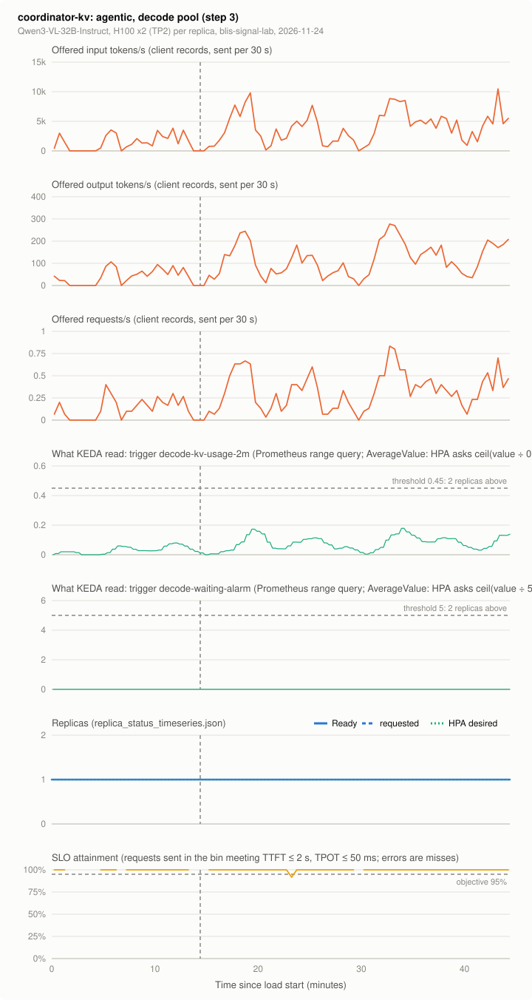
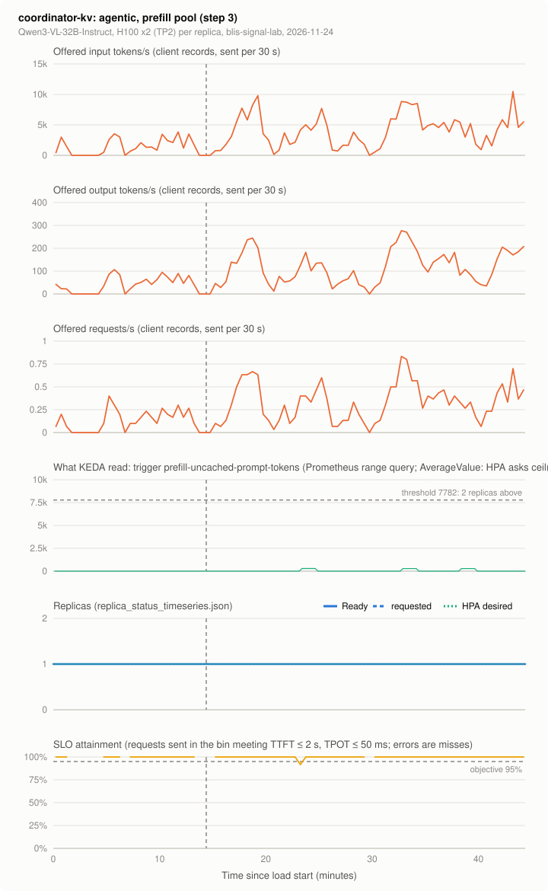

# Step 3, run 5: Agentic (coord-disaggregation/coordinator-kv)

Part of the [step 3 summary](../../coordinator-kv-step3.md). Simulator numbers: blis priced this plant; they are not GPU measurements.

| | |
|---|---|
| Plant | blis-signal-lab `25f2dfb` (branch `signals-hpa`); blis-substrate `v0.14.0` catalog plus the `Qwen/Qwen3-VL-32B-Instruct` entry of inference-sim/blis-substrate#415 (open), from a local copy |
| BLIS scenario | [`coord-pd-qwen3-vl-32b-h100-bf16-tp2.yaml`](../coord-pd-qwen3-vl-32b-h100-bf16-tp2.yaml): a `prefill` and a `decode` pool, H100, bf16, TP2 per role, as the guide's overlay; router [`router/pd-prefix-8192.yaml`](../router/pd-prefix-8192.yaml) (prefix decider, `nonCachedTokens` 8192, the guide's PD-only value) |
| Cold start | 120 s (`loading_delay`): the protocol's default; this overlay has no GPU measurement |
| Metrics | scrape 30 s (the model-server PodMonitors set no interval; the stack's default and llm-d-benchmark's rendered PodMonitor are 30 s). The EPP's ServiceMonitor scrapes every 10 s; blis uses one interval for every series. `metrics_delay_s` 0 (raw series, no recording rule). HPA sync 15 s, `pollingInterval` 15 s |
| Seed | blis's default (no `--seed`); the load's seed is `schedule.seed` in `blis-run.json` |
| Scenario | `benchmark/config/scenarios/staging/coord-disaggregation/coordinator-kv.yaml`, rendered with `standup --dry-run`; policy [`policy.json`](policy.json), translated from it ([`terms.json`](../terms.json)) |
| Model | `Qwen/Qwen3-VL-32B-Instruct`, 2 H100 per replica (TP2), both roles |
| SLO | TTFT ≤ 2 s, TPOT ≤ 0.05 s; X = 0.95 |
| Run | 5, Agentic |
| Load | `agentic` in [`index.json`](../index.json) |
| Arm | as run 2 |
| Raw results | `benchmark/results/step3-coordinator-kv-20261124/agentic/` (not committed) |

blis multi-turn sessions: a shared 4,096-token system prompt, 10 rounds with accumulating context, a 2 s pause between rounds, per-turn lengths at most 2,400 input and 640 output tokens. A 900 s phase at 0.122 req/s and an 1,800 s phase at 0.327 req/s (sessions per second × 10). Both pools held 1 pod. The trigger panels are the HPA's own reading at each sync, from blis's decision log, not a Prometheus query. Each run is one sample (n = 1).

## Per stage, decode pool

| stage | s | set req/s | offered req/s | λ_in tok/s | λ_out tok/s | sent | errors | A | TTFT p50/p90/p99 s | TPOT p50/p90/p99 ms | Ready | need | requested replica-s | Ready replica-s |
|---|---|---|---|---|---|---|---|---|---|---|---|---|---|---|
| 1 | 900 | 0.114 | 0.122 | 1,339 | 39 | 110 | 0 | 100.0 % | 0.18/0.26/0.31 | 22.0/23.2/23.9 | 1–1 | – | 900 | 900 |
| 2 | 1800 | 0.341 | 0.327 | 4,039 | 116 | 589 | 0 | 99.8 % | 0.21/0.30/0.45 | 24.5/27.6/31.5 | 1–1 | – | 1,800 | 1,800 |

- run: 699 sent, A 99.9 %, errors 0, requested 2,700 replica-s = 5,400 GPU-s at 2 GPU per replica
- placement: 0 request(s) before the first stage, 31 after the last (session rounds); stages more than 3 sd off their set rate: none: ok

## Per stage, prefill pool

| stage | s | set req/s | offered req/s | λ_in tok/s | λ_out tok/s | sent | errors | A | TTFT p50/p90/p99 s | TPOT p50/p90/p99 ms | Ready | need | requested replica-s | Ready replica-s |
|---|---|---|---|---|---|---|---|---|---|---|---|---|---|---|
| 1 | 900 | 0.114 | 0.122 | 1,339 | 39 | 110 | 0 | 100.0 % | 0.18/0.26/0.31 | 22.0/23.2/23.9 | 1–1 | – | 900 | 900 |
| 2 | 1800 | 0.341 | 0.327 | 4,039 | 116 | 589 | 0 | 99.8 % | 0.21/0.30/0.45 | 24.5/27.6/31.5 | 1–1 | – | 1,800 | 1,800 |

- run: 699 sent, A 99.9 %, errors 0, requested 2,700 replica-s = 5,400 GPU-s at 2 GPU per replica
- placement: 0 request(s) before the first stage, 31 after the last (session rounds); stages more than 3 sd off their set rate: none: ok

## What the run shows

The run shows a problem when A < X once settled, or any context-overflow error.

- A 100.0 % and 99.8 % per phase; 0 errors in the per-request records, so no context overflow. The largest prompt was 26,551 tokens.
- Decode KV read at most 0.18 and the alarm 0; the prefill trigger read at most 295 tok/s. Both pools stayed at 1.
- 31 rounds of sessions still open at the end of the schedule were sent after the last stage.
- The sessions lack per-conversation system prompts and subagent fan-out (3-blis-evaluation.md §3.3); the run does not judge sizing.

**Outcome: as expected.**

## Amendments

None.
