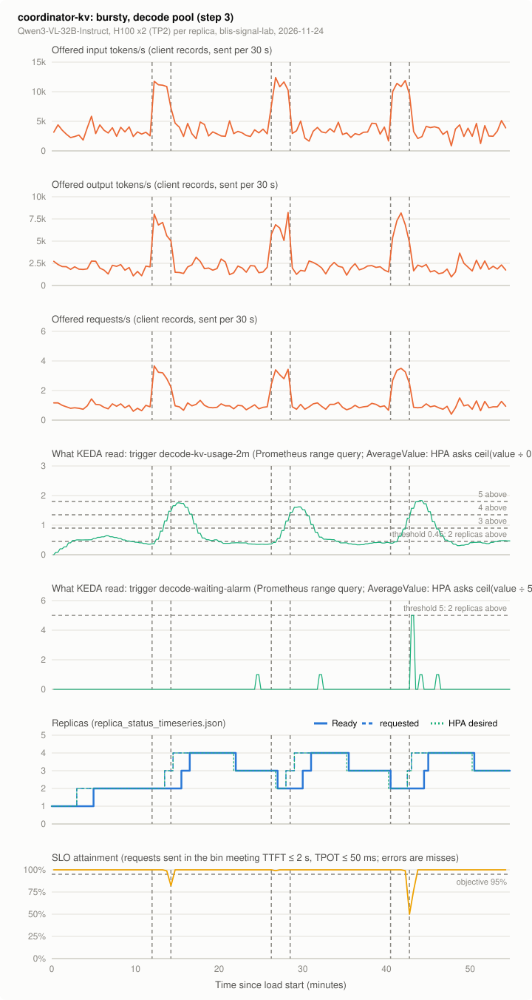
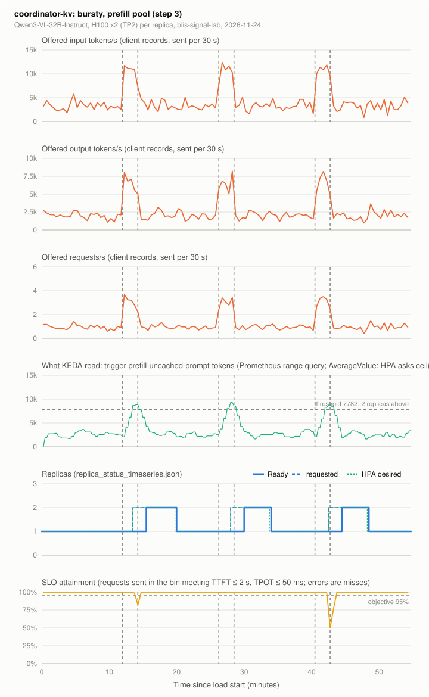

# Step 3, run 8: Bursty (coord-disaggregation/coordinator-kv)

Part of the [step 3 summary](../../coordinator-kv-step3.md). Simulator numbers: blis priced this plant; they are not GPU measurements.

| | |
|---|---|
| Plant | blis-signal-lab `25f2dfb` (branch `signals-hpa`); blis-substrate `v0.14.0` catalog plus the `Qwen/Qwen3-VL-32B-Instruct` entry of inference-sim/blis-substrate#415 (open), from a local copy |
| BLIS scenario | [`coord-pd-qwen3-vl-32b-h100-bf16-tp2.yaml`](../coord-pd-qwen3-vl-32b-h100-bf16-tp2.yaml): a `prefill` and a `decode` pool, H100, bf16, TP2 per role, as the guide's overlay; router [`router/pd-prefix-8192.yaml`](../router/pd-prefix-8192.yaml) (prefix decider, `nonCachedTokens` 8192, the guide's PD-only value) |
| Cold start | 120 s (`loading_delay`): the protocol's default; this overlay has no GPU measurement |
| Metrics | scrape 30 s (the model-server PodMonitors set no interval; the stack's default and llm-d-benchmark's rendered PodMonitor are 30 s). The EPP's ServiceMonitor scrapes every 10 s; blis uses one interval for every series. `metrics_delay_s` 0 (raw series, no recording rule). HPA sync 15 s, `pollingInterval` 15 s |
| Seed | blis's default (no `--seed`); the load's seed is `schedule.seed` in `blis-run.json` |
| Scenario | `benchmark/config/scenarios/staging/coord-disaggregation/coordinator-kv.yaml`, rendered with `standup --dry-run`; policy [`policy.json`](policy.json), translated from it ([`terms.json`](../terms.json)) |
| Model | `Qwen/Qwen3-VL-32B-Instruct`, 2 H100 per replica (TP2), both roles |
| SLO | TTFT ≤ 2 s, TPOT ≤ 0.05 s; X = 0.95 |
| Run | 8, Bursty |
| Load | `bursty` in [`index.json`](../index.json) |
| Arm | as run 2 |
| Raw results | `benchmark/results/step3-coordinator-kv-20261124/bursty/` (not committed) |

The blend: a quiet phase Q = 720 s at 0.2 × C (0.932 req/s), then three cycles of a spike R = 135 s at 0.7 × C (3.262 req/s) and a quiet phase Q. Each spike's decode replicas were Ready after it ended; decode then rose to 4 in each quiet phase and came down at 1 pod per 300 s. The trigger panels are the HPA's own reading at each sync, from blis's decision log, not a Prometheus query. Each run is one sample (n = 1).

## Per stage, decode pool

| stage | s | set req/s | offered req/s | λ_in tok/s | λ_out tok/s | sent | errors | A | TTFT p50/p90/p99 s | TPOT p50/p90/p99 ms | Ready | need | requested replica-s | Ready replica-s |
|---|---|---|---|---|---|---|---|---|---|---|---|---|---|---|
| 1 | 720 | 0.932 | 0.933 | 3,265 | 1,991 | 672 | 0 | 100.0 % | 0.21/0.60/1.01 | 29.7/35.4/38.5 | 1–2 | 1 | 1,260 | 1,140 |
| 2 | 135 | 3.262 | 3.267 | 11,429 | 6,969 | 441 | 0 | 97.3 % | 0.24/1.04/4.33 | 41.7/44.3/48.7 | 2–2 | 3 | 315 | 270 |
| 3 | 720 | 0.932 | 0.933 | 3,265 | 1,991 | 672 | 0 | 99.9 % | 0.20/0.60/1.16 | 24.3/32.7/42.8 | 2–4 | 1 | 2,610 | 2,415 |
| 4 | 135 | 3.262 | 3.267 | 11,429 | 6,969 | 441 | 0 | 99.8 % | 0.22/0.80/1.60 | 38.9/41.9/43.9 | 2–3 | 3 | 345 | 315 |
| 5 | 720 | 0.932 | 0.933 | 3,265 | 1,991 | 672 | 0 | 100.0 % | 0.20/0.60/0.98 | 24.4/32.0/40.3 | 2–4 | 1 | 2,550 | 2,340 |
| 6 | 135 | 3.262 | 3.267 | 11,429 | 6,969 | 441 | 0 | 95.0 % | 0.23/1.04/5.41 | 41.4/45.1/49.4 | 2–3 | 3 | 285 | 270 |
| 7 | 720 | 0.932 | 0.933 | 3,265 | 1,991 | 672 | 0 | 96.7 % | 0.20/0.60/8.28 | 24.6/34.0/44.0 | 2–4 | 1 | 2,610 | 2,385 |

- run: 4,011 sent, A 98.6 %, errors 0, requested 9,975 replica-s = 19,950 GPU-s at 2 GPU per replica
- placement: 0 request(s) before the first stage, 0 after the last; stages more than 3 sd off their set rate: none: ok

Decode's `need` is `ceil(q / μ_SLO)` with the decode knees (runs 1a to 1d).

## Per stage, prefill pool

| stage | s | set req/s | offered req/s | λ_in tok/s | λ_out tok/s | sent | errors | A | TTFT p50/p90/p99 s | TPOT p50/p90/p99 ms | Ready | need | requested replica-s | Ready replica-s |
|---|---|---|---|---|---|---|---|---|---|---|---|---|---|---|
| 1 | 720 | 0.932 | 0.933 | 3,265 | 1,991 | 672 | 0 | 100.0 % | 0.21/0.60/1.01 | 29.7/35.4/38.5 | 1–1 | 1 | 720 | 720 |
| 2 | 135 | 3.262 | 3.267 | 11,429 | 6,969 | 441 | 0 | 97.3 % | 0.24/1.04/4.33 | 41.7/44.3/48.7 | 1–1 | 1 | 180 | 135 |
| 3 | 720 | 0.932 | 0.933 | 3,265 | 1,991 | 672 | 0 | 99.9 % | 0.20/0.60/1.16 | 24.3/32.7/42.8 | 1–2 | 1 | 1,065 | 990 |
| 4 | 135 | 3.262 | 3.267 | 11,429 | 6,969 | 441 | 0 | 99.8 % | 0.22/0.80/1.60 | 38.9/41.9/43.9 | 1–1 | 1 | 165 | 135 |
| 5 | 720 | 0.932 | 0.933 | 3,265 | 1,991 | 672 | 0 | 100.0 % | 0.20/0.60/0.98 | 24.4/32.0/40.3 | 1–2 | 1 | 1,050 | 960 |
| 6 | 135 | 3.262 | 3.267 | 11,429 | 6,969 | 441 | 0 | 95.0 % | 0.23/1.04/5.41 | 41.4/45.1/49.4 | 1–1 | 1 | 150 | 135 |
| 7 | 720 | 0.932 | 0.933 | 3,265 | 1,991 | 672 | 0 | 96.7 % | 0.20/0.60/8.28 | 24.6/34.0/44.0 | 1–2 | 1 | 1,065 | 960 |

- run: 4,011 sent, A 98.6 %, errors 0, requested 4,395 replica-s = 8,790 GPU-s at 2 GPU per replica
- placement: 0 request(s) before the first stage, 0 after the last; stages more than 3 sd off their set rate: none: ok

Prefill's `need` is `ceil(q / μ)` with prefill's own capacity ([`index-prefill.json`](../index-prefill.json)): 1.341 req/s for 8192:256 and 3.972 req/s for the blend (3 × 1.324, where the 8192-token requests' A crosses 0.95 in the prefill blend knee; only they reach prefill). 2048:2048 and 256:4096 prompts stay on decode (the decider's `nonCachedTokens` is 8192), so a phase of those needs `minReplicaCount`, 1.

## What the run shows

The run shows a problem when A < X in a quiet phase, or requests fail at a scale-down.

- Spikes: A 97.3, 99.8, 95.0 %. Decode at the start of each spike: 2, 3, 2 Ready; a scale-up was requested during spikes 1 and 3 (at 810 and 2,550 s) and only after spike 2 ended; the next Ready pod came at 930, 1,860 and 2,670 s, after each spike's end (855, 1,710, 2,565 s).
- Quiet phases: A 100.0, 99.9, 100.0, 96.7 %. The last one's loss is in its first 60 s after spike 3 (A 0.61), then 1.00.
- Decode in the quiet phases after a spike: 2–4, with the HPA at 3, 2 and 3 at their end, against a knee need of 1 and a headroom need of 2 (`ceil(0.933 / 0.84)`, 1.11 is past the 10 % tolerance). Prefill: 1 in spikes, 1–2 in quiet phases (need 1).
- No request can fail at a scale-down in blis (a draining pod finishes its work, 3-blis-evaluation.md §3.2), so the second half of the criterion is not observable here.

**Outcome: as expected: A ≥ 0.967 in every quiet phase; failures at scale-down are not observable in blis.**

## Amendments

None.
