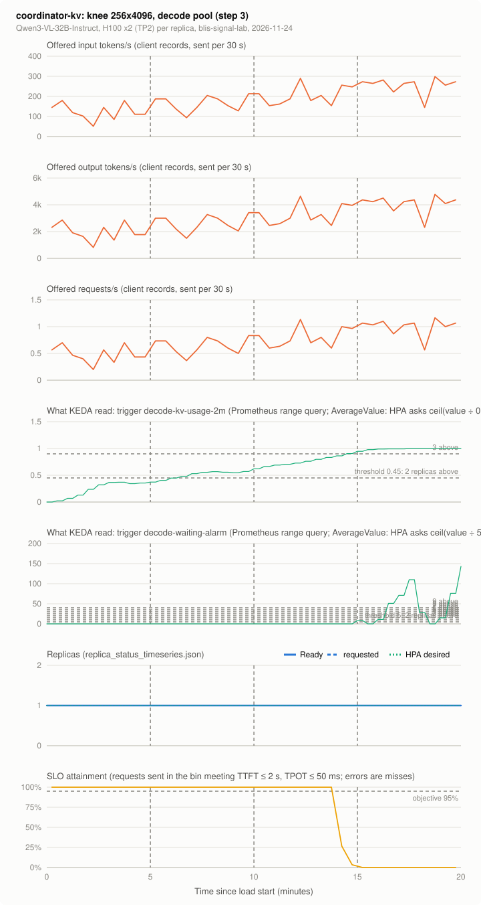

# Step 3, run 1c: knee 256:4096, decode pool (coord-disaggregation/coordinator-kv)

Part of the [step 3 summary](../../../coordinator-kv-step3.md). Simulator numbers: blis priced this plant; they are not GPU measurements.

| | |
|---|---|
| Plant | blis-signal-lab `25f2dfb` (branch `signals-hpa`); blis-substrate `v0.14.0` catalog plus the `Qwen/Qwen3-VL-32B-Instruct` entry of inference-sim/blis-substrate#415 (open), from a local copy |
| BLIS scenario | [`coord-pd-qwen3-vl-32b-h100-bf16-tp2.yaml`](../../coord-pd-qwen3-vl-32b-h100-bf16-tp2.yaml): a `prefill` and a `decode` pool, H100, bf16, TP2 per role, as the guide's overlay; router [`router/pd-prefix-8192.yaml`](../../router/pd-prefix-8192.yaml) (prefix decider, `nonCachedTokens` 8192, the guide's PD-only value) |
| Cold start | 120 s (`loading_delay`): the protocol's default; this overlay has no GPU measurement |
| Metrics | scrape 30 s (the model-server PodMonitors set no interval; the stack's default and llm-d-benchmark's rendered PodMonitor are 30 s). The EPP's ServiceMonitor scrapes every 10 s; blis uses one interval for every series. `metrics_delay_s` 0 (raw series, no recording rule). HPA sync 15 s, `pollingInterval` 15 s |
| Seed | blis's default (no `--seed`); the load's seed is `schedule.seed` in `blis-run.json` |
| Scenario | `benchmark/config/scenarios/staging/coord-disaggregation/coordinator-kv.yaml`, rendered with `standup --dry-run`; policy [`policy.json`](policy.json), translated from it ([`terms.json`](../../terms.json)) |
| Model | `Qwen/Qwen3-VL-32B-Instruct`, 2 H100 per replica (TP2), both roles |
| SLO | TTFT ≤ 2 s, TPOT ≤ 0.05 s; X = 0.95 |
| Run | 1c, knee 256:4096, decode pool |
| Load | four 300 s stages at 0.6, 0.8, 1.0 and 1.25 × an estimate of 0.8 req/s ([`knee-index.json`](knee-index.json)) |
| Arm | pinned: prefill 4, decode 1 (the other pool large enough not to bind) |
| Raw results | `benchmark/results/step3-coordinator-kv-20261124/decode-knee-256x4096/` (not committed) |

256:4096 at four rates on one pinned decode pod. A crosses 0.95 between two stages; μ_SLO = 0.678 req/s. The trigger panels are the HPA's own reading at each sync, from blis's decision log, not a Prometheus query. Each run is one sample (n = 1).

## Per stage, decode pool

| stage | s | set req/s | offered req/s | λ_in tok/s | λ_out tok/s | sent | errors | A | TTFT p50/p90/p99 s | TPOT p50/p90/p99 ms | Ready | need | requested replica-s | Ready replica-s |
|---|---|---|---|---|---|---|---|---|---|---|---|---|---|---|
| 1 | 300 | 0.480 | 0.480 | 123 | 1,966 | 144 | 0 | 100.0 % | 0.12/0.14/0.14 | 30.1/32.3/33.4 | 1–1 | – | 300 | 300 |
| 2 | 300 | 0.640 | 0.640 | 164 | 2,621 | 192 | 0 | 100.0 % | 0.14/0.15/0.17 | 35.8/38.9/39.4 | 1–1 | – | 300 | 300 |
| 3 | 300 | 0.800 | 0.800 | 205 | 3,277 | 240 | 0 | 79.2 % | 0.16/0.19/7.13 | 44.7/50.7/52.7 | 1–1 | – | 300 | 300 |
| 4 | 300 | 1.000 | 1.000 | 256 | 4,096 | 300 | 72 timeout | 0.0 % | 18.82/104.52/124.91 | 52.7/69.2/75.3 | 1–1 | – | 300 | 300 |

- run: 876 sent, A 60.0 %, errors {'timeout': 72}, requested 1,200 replica-s = 2,400 GPU-s at 2 GPU per replica
- placement: 0 request(s) before the first stage, 0 after the last; stages more than 3 sd off their set rate: none: ok
- knee: μ_SLO = 0.678 req/s (A crosses 0.95 between stages 2 and 3)

300 s is under two request lifetimes at the TPOT limit for this mix (4,096 × 0.05 s = 205 s), so its μ_SLO is an upper bound (run-set.md §2).

## What the run shows

The run shows a problem when stage 1 fails or stage 4 passes (the crossing is outside the stages). μ_SLO = 0.678 req/s (A crosses 0.95 between stages 2 and 3).

**Outcome: as expected; μ_SLO = 0.678 req/s.**

## Amendments

None.
