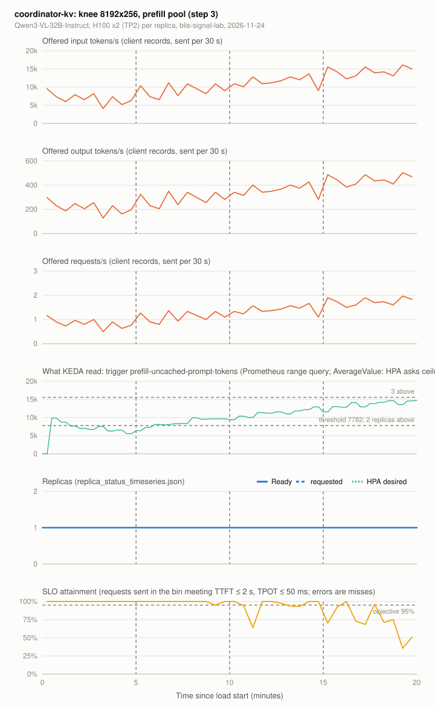

# Step 3, run 1e: knee 8192:256, prefill pool (coord-disaggregation/coordinator-kv)

Part of the [step 3 summary](../../../coordinator-kv-step3.md). Simulator numbers: blis priced this plant; they are not GPU measurements.

| | |
|---|---|
| Plant | blis-signal-lab `25f2dfb` (branch `signals-hpa`); blis-substrate `v0.14.0` catalog plus the `Qwen/Qwen3-VL-32B-Instruct` entry of inference-sim/blis-substrate#415 (open), from a local copy |
| BLIS scenario | [`coord-pd-qwen3-vl-32b-h100-bf16-tp2.yaml`](../../coord-pd-qwen3-vl-32b-h100-bf16-tp2.yaml): a `prefill` and a `decode` pool, H100, bf16, TP2 per role, as the guide's overlay; router [`router/pd-prefix-8192.yaml`](../../router/pd-prefix-8192.yaml) (prefix decider, `nonCachedTokens` 8192, the guide's PD-only value) |
| Cold start | 120 s (`loading_delay`): the protocol's default; this overlay has no GPU measurement |
| Metrics | scrape 30 s (the model-server PodMonitors set no interval; the stack's default and llm-d-benchmark's rendered PodMonitor are 30 s). The EPP's ServiceMonitor scrapes every 10 s; blis uses one interval for every series. `metrics_delay_s` 0 (raw series, no recording rule). HPA sync 15 s, `pollingInterval` 15 s |
| Seed | blis's default (no `--seed`); the load's seed is `schedule.seed` in `blis-run.json` |
| Scenario | `benchmark/config/scenarios/staging/coord-disaggregation/coordinator-kv.yaml`, rendered with `standup --dry-run`; policy [`policy.json`](policy.json), translated from it ([`terms.json`](../../terms.json)) |
| Model | `Qwen/Qwen3-VL-32B-Instruct`, 2 H100 per replica (TP2), both roles |
| SLO | TTFT ≤ 2 s, TPOT ≤ 0.05 s; X = 0.95 |
| Run | 1e, knee 8192:256, prefill pool |
| Load | four 300 s stages at 0.6, 0.8, 1.0 and 1.25 × an estimate of 1.4 req/s ([`knee-index.json`](knee-index.json)) |
| Arm | pinned: prefill 1, decode 4 (the other pool large enough not to bind) |
| Raw results | `benchmark/results/step3-coordinator-kv-20261124/prefill-knee-8192x256/` (not committed) |

8192:256 at four rates on one pinned prefill pod. A crosses 0.95 between two stages; μ_SLO = 1.341 req/s. The trigger panels are the HPA's own reading at each sync, from blis's decision log, not a Prometheus query. Each run is one sample (n = 1).

## Per stage, prefill pool

| stage | s | set req/s | offered req/s | λ_in tok/s | λ_out tok/s | sent | errors | A | TTFT p50/p90/p99 s | TPOT p50/p90/p99 ms | Ready | need | requested replica-s | Ready replica-s |
|---|---|---|---|---|---|---|---|---|---|---|---|---|---|---|
| 1 | 300 | 0.840 | 0.840 | 6,881 | 215 | 252 | 0 | 100.0 % | 0.59/0.99/1.50 | 21.9/22.5/23.0 | 1–1 | – | 300 | 300 |
| 2 | 300 | 1.120 | 1.123 | 9,202 | 288 | 337 | 0 | 99.4 % | 0.60/1.25/1.78 | 22.2/22.9/23.6 | 1–1 | – | 300 | 300 |
| 3 | 300 | 1.400 | 1.400 | 11,469 | 358 | 420 | 0 | 93.8 % | 0.84/1.73/3.78 | 22.4/23.0/23.4 | 1–1 | – | 300 | 300 |
| 4 | 300 | 1.750 | 1.750 | 14,336 | 448 | 525 | 0 | 72.2 % | 1.33/3.03/4.33 | 22.5/23.3/23.9 | 1–1 | – | 300 | 300 |

- run: 1,534 sent, A 88.7 %, errors 0, requested 1,200 replica-s = 2,400 GPU-s at 2 GPU per replica
- placement: 0 request(s) before the first stage, 0 after the last; stages more than 3 sd off their set rate: none: ok
- knee: μ_SLO = 1.341 req/s (A crosses 0.95 between stages 2 and 3)

1.341 req/s × 8,192 tokens = 10,985 uncached prompt tokens per second per prefill pod. The scenario's threshold, 7,782, is 0.71 of it.

## What the run shows

The run shows a problem when stage 1 fails or stage 4 passes (the crossing is outside the stages). μ_SLO = 1.341 req/s (A crosses 0.95 between stages 2 and 3).

**Outcome: as expected; μ_SLO = 1.341 req/s.**

## Amendments

None.
