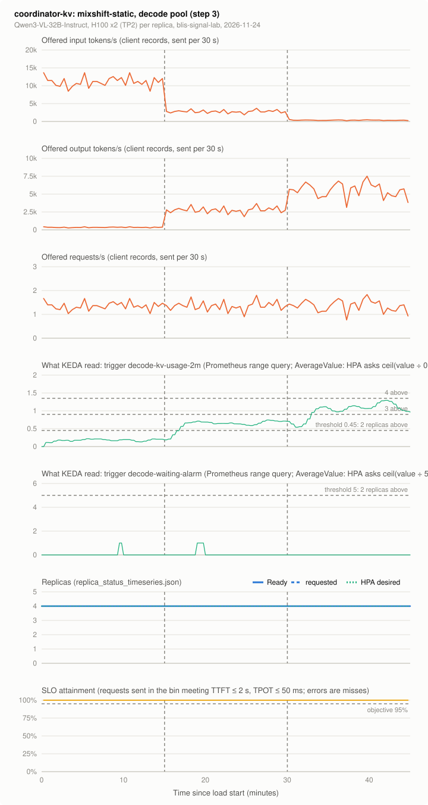
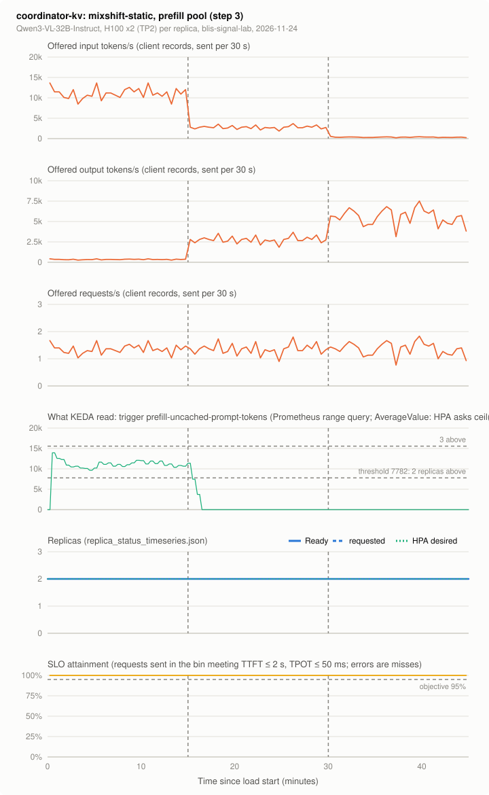

# Step 3, run 6: Static-replica baseline (coord-disaggregation/coordinator-kv)

Part of the [step 3 summary](../../coordinator-kv-step3.md). Simulator numbers: blis priced this plant; they are not GPU measurements.

| | |
|---|---|
| Plant | blis-signal-lab `25f2dfb` (branch `signals-hpa`); blis-substrate `v0.14.0` catalog plus the `Qwen/Qwen3-VL-32B-Instruct` entry of inference-sim/blis-substrate#415 (open), from a local copy |
| BLIS scenario | [`coord-pd-qwen3-vl-32b-h100-bf16-tp2.yaml`](../coord-pd-qwen3-vl-32b-h100-bf16-tp2.yaml): a `prefill` and a `decode` pool, H100, bf16, TP2 per role, as the guide's overlay; router [`router/pd-prefix-8192.yaml`](../router/pd-prefix-8192.yaml) (prefix decider, `nonCachedTokens` 8192, the guide's PD-only value) |
| Cold start | 120 s (`loading_delay`): the protocol's default; this overlay has no GPU measurement |
| Metrics | scrape 30 s (the model-server PodMonitors set no interval; the stack's default and llm-d-benchmark's rendered PodMonitor are 30 s). The EPP's ServiceMonitor scrapes every 10 s; blis uses one interval for every series. `metrics_delay_s` 0 (raw series, no recording rule). HPA sync 15 s, `pollingInterval` 15 s |
| Seed | blis's default (no `--seed`); the load's seed is `schedule.seed` in `blis-run.json` |
| Scenario | `benchmark/config/scenarios/staging/coord-disaggregation/coordinator-kv.yaml`, rendered with `standup --dry-run`; policy [`policy.json`](policy.json), translated from it ([`terms.json`](../terms.json)) |
| Model | `Qwen/Qwen3-VL-32B-Instruct`, 2 H100 per replica (TP2), both roles |
| SLO | TTFT ≤ 2 s, TPOT ≤ 0.05 s; X = 0.95 |
| Run | 6, Static-replica baseline |
| Load | `mixshift` in [`index.json`](../index.json) |
| Arm | pinned at run 3's peaks: prefill 2, decode 4; the HPAs read and log but cannot move the pools |
| Raw results | `benchmark/results/step3-coordinator-kv-20261124/mixshift-static/` (not committed) |

Run 3's load (the same `mixshift` schedule and seed) on fixed pools of 2 prefill and 4 decode replicas. The trigger panels are the HPA's own reading at each sync, from blis's decision log, not a Prometheus query. Each run is one sample (n = 1).

## Per stage, decode pool

| stage | s | set req/s | offered req/s | λ_in tok/s | λ_out tok/s | sent | errors | A | TTFT p50/p90/p99 s | TPOT p50/p90/p99 ms | Ready | need | requested replica-s | Ready replica-s |
|---|---|---|---|---|---|---|---|---|---|---|---|---|---|---|
| 1 | 900 | 1.356 | 1.357 | 11,114 | 347 | 1,221 | 0 | 100.0 % | 0.59/0.91/1.17 | 22.2/23.0/23.6 | 4–4 | 1 | 3,600 | 3,600 |
| 2 | 900 | 1.356 | 1.357 | 2,778 | 2,778 | 1,221 | 0 | 100.0 % | 0.20/0.21/0.30 | 25.6/26.8/27.5 | 4–4 | 2 | 3,600 | 3,600 |
| 3 | 900 | 1.356 | 1.357 | 347 | 5,557 | 1,221 | 0 | 100.0 % | 0.12/0.13/0.14 | 27.6/29.1/30.3 | 4–4 | 2 | 3,600 | 3,600 |

- run: 3,663 sent, A 100.0 %, errors 0, requested 10,800 replica-s = 21,600 GPU-s at 2 GPU per replica
- placement: 0 request(s) before the first stage, 0 after the last; stages more than 3 sd off their set rate: none: ok

Decode's `need` is `ceil(q / μ_SLO)` with the decode knees (runs 1a to 1d).

## Per stage, prefill pool

| stage | s | set req/s | offered req/s | λ_in tok/s | λ_out tok/s | sent | errors | A | TTFT p50/p90/p99 s | TPOT p50/p90/p99 ms | Ready | need | requested replica-s | Ready replica-s |
|---|---|---|---|---|---|---|---|---|---|---|---|---|---|---|
| 1 | 900 | 1.356 | 1.357 | 11,114 | 347 | 1,221 | 0 | 100.0 % | 0.59/0.91/1.17 | 22.2/23.0/23.6 | 2–2 | 2 | 1,800 | 1,800 |
| 2 | 900 | 1.356 | 1.357 | 2,778 | 2,778 | 1,221 | 0 | 100.0 % | 0.20/0.21/0.30 | 25.6/26.8/27.5 | 2–2 | 1 | 1,800 | 1,800 |
| 3 | 900 | 1.356 | 1.357 | 347 | 5,557 | 1,221 | 0 | 100.0 % | 0.12/0.13/0.14 | 27.6/29.1/30.3 | 2–2 | 1 | 1,800 | 1,800 |

- run: 3,663 sent, A 100.0 %, errors 0, requested 5,400 replica-s = 10,800 GPU-s at 2 GPU per replica
- placement: 0 request(s) before the first stage, 0 after the last; stages more than 3 sd off their set rate: none: ok

Prefill's `need` is `ceil(q / μ)` with prefill's own capacity ([`index-prefill.json`](../index-prefill.json)): 1.341 req/s for 8192:256 and 3.972 req/s for the blend (3 × 1.324, where the 8192-token requests' A crosses 0.95 in the prefill blend knee; only they reach prefill). 2048:2048 and 256:4096 prompts stay on decode (the decider's `nonCachedTokens` is 8192), so a phase of those needs `minReplicaCount`, 1.

## What the run shows

Not a pass/fail run: the cost reference for run 3.

- A 100.0 % in each phase.
- GPU-seconds: decode 21,600, prefill 10,800, total 32,400, against run 3's 12,840, 7,800 and 20,640.
- Per phase (both pools): 10,800 GPU-s each, against run 3's 5,340, 8,400 and 6,900.

**Outcome: cost reference: 32,400 GPU-s at 2 prefill and 4 decode, A 1.000.**

## Amendments

None.
