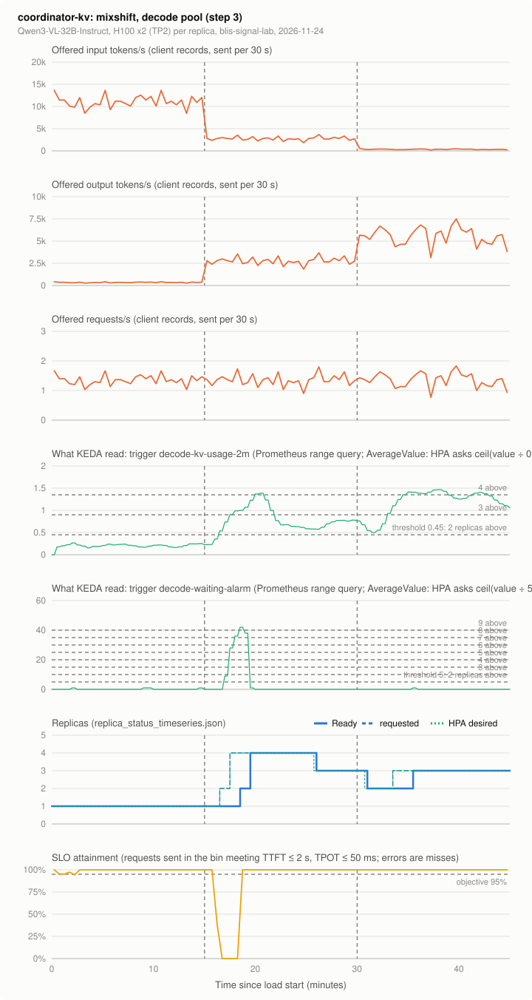
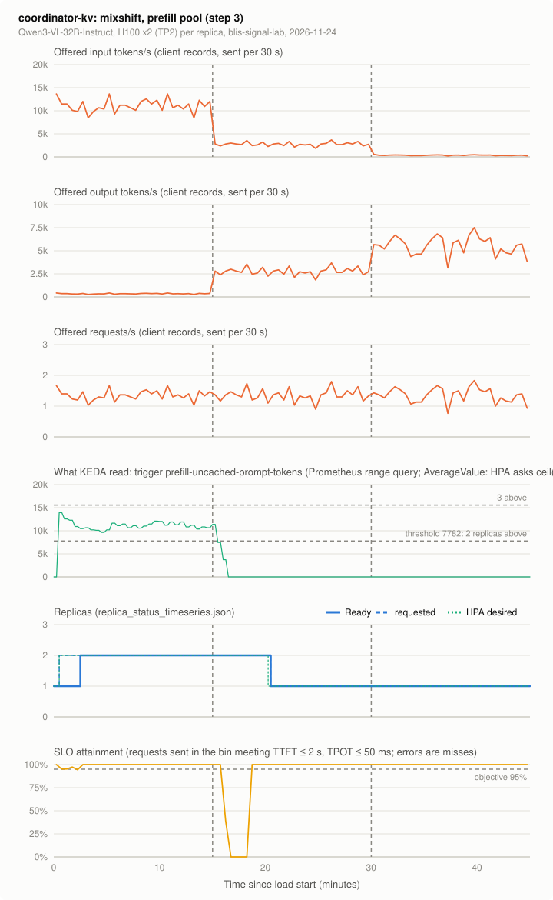

# Step 3, run 3: Mix-shift at constant rate (coord-disaggregation/coordinator-kv)

Part of the [step 3 summary](../../coordinator-kv-step3.md). Simulator numbers: blis priced this plant; they are not GPU measurements.

| | |
|---|---|
| Plant | blis-signal-lab `25f2dfb` (branch `signals-hpa`); blis-substrate `v0.14.0` catalog plus the `Qwen/Qwen3-VL-32B-Instruct` entry of inference-sim/blis-substrate#415 (open), from a local copy |
| BLIS scenario | [`coord-pd-qwen3-vl-32b-h100-bf16-tp2.yaml`](../coord-pd-qwen3-vl-32b-h100-bf16-tp2.yaml): a `prefill` and a `decode` pool, H100, bf16, TP2 per role, as the guide's overlay; router [`router/pd-prefix-8192.yaml`](../router/pd-prefix-8192.yaml) (prefix decider, `nonCachedTokens` 8192, the guide's PD-only value) |
| Cold start | 120 s (`loading_delay`): the protocol's default; this overlay has no GPU measurement |
| Metrics | scrape 30 s (the model-server PodMonitors set no interval; the stack's default and llm-d-benchmark's rendered PodMonitor are 30 s). The EPP's ServiceMonitor scrapes every 10 s; blis uses one interval for every series. `metrics_delay_s` 0 (raw series, no recording rule). HPA sync 15 s, `pollingInterval` 15 s |
| Seed | blis's default (no `--seed`); the load's seed is `schedule.seed` in `blis-run.json` |
| Scenario | `benchmark/config/scenarios/staging/coord-disaggregation/coordinator-kv.yaml`, rendered with `standup --dry-run`; policy [`policy.json`](policy.json), translated from it ([`terms.json`](../terms.json)) |
| Model | `Qwen/Qwen3-VL-32B-Instruct`, 2 H100 per replica (TP2), both roles |
| SLO | TTFT ≤ 2 s, TPOT ≤ 0.05 s; X = 0.95 |
| Run | 3, Mix-shift at constant rate |
| Load | `mixshift` in [`index.json`](../index.json) |
| Arm | as run 2 |
| Raw results | `benchmark/results/step3-coordinator-kv-20261124/mixshift/` (not committed) |

One request rate, 1.357 req/s (0.5 × 4 × 0.678), in three 900 s phases: 8192:256, 2048:2048, 256:4096. At the shift to 2048:2048, decode went 1 → 4 (4 requested at 1,050 s, 4 Ready at 1,170 s) and back to 3 at 1,545 s; prefill held 1–2 in phase 1 and returned to 1. The trigger panels are the HPA's own reading at each sync, from blis's decision log, not a Prometheus query. Each run is one sample (n = 1).

## Per stage, decode pool

| stage | s | set req/s | offered req/s | λ_in tok/s | λ_out tok/s | sent | errors | A | TTFT p50/p90/p99 s | TPOT p50/p90/p99 ms | Ready | need | requested replica-s | Ready replica-s |
|---|---|---|---|---|---|---|---|---|---|---|---|---|---|---|
| 1 | 900 | 1.356 | 1.357 | 11,114 | 347 | 1,221 | 0 | 99.4 % | 0.60/1.00/1.69 | 25.7/27.2/28.3 | 1–1 | 1 | 900 | 900 |
| 2 | 900 | 1.356 | 1.357 | 2,778 | 2,778 | 1,221 | 0 | 83.5 % | 0.21/21.11/63.14 | 27.5/49.9/53.0 | 1–4 | 2 | 2,970 | 2,610 |
| 3 | 900 | 1.356 | 1.357 | 347 | 5,557 | 1,221 | 0 | 100.0 % | 0.13/0.15/0.16 | 32.4/37.5/38.6 | 2–3 | 2 | 2,550 | 2,430 |

- run: 3,663 sent, A 94.3 %, errors 0, requested 6,420 replica-s = 12,840 GPU-s at 2 GPU per replica
- placement: 0 request(s) before the first stage, 0 after the last; stages more than 3 sd off their set rate: none: ok

Decode's `need` is `ceil(q / μ_SLO)` with the decode knees (runs 1a to 1d).

## Per stage, prefill pool

| stage | s | set req/s | offered req/s | λ_in tok/s | λ_out tok/s | sent | errors | A | TTFT p50/p90/p99 s | TPOT p50/p90/p99 ms | Ready | need | requested replica-s | Ready replica-s |
|---|---|---|---|---|---|---|---|---|---|---|---|---|---|---|
| 1 | 900 | 1.356 | 1.357 | 11,114 | 347 | 1,221 | 0 | 99.4 % | 0.60/1.00/1.69 | 25.7/27.2/28.3 | 1–2 | 2 | 1,770 | 1,650 |
| 2 | 900 | 1.356 | 1.357 | 2,778 | 2,778 | 1,221 | 0 | 83.5 % | 0.21/21.11/63.14 | 27.5/49.9/53.0 | 1–2 | 1 | 1,230 | 1,230 |
| 3 | 900 | 1.356 | 1.357 | 347 | 5,557 | 1,221 | 0 | 100.0 % | 0.13/0.15/0.16 | 32.4/37.5/38.6 | 1–1 | 1 | 900 | 900 |

- run: 3,663 sent, A 94.3 %, errors 0, requested 3,900 replica-s = 7,800 GPU-s at 2 GPU per replica
- placement: 0 request(s) before the first stage, 0 after the last; stages more than 3 sd off their set rate: none: ok

Prefill's `need` is `ceil(q / μ)` with prefill's own capacity ([`index-prefill.json`](../index-prefill.json)): 1.341 req/s for 8192:256 and 3.972 req/s for the blend (3 × 1.324, where the 8192-token requests' A crosses 0.95 in the prefill blend knee; only they reach prefill). 2048:2048 and 256:4096 prompts stay on decode (the decider's `nonCachedTokens` is 8192), so a phase of those needs `minReplicaCount`, 1.

## What the run shows

The run shows a problem when A < X once settled, or settled replicas differ from the need by more than the configuration's headroom, `ceil(q / (U × μ_SLO(m)))`. The KV target 0.45 sits at U = 0.73 (8192:256), 0.76 (2048:2048) and 0.83 (256:4096) of each mix's knee (the decode knees' readings, interpolated between stages 1 and 2), so the headroom needs are 1, 2 and 3.

- Phase 1 (8192:256): decode 1 (need 1, headroom need 1), A 99.4 %. Prefill 1–2 against a need of 2 (1.357 req/s, knee 1.341).
- Phase 2 (2048:2048): A 83.5 %. Per 60 s from 960 s: 0.186, 0.000, 0.420; from 1,170 s (4 Ready) A 1.000 (851 requests). Decode asked 2 at 990 s and the cap of 4 at 1,050 s; the waiting alarm won 8 of 60 syncs (at most 42 waiting, proposal 9). Ready reached 4 at 1,170 s, 270 s after the shift. One pod was released at 1,545 s (300 s window, then 1 pod per 300 s): the phase ended at 3 against a headroom need of 2.
- Phase 3 (256:4096): decode 2–3 (headroom need 3), A 100.0 %. Phases 2 and 3 send no request to prefill (need 1).
- The KV readings put the three mixes within U = 0.73 to 0.83 of their knees; the step 1 verdict measured bare arrival rate 3.9× apart across the same mixes.

**Outcome: problem shown: phase 2 ended at 3 decode pods against a headroom need of 2 (the alarm's step to the cap, released at 1 pod per 300 s), and lost 180 s of attainment after the shift (A 0.000 to 0.420 per 60 s). Once settled, A was 1.000 in every phase.**

## Amendments

None.
