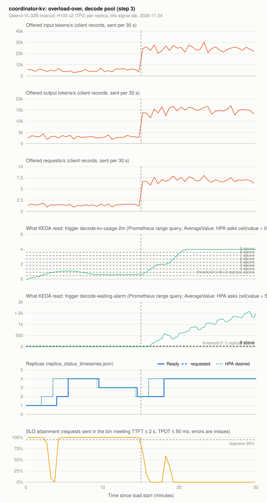
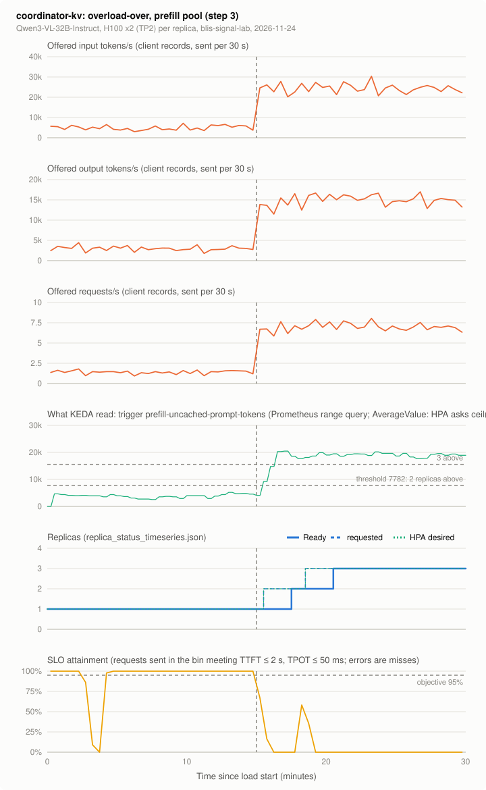

# Step 3, run 4b: Overload over the cap (coord-disaggregation/coordinator-kv)

Part of the [step 3 summary](../../coordinator-kv-step3.md). Simulator numbers: blis priced this plant; they are not GPU measurements.

| | |
|---|---|
| Plant | blis-signal-lab `25f2dfb` (branch `signals-hpa`); blis-substrate `v0.14.0` catalog plus the `Qwen/Qwen3-VL-32B-Instruct` entry of inference-sim/blis-substrate#415 (open), from a local copy |
| BLIS scenario | [`coord-pd-qwen3-vl-32b-h100-bf16-tp2.yaml`](../coord-pd-qwen3-vl-32b-h100-bf16-tp2.yaml): a `prefill` and a `decode` pool, H100, bf16, TP2 per role, as the guide's overlay; router [`router/pd-prefix-8192.yaml`](../router/pd-prefix-8192.yaml) (prefix decider, `nonCachedTokens` 8192, the guide's PD-only value) |
| Cold start | 120 s (`loading_delay`): the protocol's default; this overlay has no GPU measurement |
| Metrics | scrape 30 s (the model-server PodMonitors set no interval; the stack's default and llm-d-benchmark's rendered PodMonitor are 30 s). The EPP's ServiceMonitor scrapes every 10 s; blis uses one interval for every series. `metrics_delay_s` 0 (raw series, no recording rule). HPA sync 15 s, `pollingInterval` 15 s |
| Seed | blis's default (no `--seed`); the load's seed is `schedule.seed` in `blis-run.json` |
| Scenario | `benchmark/config/scenarios/staging/coord-disaggregation/coordinator-kv.yaml`, rendered with `standup --dry-run`; policy [`policy.json`](policy.json), translated from it ([`terms.json`](../terms.json)) |
| Model | `Qwen/Qwen3-VL-32B-Instruct`, 2 H100 per replica (TP2), both roles |
| SLO | TTFT ≤ 2 s, TPOT ≤ 0.05 s; X = 0.95 |
| Run | 4b, Overload over the cap |
| Load | `overload-over` in [`index.json`](../index.json) |
| Arm | as run 2 |
| Raw results | `benchmark/results/step3-coordinator-kv-20261124/overload-over/` (not committed) |
| Lab patch | [`lab-patch.diff`](lab-patch.diff): the TTFT projection of inference-sim `dfa8987` (#2237) applied to `25f2dfb`. Without it blis refuses its own Result under this load: two decode sub-requests preempted after their first token get a TTFT past their E2E. It moves the TTFT of most disaggregated requests, not only those two: on the prefill 8192:256 knee rerun with it ([`lab-patch-rerun/`](../knees/prefill-8192x256/lab-patch-rerun/ttft-shift.txt)), 1,286 of 1,534 requests read 18.4 ms more on average (at most 24.3 ms), E2E does not move, and A per stage is unchanged in stages 1 to 3 (72.2 to 71.6 % in stage 4), so the knee does not move. This run's TTFT and A are therefore on that basis, about 20 ms of TTFT above runs 1 to 10 for a disaggregated request. No trigger reads TTFT: the decision logs and pod series are byte-identical with and without it |

The blend at 1.2 × μ_SLO(B) (1.398 req/s) for 900 s, then 1.5 × C (6.990 req/s) for 900 s. Decode went 1 → 4 and back to 2 in phase 1, then to the cap of 4 in phase 2 (requested at 960 s, Ready at 1,080 s) and held it; prefill went 1 → 3 in phase 2. The trigger panels are the HPA's own reading at each sync, from blis's decision log, not a Prometheus query. Each run is one sample (n = 1).

## Per stage, decode pool

| stage | s | set req/s | offered req/s | λ_in tok/s | λ_out tok/s | sent | errors | A | TTFT p50/p90/p99 s | TPOT p50/p90/p99 ms | Ready | need | requested replica-s | Ready replica-s |
|---|---|---|---|---|---|---|---|---|---|---|---|---|---|---|
| 1 | 900 | 1.398 | 1.400 | 4,898 | 2,987 | 1,260 | 0 | 93.1 % | 0.21/0.96/23.89 | 27.6/44.8/51.6 | 1–4 | 2 | 2,700 | 2,340 |
| 2 | 900 | 6.990 | 6.990 | 24,456 | 14,912 | 6,291 | 4844 timeout | 5.7 % | 43.74/185.76/268.46 | 51.2/64.2/84.3 | 2–4 | 6 | 3,480 | 3,240 |

- run: 7,551 sent, A 20.3 %, errors {'timeout': 4844}, requested 6,180 replica-s = 12,360 GPU-s at 2 GPU per replica
- placement: 0 request(s) before the first stage, 0 after the last; stages more than 3 sd off their set rate: none: ok

Decode's `need` is `ceil(q / μ_SLO)` with the decode knees (runs 1a to 1d).

## Per stage, prefill pool

| stage | s | set req/s | offered req/s | λ_in tok/s | λ_out tok/s | sent | errors | A | TTFT p50/p90/p99 s | TPOT p50/p90/p99 ms | Ready | need | requested replica-s | Ready replica-s |
|---|---|---|---|---|---|---|---|---|---|---|---|---|---|---|
| 1 | 900 | 1.398 | 1.400 | 4,898 | 2,987 | 1,260 | 0 | 93.1 % | 0.21/0.96/23.89 | 27.6/44.8/51.6 | 1–1 | 1 | 900 | 900 |
| 2 | 900 | 6.990 | 6.990 | 24,456 | 14,912 | 6,291 | 4844 timeout | 5.7 % | 43.74/185.76/268.46 | 51.2/64.2/84.3 | 1–3 | 2 | 2,460 | 2,220 |

- run: 7,551 sent, A 20.3 %, errors {'timeout': 4844}, requested 3,360 replica-s = 6,720 GPU-s at 2 GPU per replica
- placement: 0 request(s) before the first stage, 0 after the last; stages more than 3 sd off their set rate: none: ok

Prefill's `need` is `ceil(q / μ)` with prefill's own capacity ([`index-prefill.json`](../index-prefill.json)): 1.341 req/s for 8192:256 and 3.972 req/s for the blend (3 × 1.324, where the 8192-token requests' A crosses 0.95 in the prefill blend knee; only they reach prefill). 2048:2048 and 256:4096 prompts stay on decode (the decider's `nonCachedTokens` is 8192), so a phase of those needs `minReplicaCount`, 1.

## What the run shows

The run shows a problem when the trigger reads 0 or falls while the load holds, or replicas stop below `maxReplicaCount`.

- Phase 2, decode: the cap was requested at 960 s and Ready at 1,080 s, 180 s after the step, and held to the end. From 1,080 s the KV driver read 1.98 to 3.99 (each asks 5 or more, above the cap) and the alarm 350 to 1,567: neither fell to a count below the cap.
- Phase 2, prefill: 1 → 2 at 1,050 s, 2 → 3 at 1,230 s, then 3 to the end, below its `maxReplicaCount` of 4. From 1,230 s the trigger read 17,658 to 20,207 tok/s (mean 19,091), which asks 3. 1.5 × C is relative to decode's capacity: prefill's need at 6.99 req/s of the blend is 2 (`ceil(6.99 / 3.972)`), and its threshold's headroom makes it 3.
- Phase 2: A 5.7 %, 4,844 timeouts, as the load is half again what 4 decode pods serve; 2,510 requests were still queued or running at the horizon.
- Phase 1 (need 2): decode asked 2 at 120 s and the cap at 210 s (the alarm won 4 of 60 syncs, at most 29 waiting), was 4 Ready at 330 s, and came back to 2 by 870 s. A 93.1 %, under X: the step from 1 pod.

**Outcome: as expected: decode reached the cap 180 s after the step and held it while the load held; prefill held its own need with headroom (3). Phase 1, before the overload, had A 0.931 after its step from 1 pod.**

## Amendments

- 2026-11-24: the lab patch row said the patch changes only the two preempted requests' TTFT. It changes the TTFT of most disaggregated requests (+18.4 ms on average on the prefill 8192:256 knee rerun with it, at most 24.3 ms, [`lab-patch-rerun/`](../knees/prefill-8192x256/lab-patch-rerun/ttft-shift.txt); the knee does not move). Found while porting the fix to blis-signal-lab (vishakha-ramani/blis-signal-lab#7), whose golden file moved on every disaggregated request. No number in this report changes.
