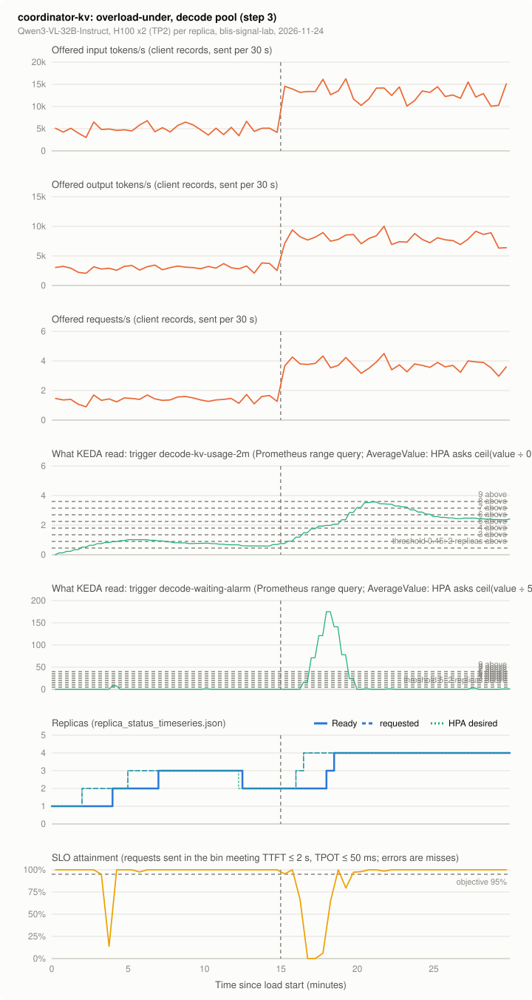
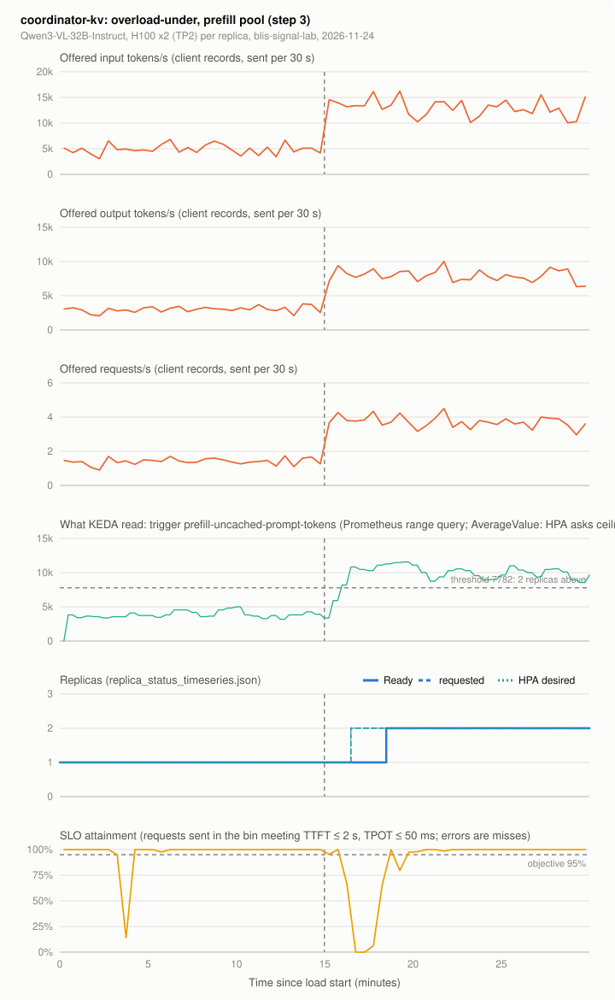

# Step 3, run 4a: Overload under the cap (coord-disaggregation/coordinator-kv)

Part of the [step 3 summary](../../coordinator-kv-step3.md). Simulator numbers: blis priced this plant; they are not GPU measurements.

| | |
|---|---|
| Plant | blis-signal-lab `25f2dfb` (branch `signals-hpa`); blis-substrate `v0.14.0` catalog plus the `Qwen/Qwen3-VL-32B-Instruct` entry of inference-sim/blis-substrate#415 (open), from a local copy |
| BLIS scenario | [`coord-pd-qwen3-vl-32b-h100-bf16-tp2.yaml`](../coord-pd-qwen3-vl-32b-h100-bf16-tp2.yaml): a `prefill` and a `decode` pool, H100, bf16, TP2 per role, as the guide's overlay; router [`router/pd-prefix-8192.yaml`](../router/pd-prefix-8192.yaml) (prefix decider, `nonCachedTokens` 8192, the guide's PD-only value) |
| Cold start | 120 s (`loading_delay`): the protocol's default; this overlay has no GPU measurement |
| Metrics | scrape 30 s (the model-server PodMonitors set no interval; the stack's default and llm-d-benchmark's rendered PodMonitor are 30 s). The EPP's ServiceMonitor scrapes every 10 s; blis uses one interval for every series. `metrics_delay_s` 0 (raw series, no recording rule). HPA sync 15 s, `pollingInterval` 15 s |
| Seed | blis's default (no `--seed`); the load's seed is `schedule.seed` in `blis-run.json` |
| Scenario | `benchmark/config/scenarios/staging/coord-disaggregation/coordinator-kv.yaml`, rendered with `standup --dry-run`; policy [`policy.json`](policy.json), translated from it ([`terms.json`](../terms.json)) |
| Model | `Qwen/Qwen3-VL-32B-Instruct`, 2 H100 per replica (TP2), both roles |
| SLO | TTFT ≤ 2 s, TPOT ≤ 0.05 s; X = 0.95 |
| Run | 4a, Overload under the cap |
| Load | `overload-under` in [`index.json`](../index.json) |
| Arm | as run 2 |
| Raw results | `benchmark/results/step3-coordinator-kv-20261124/overload-under/` (not committed) |

The blend at 1.2 × μ_SLO(B) (1.398 req/s) for 900 s, then 0.8 × C (3.728 req/s) for 900 s. Decode went 1 → 3 in phase 1 and to the cap of 4 in phase 2 (requested at 990 s, Ready at 1,110 s); prefill went 1 → 2 in phase 2. The trigger panels are the HPA's own reading at each sync, from blis's decision log, not a Prometheus query. Each run is one sample (n = 1).

## Per stage, decode pool

| stage | s | set req/s | offered req/s | λ_in tok/s | λ_out tok/s | sent | errors | A | TTFT p50/p90/p99 s | TPOT p50/p90/p99 ms | Ready | need | requested replica-s | Ready replica-s |
|---|---|---|---|---|---|---|---|---|---|---|---|---|---|---|
| 1 | 900 | 1.398 | 1.400 | 4,898 | 2,987 | 1,260 | 0 | 96.8 % | 0.21/0.69/7.10 | 30.0/42.1/46.2 | 1–3 | 2 | 2,130 | 1,890 |
| 2 | 900 | 3.728 | 3.730 | 13,050 | 7,957 | 3,357 | 0 | 86.2 % | 0.24/24.61/86.45 | 39.1/47.0/50.5 | 2–4 | 4 | 3,450 | 3,210 |

- run: 4,617 sent, A 89.1 %, errors 0, requested 5,580 replica-s = 11,160 GPU-s at 2 GPU per replica
- placement: 0 request(s) before the first stage, 0 after the last; stages more than 3 sd off their set rate: none: ok

Decode's `need` is `ceil(q / μ_SLO)` with the decode knees (runs 1a to 1d).

## Per stage, prefill pool

| stage | s | set req/s | offered req/s | λ_in tok/s | λ_out tok/s | sent | errors | A | TTFT p50/p90/p99 s | TPOT p50/p90/p99 ms | Ready | need | requested replica-s | Ready replica-s |
|---|---|---|---|---|---|---|---|---|---|---|---|---|---|---|
| 1 | 900 | 1.398 | 1.400 | 4,898 | 2,987 | 1,260 | 0 | 96.8 % | 0.21/0.69/7.10 | 30.0/42.1/46.2 | 1–1 | 1 | 900 | 900 |
| 2 | 900 | 3.728 | 3.730 | 13,050 | 7,957 | 3,357 | 0 | 86.2 % | 0.24/24.61/86.45 | 39.1/47.0/50.5 | 1–2 | 1 | 1,710 | 1,590 |

- run: 4,617 sent, A 89.1 %, errors 0, requested 2,610 replica-s = 5,220 GPU-s at 2 GPU per replica
- placement: 0 request(s) before the first stage, 0 after the last; stages more than 3 sd off their set rate: none: ok

Prefill's `need` is `ceil(q / μ)` with prefill's own capacity ([`index-prefill.json`](../index-prefill.json)): 1.341 req/s for 8192:256 and 3.972 req/s for the blend (3 × 1.324, where the 8192-token requests' A crosses 0.95 in the prefill blend knee; only they reach prefill). 2048:2048 and 256:4096 prompts stay on decode (the decider's `nonCachedTokens` is 8192), so a phase of those needs `minReplicaCount`, 1.

## What the run shows

The run shows a problem when A < X after Ready replicas stop rising.

- Phase 1: decode 1–3 (need 2), A 96.8 %.
- Phase 2: decode asked 3 at 960 s and 4 at 990 s; the waiting alarm won 10 of 60 syncs (at most 175 waiting). 4 Ready at 1,110 s, 210 s after the step. A per 60 s from 960 s: 0.320, 0.037, 0.833, 0.878, then 0.990 or more. A from 1,110 s to the end: 0.987 (2,534 requests); from 1,200 s: 0.998.
- Prefill: 1 in phase 1, 1–2 in phase 2, need 1 in both.
- 0 errors in the per-request records.

**Outcome: as expected: A 0.987 after decode reached the cap. The step cost about 240 s of attainment (A 0.037 to 0.878 per 60 s).**

## Amendments

None.
