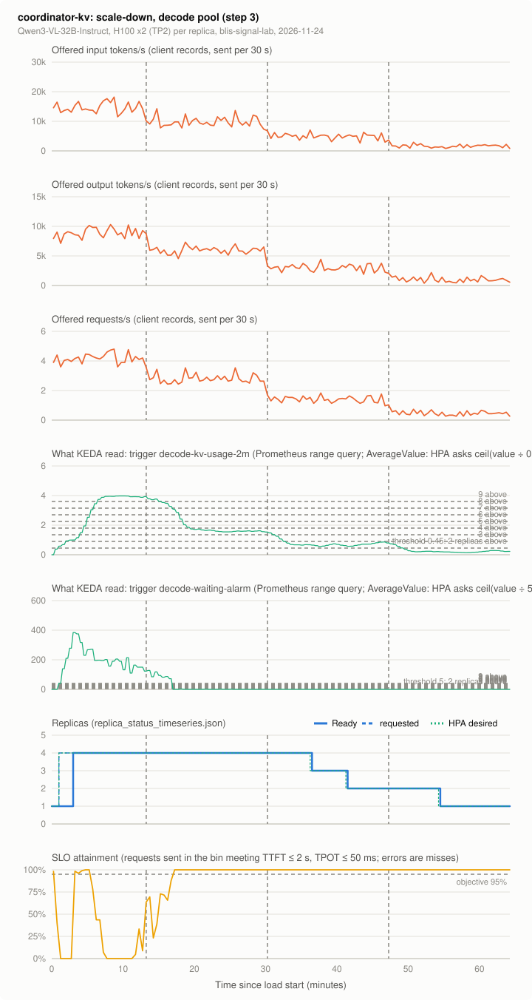
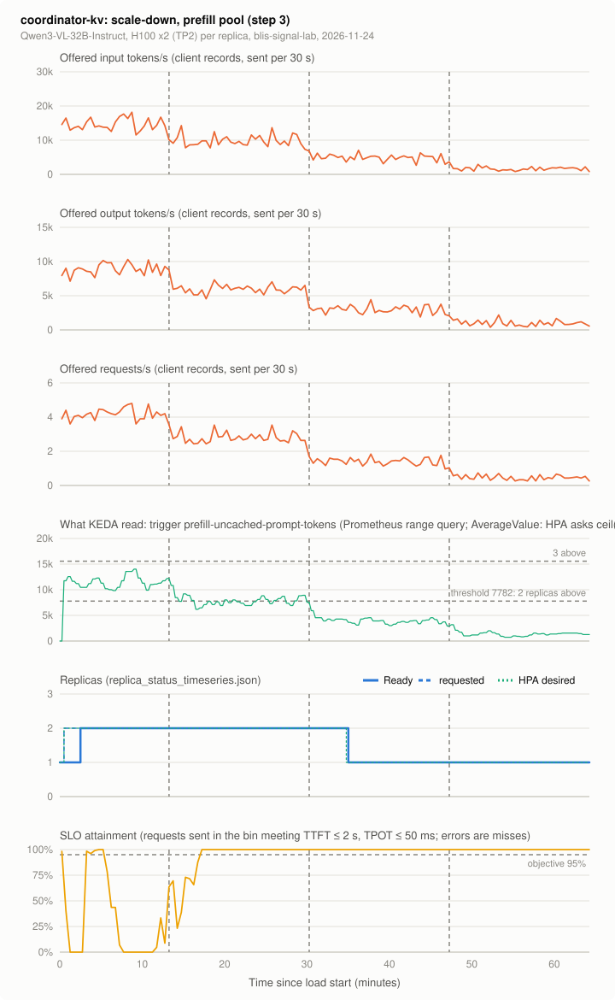

# Step 3, run 10: Scale-down (coord-disaggregation/coordinator-kv)

Part of the [step 3 summary](../../coordinator-kv-step3.md). Simulator numbers: blis priced this plant; they are not GPU measurements.

| | |
|---|---|
| Plant | blis-signal-lab `25f2dfb` (branch `signals-hpa`); blis-substrate `v0.14.0` catalog plus the `Qwen/Qwen3-VL-32B-Instruct` entry of inference-sim/blis-substrate#415 (open), from a local copy |
| BLIS scenario | [`coord-pd-qwen3-vl-32b-h100-bf16-tp2.yaml`](../coord-pd-qwen3-vl-32b-h100-bf16-tp2.yaml): a `prefill` and a `decode` pool, H100, bf16, TP2 per role, as the guide's overlay; router [`router/pd-prefix-8192.yaml`](../router/pd-prefix-8192.yaml) (prefix decider, `nonCachedTokens` 8192, the guide's PD-only value) |
| Cold start | 120 s (`loading_delay`): the protocol's default; this overlay has no GPU measurement |
| Metrics | scrape 30 s (the model-server PodMonitors set no interval; the stack's default and llm-d-benchmark's rendered PodMonitor are 30 s). The EPP's ServiceMonitor scrapes every 10 s; blis uses one interval for every series. `metrics_delay_s` 0 (raw series, no recording rule). HPA sync 15 s, `pollingInterval` 15 s |
| Seed | blis's default (no `--seed`); the load's seed is `schedule.seed` in `blis-run.json` |
| Scenario | `benchmark/config/scenarios/staging/coord-disaggregation/coordinator-kv.yaml`, rendered with `standup --dry-run`; policy [`policy.json`](policy.json), translated from it ([`terms.json`](../terms.json)) |
| Model | `Qwen/Qwen3-VL-32B-Instruct`, 2 H100 per replica (TP2), both roles |
| SLO | TTFT ≤ 2 s, TPOT ≤ 0.05 s; X = 0.95 |
| Run | 10, Scale-down |
| Load | `scale-down` in [`index.json`](../index.json) |
| Arm | as run 2 |
| Raw results | `benchmark/results/step3-coordinator-kv-20261124/scale-down/` (not committed) |

The blend: H = 795 s at 0.9 × C (4.194 req/s), then steps of D = 1,020 s at 0.6, 0.3 and 0.1 × C (2.796, 1.398, 0.466 req/s). Decode went 1 → 4 in one decision at 60 s (Ready at 180 s), held 4 through the 0.6 × C step, then came down to 2 and 1. The trigger panels are the HPA's own reading at each sync, from blis's decision log, not a Prometheus query. Each run is one sample (n = 1).

## Per stage, decode pool

| stage | s | set req/s | offered req/s | λ_in tok/s | λ_out tok/s | sent | errors | A | TTFT p50/p90/p99 s | TPOT p50/p90/p99 ms | Ready | need | requested replica-s | Ready replica-s |
|---|---|---|---|---|---|---|---|---|---|---|---|---|---|---|
| 1 | 795 | 4.194 | 4.196 | 14,681 | 8,952 | 3,336 | 340 timeout | 33.3 % | 4.34/185.41/228.90 | 48.0/53.1/78.9 | 1–4 | 4 | 3,000 | 2,640 |
| 2 | 1020 | 2.796 | 2.797 | 9,786 | 5,967 | 2,853 | 0 | 91.6 % | 0.22/0.96/152.89 | 32.2/41.4/49.2 | 4–4 | 3 | 4,080 | 4,080 |
| 3 | 1020 | 1.398 | 1.400 | 4,898 | 2,987 | 1,428 | 0 | 100.0 % | 0.21/0.60/1.05 | 27.0/30.9/33.1 | 2–4 | 2 | 3,090 | 3,090 |
| 4 | 1020 | 0.466 | 0.468 | 1,636 | 998 | 477 | 0 | 100.0 % | 0.20/0.60/0.89 | 25.3/27.5/28.5 | 1–2 | 1 | 1,455 | 1,455 |

- run: 8,094 sent, A 69.5 %, errors {'timeout': 340}, requested 11,625 replica-s = 23,250 GPU-s at 2 GPU per replica
- placement: 0 request(s) before the first stage, 0 after the last; stages more than 3 sd off their set rate: none: ok

Decode's `need` is `ceil(q / μ_SLO)` with the decode knees (runs 1a to 1d).

## Per stage, prefill pool

| stage | s | set req/s | offered req/s | λ_in tok/s | λ_out tok/s | sent | errors | A | TTFT p50/p90/p99 s | TPOT p50/p90/p99 ms | Ready | need | requested replica-s | Ready replica-s |
|---|---|---|---|---|---|---|---|---|---|---|---|---|---|---|
| 1 | 795 | 4.194 | 4.196 | 14,681 | 8,952 | 3,336 | 340 timeout | 33.3 % | 4.34/185.41/228.90 | 48.0/53.1/78.9 | 1–2 | 2 | 1,560 | 1,440 |
| 2 | 1020 | 2.796 | 2.797 | 9,786 | 5,967 | 2,853 | 0 | 91.6 % | 0.22/0.96/152.89 | 32.2/41.4/49.2 | 2–2 | 1 | 2,040 | 2,040 |
| 3 | 1020 | 1.398 | 1.400 | 4,898 | 2,987 | 1,428 | 0 | 100.0 % | 0.21/0.60/1.05 | 27.0/30.9/33.1 | 1–2 | 1 | 1,305 | 1,305 |
| 4 | 1020 | 0.466 | 0.468 | 1,636 | 998 | 477 | 0 | 100.0 % | 0.20/0.60/0.89 | 25.3/27.5/28.5 | 1–1 | 1 | 1,020 | 1,020 |

- run: 8,094 sent, A 69.5 %, errors {'timeout': 340}, requested 5,925 replica-s = 11,850 GPU-s at 2 GPU per replica
- placement: 0 request(s) before the first stage, 0 after the last; stages more than 3 sd off their set rate: none: ok

Prefill's `need` is `ceil(q / μ)` with prefill's own capacity ([`index-prefill.json`](../index-prefill.json)): 1.341 req/s for 8192:256 and 3.972 req/s for the blend (3 × 1.324, where the 8192-token requests' A crosses 0.95 in the prefill blend knee; only they reach prefill). 2048:2048 and 256:4096 prompts stay on decode (the decider's `nonCachedTokens` is 8192), so a phase of those needs `minReplicaCount`, 1.

## What the run shows

The run shows a problem when A < X after a step down, requests fail at a scale-down, or replicas have not reached the new need at the end of a step.

- Opening hold: decode asked the cap of 4 at 60 s (4 pods per 60 s); 4 Ready at 180 s. Prefill asked 2 at 30 s, Ready at 150 s. The waiting alarm won 49 of 53 syncs (at most 384 waiting). A 33.3 %, with 340 timeouts; after 4 decode Ready [180, 795) s, A 0.360. With decode at 1 pod for 180 s at 3.6 × its blend capacity, 650 to 770 requests were in flight from 240 to 960 s (blis's result). The 340 timed-out requests were sent from 65 to 180 s; blis kept serving them until 759 s (219 still running at 480 s), where a client would have cancelled each at 311 s (3-blis-evaluation.md §3.2, inference-sim#2291). Recovery here is therefore slower than on a cluster, by an amount this run does not measure.
- Step to 0.6 × C (need 3): decode held 4 for the whole step, 1,020 replica-s above the need. The KV reading settled at 1.66 and 1.58 in the step's last two thirds, which asks 4: the target's headroom (`ceil(2.796 / 0.84)` = 4). A 91.6 %; from 1,080 s, A 1.000 (2,081 requests). Prefill held 2 (need 1).
- Step to 0.3 × C (need 2): decode reached 2 at 675 s into the step, 1,050 replica-s above the need; A 100.0 %.
- Step to 0.1 × C (need 1): decode reached 1 at 435 s into the step, 435 replica-s above the need; A 100.0 %.
- Failures at scale-down are not observable in blis (3-blis-evaluation.md §3.2).

**Outcome: problem shown: A 0.333 in the opening hold (0.360 after decode reached the cap, with the backlog of its first 180 s), 340 timeouts; the 0.6 × C step ended at 4 decode pods against a need of 3 (the KV target's headroom asks 4). The 0.3 and 0.1 × C steps reached their need, at 675 and 435 s, with A 1.000.**

## Amendments

None.
