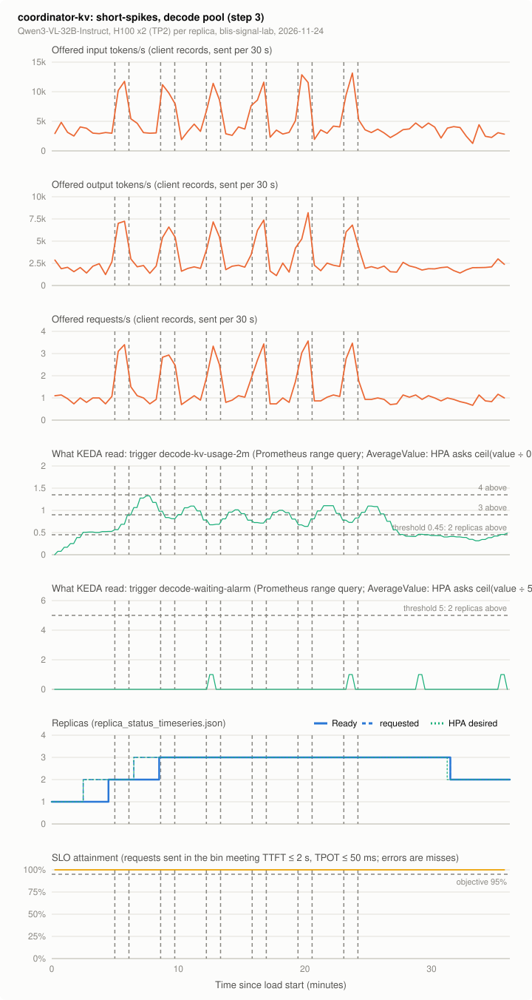
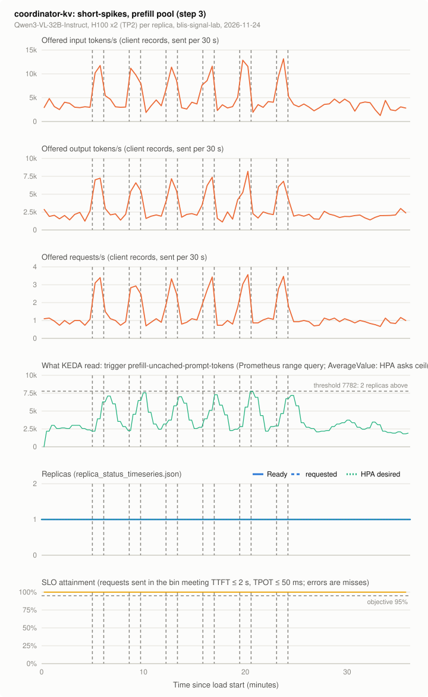

# Step 3, run 9: Short spikes (coord-disaggregation/coordinator-kv)

Part of the [step 3 summary](../../coordinator-kv-step3.md). Simulator numbers: blis priced this plant; they are not GPU measurements.

| | |
|---|---|
| Plant | blis-signal-lab `25f2dfb` (branch `signals-hpa`); blis-substrate `v0.14.0` catalog plus the `Qwen/Qwen3-VL-32B-Instruct` entry of inference-sim/blis-substrate#415 (open), from a local copy |
| BLIS scenario | [`coord-pd-qwen3-vl-32b-h100-bf16-tp2.yaml`](../coord-pd-qwen3-vl-32b-h100-bf16-tp2.yaml): a `prefill` and a `decode` pool, H100, bf16, TP2 per role, as the guide's overlay; router [`router/pd-prefix-8192.yaml`](../router/pd-prefix-8192.yaml) (prefix decider, `nonCachedTokens` 8192, the guide's PD-only value) |
| Cold start | 120 s (`loading_delay`): the protocol's default; this overlay has no GPU measurement |
| Metrics | scrape 30 s (the model-server PodMonitors set no interval; the stack's default and llm-d-benchmark's rendered PodMonitor are 30 s). The EPP's ServiceMonitor scrapes every 10 s; blis uses one interval for every series. `metrics_delay_s` 0 (raw series, no recording rule). HPA sync 15 s, `pollingInterval` 15 s |
| Seed | blis's default (no `--seed`); the load's seed is `schedule.seed` in `blis-run.json` |
| Scenario | `benchmark/config/scenarios/staging/coord-disaggregation/coordinator-kv.yaml`, rendered with `standup --dry-run`; policy [`policy.json`](policy.json), translated from it ([`terms.json`](../terms.json)) |
| Model | `Qwen/Qwen3-VL-32B-Instruct`, 2 H100 per replica (TP2), both roles |
| SLO | TTFT ≤ 2 s, TPOT ≤ 0.05 s; X = 0.95 |
| Run | 9, Short spikes |
| Load | `short-spikes` in [`index.json`](../index.json) |
| Arm | as run 2 |
| Raw results | `benchmark/results/step3-coordinator-kv-20261124/short-spikes/` (not committed) |

The blend: 300 s at 0.2 × C (0.940 req/s), six spikes of R/2 = 67 s at 0.7 × C (3.269 req/s) separated by gaps G = 150 s at 0.2 × C, then Q = 720 s at 0.2 × C. Decode rose 1 → 2 → 3 by the second spike and held 3 through every gap. The trigger panels are the HPA's own reading at each sync, from blis's decision log, not a Prometheus query. Each run is one sample (n = 1).

## Per stage, decode pool

| stage | s | set req/s | offered req/s | λ_in tok/s | λ_out tok/s | sent | errors | A | TTFT p50/p90/p99 s | TPOT p50/p90/p99 ms | Ready | need | requested replica-s | Ready replica-s |
|---|---|---|---|---|---|---|---|---|---|---|---|---|---|---|
| 1 | 300 | 0.932 | 0.940 | 3,289 | 2,005 | 282 | 0 | 100.0 % | 0.21/0.60/0.97 | 33.9/36.5/37.5 | 1–2 | 1 | 450 | 330 |
| 2 | 67 | 3.262 | 3.269 | 11,436 | 6,973 | 219 | 0 | 100.0 % | 0.23/0.81/1.32 | 37.3/40.0/40.9 | 2–2 | 3 | 134 | 134 |
| 3 | 150 | 0.932 | 0.940 | 3,289 | 2,005 | 141 | 0 | 100.0 % | 0.22/0.60/0.88 | 32.2/37.8/38.8 | 2–3 | 1 | 427 | 307 |
| 4 | 67 | 3.262 | 3.269 | 11,436 | 6,973 | 219 | 0 | 100.0 % | 0.22/0.80/1.19 | 30.5/31.8/34.9 | 3–3 | 3 | 201 | 201 |
| 5 | 150 | 0.932 | 0.940 | 3,289 | 2,005 | 141 | 0 | 100.0 % | 0.21/0.60/0.95 | 27.3/30.6/32.4 | 3–3 | 1 | 450 | 450 |
| 6 | 67 | 3.262 | 3.269 | 11,436 | 6,973 | 219 | 0 | 100.0 % | 0.20/0.77/1.25 | 29.7/31.5/32.8 | 3–3 | 3 | 201 | 201 |
| 7 | 150 | 0.932 | 0.940 | 3,289 | 2,005 | 141 | 0 | 100.0 % | 0.20/0.60/1.20 | 27.2/30.2/31.9 | 3–3 | 1 | 450 | 450 |
| 8 | 67 | 3.262 | 3.269 | 11,436 | 6,973 | 219 | 0 | 100.0 % | 0.21/0.93/1.62 | 29.7/32.5/33.8 | 3–3 | 3 | 201 | 201 |
| 9 | 150 | 0.932 | 0.940 | 3,289 | 2,005 | 141 | 0 | 100.0 % | 0.20/0.61/1.01 | 27.0/30.1/33.0 | 3–3 | 1 | 450 | 450 |
| 10 | 67 | 3.262 | 3.269 | 11,436 | 6,973 | 219 | 0 | 100.0 % | 0.21/0.82/1.52 | 30.0/31.2/33.9 | 3–3 | 3 | 201 | 201 |
| 11 | 150 | 0.932 | 0.940 | 3,289 | 2,005 | 141 | 0 | 100.0 % | 0.21/0.60/1.27 | 27.6/29.6/31.0 | 3–3 | 1 | 450 | 450 |
| 12 | 67 | 3.262 | 3.269 | 11,436 | 6,973 | 219 | 0 | 100.0 % | 0.21/0.93/1.30 | 30.1/31.4/33.4 | 3–3 | 3 | 201 | 201 |
| 13 | 720 | 0.932 | 0.933 | 3,265 | 1,991 | 672 | 0 | 100.0 % | 0.20/0.60/1.06 | 25.5/27.5/30.8 | 2–3 | 1 | 1,878 | 1,878 |

- run: 2,973 sent, A 100.0 %, errors 0, requested 5,694 replica-s = 11,388 GPU-s at 2 GPU per replica
- placement: 0 request(s) before the first stage, 0 after the last; stages more than 3 sd off their set rate: none: ok

Decode's `need` is `ceil(q / μ_SLO)` with the decode knees (runs 1a to 1d).

## Per stage, prefill pool

| stage | s | set req/s | offered req/s | λ_in tok/s | λ_out tok/s | sent | errors | A | TTFT p50/p90/p99 s | TPOT p50/p90/p99 ms | Ready | need | requested replica-s | Ready replica-s |
|---|---|---|---|---|---|---|---|---|---|---|---|---|---|---|
| 1 | 300 | 0.932 | 0.940 | 3,289 | 2,005 | 282 | 0 | 100.0 % | 0.21/0.60/0.97 | 33.9/36.5/37.5 | 1–1 | 1 | 300 | 300 |
| 2 | 67 | 3.262 | 3.269 | 11,436 | 6,973 | 219 | 0 | 100.0 % | 0.23/0.81/1.32 | 37.3/40.0/40.9 | 1–1 | 1 | 67 | 67 |
| 3 | 150 | 0.932 | 0.940 | 3,289 | 2,005 | 141 | 0 | 100.0 % | 0.22/0.60/0.88 | 32.2/37.8/38.8 | 1–1 | 1 | 150 | 150 |
| 4 | 67 | 3.262 | 3.269 | 11,436 | 6,973 | 219 | 0 | 100.0 % | 0.22/0.80/1.19 | 30.5/31.8/34.9 | 1–1 | 1 | 67 | 67 |
| 5 | 150 | 0.932 | 0.940 | 3,289 | 2,005 | 141 | 0 | 100.0 % | 0.21/0.60/0.95 | 27.3/30.6/32.4 | 1–1 | 1 | 150 | 150 |
| 6 | 67 | 3.262 | 3.269 | 11,436 | 6,973 | 219 | 0 | 100.0 % | 0.20/0.77/1.25 | 29.7/31.5/32.8 | 1–1 | 1 | 67 | 67 |
| 7 | 150 | 0.932 | 0.940 | 3,289 | 2,005 | 141 | 0 | 100.0 % | 0.20/0.60/1.20 | 27.2/30.2/31.9 | 1–1 | 1 | 150 | 150 |
| 8 | 67 | 3.262 | 3.269 | 11,436 | 6,973 | 219 | 0 | 100.0 % | 0.21/0.93/1.62 | 29.7/32.5/33.8 | 1–1 | 1 | 67 | 67 |
| 9 | 150 | 0.932 | 0.940 | 3,289 | 2,005 | 141 | 0 | 100.0 % | 0.20/0.61/1.01 | 27.0/30.1/33.0 | 1–1 | 1 | 150 | 150 |
| 10 | 67 | 3.262 | 3.269 | 11,436 | 6,973 | 219 | 0 | 100.0 % | 0.21/0.82/1.52 | 30.0/31.2/33.9 | 1–1 | 1 | 67 | 67 |
| 11 | 150 | 0.932 | 0.940 | 3,289 | 2,005 | 141 | 0 | 100.0 % | 0.21/0.60/1.27 | 27.6/29.6/31.0 | 1–1 | 1 | 150 | 150 |
| 12 | 67 | 3.262 | 3.269 | 11,436 | 6,973 | 219 | 0 | 100.0 % | 0.21/0.93/1.30 | 30.1/31.4/33.4 | 1–1 | 1 | 67 | 67 |
| 13 | 720 | 0.932 | 0.933 | 3,265 | 1,991 | 672 | 0 | 100.0 % | 0.20/0.60/1.06 | 25.5/27.5/30.8 | 1–1 | 1 | 720 | 720 |

- run: 2,973 sent, A 100.0 %, errors 0, requested 2,172 replica-s = 4,344 GPU-s at 2 GPU per replica
- placement: 0 request(s) before the first stage, 0 after the last; stages more than 3 sd off their set rate: none: ok

Prefill's `need` is `ceil(q / μ)` with prefill's own capacity ([`index-prefill.json`](../index-prefill.json)): 1.341 req/s for 8192:256 and 3.972 req/s for the blend (3 × 1.324, where the 8192-token requests' A crosses 0.95 in the prefill blend knee; only they reach prefill). 2048:2048 and 256:4096 prompts stay on decode (the decider's `nonCachedTokens` is 8192), so a phase of those needs `minReplicaCount`, 1.

## What the run shows

The run shows a problem when A < X in a gap, or requests fail at a scale-down.

- A 100.0 % in every spike and every gap.
- Decode: 1–2 in the first phase, 2 in spike 1, 2–3 in the first gap, 3 from spike 2 through the last gap, 2–3 in the last phase (ending at 2). Spikes need 3 (knee); KV proposals in spikes were 2–3, because a 67 s spike does not lift the 2 m average to the spike's level.
- In the gaps (need 1, headroom need 2) the pool held 3: a gap and a spike last 217 s, under the 300 s scale-down window, so the window always holds a spike's proposal.
- Prefill held 1 throughout (need 1).
- Failures at scale-down are not observable in blis (3-blis-evaluation.md §3.2).

**Outcome: as expected: A 1.000 throughout; the pool held 3 decode pods in gaps that need 1 to 2.**

## Amendments

None.
