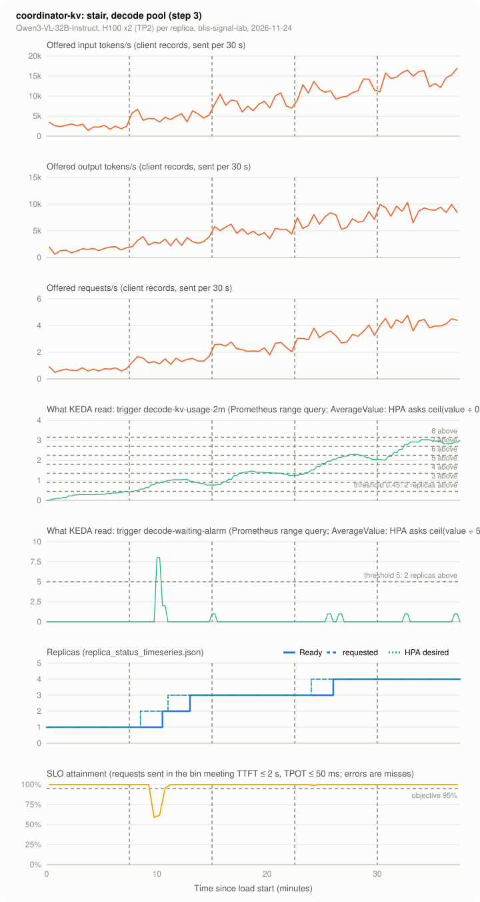
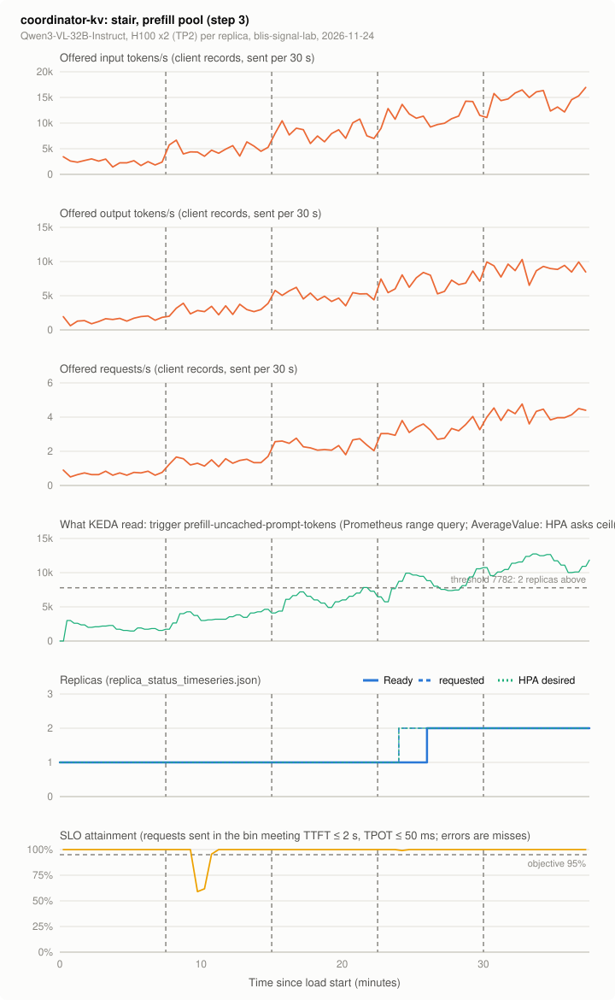

# Step 3, run 2: SO-active staircase (coord-disaggregation/coordinator-kv)

Part of the [step 3 summary](../../coordinator-kv-step3.md). Simulator numbers: blis priced this plant; they are not GPU measurements.

| | |
|---|---|
| Plant | blis-signal-lab `25f2dfb` (branch `signals-hpa`); blis-substrate `v0.14.0` catalog plus the `Qwen/Qwen3-VL-32B-Instruct` entry of inference-sim/blis-substrate#415 (open), from a local copy |
| BLIS scenario | [`coord-pd-qwen3-vl-32b-h100-bf16-tp2.yaml`](../coord-pd-qwen3-vl-32b-h100-bf16-tp2.yaml): a `prefill` and a `decode` pool, H100, bf16, TP2 per role, as the guide's overlay; router [`router/pd-prefix-8192.yaml`](../router/pd-prefix-8192.yaml) (prefix decider, `nonCachedTokens` 8192, the guide's PD-only value) |
| Cold start | 120 s (`loading_delay`): the protocol's default; this overlay has no GPU measurement |
| Metrics | scrape 30 s (the model-server PodMonitors set no interval; the stack's default and llm-d-benchmark's rendered PodMonitor are 30 s). The EPP's ServiceMonitor scrapes every 10 s; blis uses one interval for every series. `metrics_delay_s` 0 (raw series, no recording rule). HPA sync 15 s, `pollingInterval` 15 s |
| Seed | blis's default (no `--seed`); the load's seed is `schedule.seed` in `blis-run.json` |
| Scenario | `benchmark/config/scenarios/staging/coord-disaggregation/coordinator-kv.yaml`, rendered with `standup --dry-run`; policy [`policy.json`](policy.json), translated from it ([`terms.json`](../terms.json)) |
| Model | `Qwen/Qwen3-VL-32B-Instruct`, 2 H100 per replica (TP2), both roles |
| SLO | TTFT ≤ 2 s, TPOT ≤ 0.05 s; X = 0.95 |
| Run | 2, SO-active staircase |
| Load | `stair` in [`index.json`](../index.json) |
| Arm | ScaledObjects active, each pool from `minReplicaCount` (1) Ready |
| Raw results | `benchmark/results/step3-coordinator-kv-20261124/stair/` (not committed) |

The blend in five 450 s stages at 0.15, 0.3, 0.5, 0.7 and 0.9 × C (0.70 to 4.20 req/s). Decode went 1 → 3 in stage 2 and 3 → 4 in stage 4; prefill went 1 → 2 in stage 4. The trigger panels are the HPA's own reading at each sync, from blis's decision log, not a Prometheus query. Each run is one sample (n = 1).

## Per stage, decode pool

| stage | s | set req/s | offered req/s | λ_in tok/s | λ_out tok/s | sent | errors | A | TTFT p50/p90/p99 s | TPOT p50/p90/p99 ms | Ready | need | requested replica-s | Ready replica-s |
|---|---|---|---|---|---|---|---|---|---|---|---|---|---|---|
| 1 | 450 | 0.699 | 0.700 | 2,449 | 1,493 | 315 | 0 | 100.0 % | 0.21/0.59/0.92 | 29.8/33.9/39.8 | 1–1 | 1 | 450 | 450 |
| 2 | 450 | 1.398 | 1.400 | 4,898 | 2,987 | 630 | 0 | 95.1 % | 0.23/0.74/9.36 | 33.2/44.0/47.4 | 1–3 | 2 | 1,080 | 840 |
| 3 | 450 | 2.330 | 2.333 | 8,164 | 4,978 | 1,050 | 0 | 100.0 % | 0.22/0.68/1.41 | 32.2/34.9/36.5 | 3–3 | 2 | 1,350 | 1,350 |
| 4 | 450 | 3.262 | 3.267 | 11,429 | 6,969 | 1,470 | 0 | 99.9 % | 0.23/0.73/1.36 | 36.9/39.3/40.6 | 3–4 | 3 | 1,710 | 1,590 |
| 5 | 450 | 4.194 | 4.200 | 14,694 | 8,960 | 1,890 | 0 | 100.0 % | 0.23/0.67/1.05 | 38.8/40.4/41.9 | 4–4 | 4 | 1,800 | 1,800 |

- run: 5,355 sent, A 99.4 %, errors 0, requested 6,390 replica-s = 12,780 GPU-s at 2 GPU per replica
- placement: 0 request(s) before the first stage, 0 after the last; stages more than 3 sd off their set rate: none: ok

Decode's `need` is `ceil(q / μ_SLO)` with the decode knees (runs 1a to 1d).

## Per stage, prefill pool

| stage | s | set req/s | offered req/s | λ_in tok/s | λ_out tok/s | sent | errors | A | TTFT p50/p90/p99 s | TPOT p50/p90/p99 ms | Ready | need | requested replica-s | Ready replica-s |
|---|---|---|---|---|---|---|---|---|---|---|---|---|---|---|
| 1 | 450 | 0.699 | 0.700 | 2,449 | 1,493 | 315 | 0 | 100.0 % | 0.21/0.59/0.92 | 29.8/33.9/39.8 | 1–1 | 1 | 450 | 450 |
| 2 | 450 | 1.398 | 1.400 | 4,898 | 2,987 | 630 | 0 | 95.1 % | 0.23/0.74/9.36 | 33.2/44.0/47.4 | 1–1 | 1 | 450 | 450 |
| 3 | 450 | 2.330 | 2.333 | 8,164 | 4,978 | 1,050 | 0 | 100.0 % | 0.22/0.68/1.41 | 32.2/34.9/36.5 | 1–1 | 1 | 450 | 450 |
| 4 | 450 | 3.262 | 3.267 | 11,429 | 6,969 | 1,470 | 0 | 99.9 % | 0.23/0.73/1.36 | 36.9/39.3/40.6 | 1–2 | 1 | 810 | 690 |
| 5 | 450 | 4.194 | 4.200 | 14,694 | 8,960 | 1,890 | 0 | 100.0 % | 0.23/0.67/1.05 | 38.8/40.4/41.9 | 2–2 | 2 | 900 | 900 |

- run: 5,355 sent, A 99.4 %, errors 0, requested 3,060 replica-s = 6,120 GPU-s at 2 GPU per replica
- placement: 0 request(s) before the first stage, 0 after the last; stages more than 3 sd off their set rate: none: ok

Prefill's `need` is `ceil(q / μ)` with prefill's own capacity ([`index-prefill.json`](../index-prefill.json)): 1.341 req/s for 8192:256 and 3.972 req/s for the blend (3 × 1.324, where the 8192-token requests' A crosses 0.95 in the prefill blend knee; only they reach prefill). 2048:2048 and 256:4096 prompts stay on decode (the decider's `nonCachedTokens` is 8192), so a phase of those needs `minReplicaCount`, 1.

## What the run shows

The run shows a problem when replicas do not rise with the stages, or A < X once the pool settled.

- Decode Ready rose with the stages: 1, 1–3, 3, 3–4, 4. Prefill: 1, 1, 1, 1–2, 2, against a need of 1, 1, 1, 1, 2.
- A per stage: 100.0, 95.1, 100.0, 99.9, 100.0 %. In stage 2, A was 0.587 in [570, 630) s, before the second decode pod was Ready at 630 s, and 1.000 from 630 to 900 s (385 requests).
- Decode ran one pod above the knee need `ceil(q / 1.165)` in stages 3 and 4 (3 against 2, 3–4 against 3). The KV target 0.45 is reached at 0.84 req/s of the blend on one pod, 0.72 × μ_SLO(B) (the decode blend knee's readings, interpolated between stages 1 and 2); `ceil(q / 0.84)` gives 1, 2, 3, 4 and 5 (capped at 4). The pool matched it except at the end of stage 2 (3 against 2), when the KV proposal reached 3 at its reading's 1.04 peak, during the stage's transient.
- The waiting alarm never won a sync (its maximum, 8, asked 2).

**Outcome: as expected.**

## Amendments

None.
