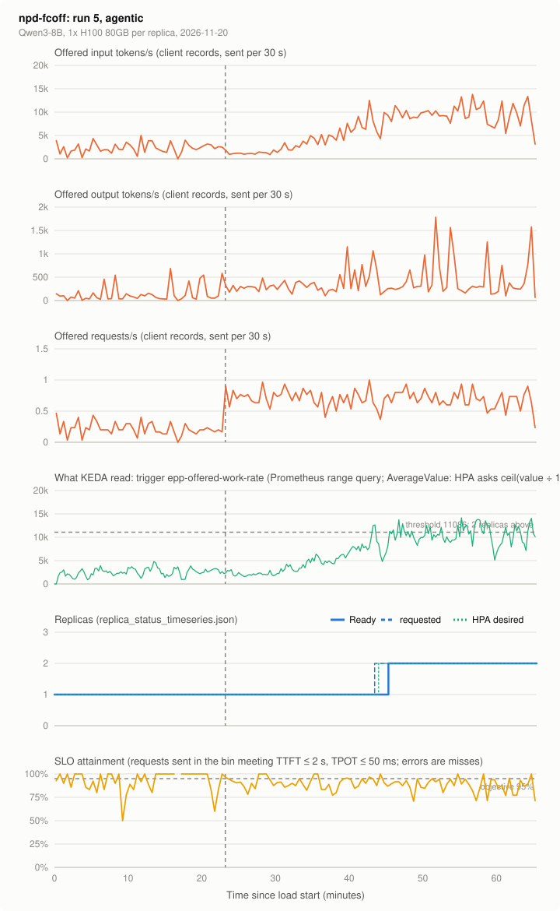

# Run 5: agentic

Part of the [npd-fcoff step 5 evaluation](../../npd-fcoff-step5.md).

| | |
|---|---|
| Namespace | `step5-npd-fcoff-20261119`, Kubernetes v1.32.9 (OpenShift) |
| Scenario / overlay | `staging/optimized-baseline/npd-fcoff.yaml` / `ocp/vllm-npd.yaml` (see the summary for the `--set` flags), plus `--set harness.resources.cpu=8 --set harness.resources.memory=32Gi` for the client |
| Model / GPU | Qwen/Qwen3-8B bf16 / 1 × NVIDIA H100 80GB HBM3 per replica, `--max-model-len 32768` |
| Images | as in the summary header |
| KEDA | Custom Metrics Autoscaler 2.19.0 |
| ScaledObject | as rendered, with `thresholdWork` 11,086 ([`scaledobject.json`](scaledobject.json)) |
| SLO | TTFT ≤ 2 s, TPOT ≤ 0.05 s; X = 0.95 |
| Profile | [`profile.yaml`](profile.yaml) (the summary's profile changes apply): inference-perf `conversation_replay`, 64 conversations, a shared 4,096-token system prompt, growing per-conversation history, lognormal turn lengths and tool pauses; two Poisson stages; `agentic` in [`../index.json`](../index.json), copied to [`load.json`](load.json) |
| Arm | `active`: paused at 1 Ready replica, 90 s, then resumed |
| Session | `villardl-20261120-073618-656` |
| Start / end (UTC) | stage 0 12:37:02 – 13:00:14, stage 1 13:00:14 – 13:42:30 (inference-perf partial reports) |

Multi-turn sessions at 0.233 req/s for 1,280 s, then at 0.698 req/s for
2,560 s. These rates are 0.1 and 0.3 × the pool's prompt-token capacity at an
estimated mean prompt of 14,364 tokens. The pool stays at 1 replica in stage 0
and runs 1 to 2 in stage 1. Every request completes; A is 0.997 or more.

## Stages

Computed by [`../agentic.py`](../agentic.py) ([`stages.json`](stages.json)):
requests placed in the stage windows of the partial reports; λ from the
records' input and output token counts (no request failed, so every request
carries them).

| Stage | Scheduled req/s | Sent req/s | λ_in tok/s | λ_out tok/s | Sent | Errors | A | TTFT p50 / p90 / p99 (s) | TPOT p50 / p90 / p99 | Mean / max prompt (tokens) | Ready min–max | Requested / Ready replica-s |
|---|---|---|---|---|---|---|---|---|---|---|---|---|
| 0 | 0.233 | 0.222 | 2,340 | 145 | 309 | 0 | 1.000 | 0.17 / 0.42 / 0.86 | 7 ms / 9 ms / 15 ms | 10,536 / 31,355 | 1 | 1,392 / 1,392 |
| 1 | 0.698 | 0.700 | 6,591 | 405 | 1,774 | 0 | 0.997 | 0.17 / 0.75 / 1.41 | 8 ms / 16 ms / 29 ms | 9,421 / 32,391 | 1–2 | 3,823 / 3,703 |

TTFT by prompt length (completed requests), p50 / p90 in seconds:

| Stage | < 8,192 | 8,192–16,383 | 16,384–24,575 | ≥ 24,576 |
|---|---|---|---|---|
| 0 | 0.10 / 0.15 (n 89) | 0.22 / 0.38 (n 200) | 0.55 / 0.83 (n 17) | 1.12 / 1.26 (n 3) |
| 1 | 0.06 / 0.15 (n 787) | 0.27 / 0.53 (n 685) | 0.62 / 0.95 (n 233) | 1.14 / 1.44 (n 69) |

Whole run: 2,084 requests, all completed; requested 5,215 and Ready 5,095
replica-seconds (5,215 GPU-seconds).

## What the run shows

- **Attainment and errors.** A = 1.000 and 0.997, 0 errors of any type, and
  no context-overflow error: the longest prompt, 32,391 tokens, fits
  `--max-model-len 32768`.
- **TTFT grows with the prompt.** p50 rises from 0.06–0.10 s under 8,192
  tokens to 1.12–1.14 s at 24,576 tokens and more.
- **The trigger tracks offered ν.** Its median over each stage after the first
  60 s, against ν = λ_in + 3.3 × λ_out from the records: 0.91 (2,553 against
  2,817) and 1.02 (8,057 against 7,928). The ratio terms carried the sessions'
  real lengths, not the 8192/128 fallback.
- **Replicas.** `ceil(ν / 11,086)` is 1 in both stages. The HPA asked for 2 at
  13:21:03 UTC, 1,249 s into stage 1, and held it to the end; the excursion of
  the trigger above 11,086 that caused it is unexplained beyond its noise. The
  protocol does not judge agentic sizing (§5.3).
- **The load was lighter than planned.** The completed prompts averaged
  9,421–10,536 tokens against the profile's estimate of 14,364, so λ_in in
  stage 1 is 6,591 tok/s, not the planned 0.3 × C × mean ISL of the blend
  (10,019 tok/s).
- inference-perf's `conversation_replay` has no subagent fan-out and drains
  in-flight requests at the stage boundary (§5.3).

Outcome: **as expected**. A ≥ 0.997 once settled and no context overflow
(n = 1).

## Tool notes

- With two stages, the harness wrote two partial reports and two benchmark
  reports; both are copied.
- Otherwise as in [run 2](../stair/report.md#tool-notes).

## Amendments

None.
