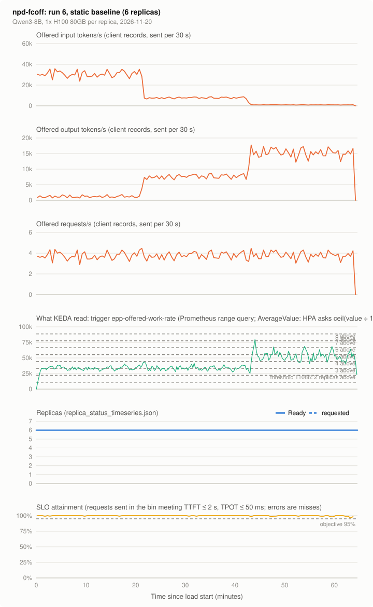

# Run 6: static-replica baseline

Part of the [npd-fcoff step 5 evaluation](../../npd-fcoff-step5.md). The cost
reference for [run 3](../mixshift/report.md).

| | |
|---|---|
| Namespace | `step5-npd-fcoff-20261119`, Kubernetes v1.32.9 (OpenShift) |
| Scenario / overlay | `staging/optimized-baseline/npd-fcoff.yaml` / `ocp/vllm-npd.yaml` (see the summary for the `--set` flags), plus `--set harness.resources.cpu=8 --set harness.resources.memory=32Gi` for the client |
| Model / GPU | Qwen/Qwen3-8B bf16 / 1 × NVIDIA H100 80GB HBM3 per replica |
| Images | as in the summary header |
| KEDA | Custom Metrics Autoscaler 2.19.0 |
| ScaledObject | paused at 6 replicas (`autoscaling.keda.sh/paused-replicas: "6"`, [`scaledobject.json`](scaledobject.json)) |
| SLO | TTFT ≤ 2 s, TPOT ≤ 0.05 s; X = 0.95 |
| Profile / trace | [`profile.yaml`](profile.yaml) and `mixshift.csv`, byte-identical to run 3's (14,519 requests); `mixshift` in [`../index.json`](../index.json), copied to [`load.json`](load.json) |
| Arm | `pin 6`: autoscaling paused at 6, run 3's peak Ready count, waited for 6 Ready |
| Session | `villardl-20261120-140732-983` |
| Start / end (UTC) | 2026-11-20 19:08:14 / 20:12:53 (inference-perf stage 0) |

Run 3's trace, 3.78 req/s through 8192:256, 2048:2048 and 256:4096, replayed
against 6 pinned replicas. Attainment is 0.997 or more in every phase.

## Phases

Computed by [`../phases.py`](../phases.py) ([`phases.json`](phases.json)),
columns as in [run 2](../stair/report.md#phases). There is no HPA series:
KEDA removes the HPA while the ScaledObject is paused.

| Phase | t (s) | Mix | Scheduled req/s | Sent req/s | λ_in tok/s | λ_out tok/s | Sent | Errors | A | TTFT p50 / p90 / p99 (s) | TPOT p50 / p90 / p99 | Ready | Requested / Ready replica-s |
|---|---|---|---|---|---|---|---|---|---|---|---|---|---|
| 1 | 0–1280 | 8192:256 | 3.78 | 3.76 | 30,813 | 966 | 4,816 | 0 | 0.999 | 0.27 / 0.57 / 0.90 | 8 ms / 13 ms / 19 ms | 6 | 7,680 / 7,678 |
| 2 | 1280–2560 | 2048:2048 | 3.78 | 3.78 | 7,730 | 7,754 | 4,838 | 1 completed without latency | 1.000 | 0.076 / 0.12 / 0.21 | 9 ms / 10 ms / 17 ms | 6 | 7,680 / 7,680 |
| 3 | 2560–3840 | 256:4096 | 3.78 | 3.80 | 973 | 15,565 | 4,864 | 4 completed without latency | 0.997 | 0.20 / 0.60 / 1.42 | 10 ms / 12 ms / 15 ms | 6 | 7,680 / 7,680 |

Whole run: 14,518 records for the trace's 14,519 rows, A 0.999, requested
23,040 and Ready 23,038 replica-seconds (23,040 GPU-seconds). With one record
short, the one-to-one match with the trace can place at most one request in
the neighbouring phase.

## Against run 3

GPU-seconds are requested replica-seconds × 1 GPU per replica.

| Phase | Mix | A, run 3 (autoscaled) | A after settling, run 3 | A, run 6 (6 static) | GPU-s, run 3 | GPU-s, run 6 | Run 3 / run 6 |
|---|---|---|---|---|---|---|---|
| 1 | 8192:256 | 0.852 | 0.998 | 0.999 | 4,352 | 7,680 | 0.57 |
| 2 | 2048:2048 | 0.999 | 0.999 | 1.000 | 5,120 | 7,680 | 0.67 |
| 3 | 256:4096 | 0.983 | 0.997 | 0.997 | 7,228 | 7,680 | 0.94 |
| all | | 0.945 | | 0.999 | 16,699 | 23,040 | 0.72 |

Run 3 used 28 % fewer GPU-seconds (16,699 against 23,040). Its attainment
cost was the ramp from 1 replica in phase 1: A 0.852 against 0.999, and
0.998 once settled. In phases 2 and 3 the two runs differ by 0.001 and 0.014
in A (0.001 and 0.000 once settled), with run 3 on 4 and then 4 to 6 replicas.

Outcome: not a pass/fail run (§5.3); it is the cost reference for run 3
(n = 1 each).

## Tool notes

As in [run 2](../stair/report.md#tool-notes).

## Amendments

None.
