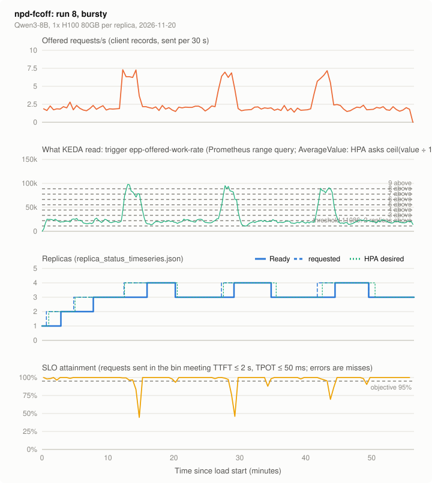

# Run 8: bursty

Part of the [npd-fcoff step 5 evaluation](../../npd-fcoff-step5.md).

| | |
|---|---|
| Namespace | `step5-npd-fcoff-20261119`, Kubernetes v1.32.9 (OpenShift) |
| Scenario / overlay | `staging/optimized-baseline/npd-fcoff.yaml` / `ocp/vllm-npd.yaml` (see the summary for the `--set` flags), plus `--set harness.resources.cpu=8 --set harness.resources.memory=32Gi` for the client |
| Model / GPU | Qwen/Qwen3-8B bf16 / 1 × NVIDIA H100 80GB HBM3 per replica |
| Images | as in the summary header |
| KEDA | Custom Metrics Autoscaler 2.19.0 |
| ScaledObject | as rendered, with `thresholdWork` 11,086 ([`scaledobject.json`](scaledobject.json)) |
| SLO | TTFT ≤ 2 s, TPOT ≤ 0.05 s; X = 0.95 |
| Profile / trace | [`profile.yaml`](profile.yaml) (the summary's profile changes apply), `bursty.csv` (8,674 requests); `bursty` in [`../index.json`](../index.json), copied to [`load.json`](load.json) |
| Arm | `active`: paused at 1 Ready replica, 90 s, then resumed |
| Session | `villardl-20261120-084954-018` |
| Start / end (UTC) | 2026-11-20 13:50:36 / 14:47:02 (inference-perf stage 0) |

The blend at 0.2 × C (1.91 req/s) for Q = 720 s, then three cycles of a
spike at 0.7 × C (6.68 req/s) for R = 158 s and a quiet phase of 720 s. The
pool settles at 3 replicas in the first quiet phase. Each spike adds one
replica, Ready after the spike has ended, and each quiet phase removes it.
Each removal cut the streams the removed pod was serving.

## Phases

Computed by [`../phases.py`](../phases.py) ([`phases.json`](phases.json)),
columns as in [run 2](../stair/report.md#phases). Phases 2, 4 and 6 are the
spikes.

| Phase | t (s) | Scheduled req/s | Sent req/s | λ_in tok/s | λ_out tok/s | Sent | Errors | A | TTFT p50 / p90 / p99 (s) | TPOT p50 / p90 / p99 | Need | Ready min–max | Ready at end (settled at, s) | HPA desired min–max | A after settling (n) | Requested / Ready replica-s |
|---|---|---|---|---|---|---|---|---|---|---|---|---|---|---|---|---|
| 1 quiet | 0–720 | 1.91 | 1.96 | 6,828 | 4,259 | 1,413 | 0 | 0.998 | 0.094 / 0.32 / 0.50 | 12 ms / 21 ms / 27 ms | 2 | 1–3 | 3 (480) | 1–3 | 1.000 (461) | 1,800 / 1,500 |
| 2 spike | 720–878 | 6.68 | 6.78 | 23,197 | 14,783 | 1,072 | 3 completed without latency | 0.907 | 0.42 / 1.53 / 5.16 | 25 ms / 30 ms / 54 ms | 5 | 3 | 3 | 3–4 | – | 602 / 474 |
| 3 quiet | 878–1598 | 1.91 | 2.00 | 7,415 | 4,114 | 1,442 | 4 `ClientPayloadError` | 0.989 | 0.086 / 0.35 / 1.80 | 9 ms / 16 ms / 24 ms | 2 | 3–4 | 3 (352) | 3–4 | 1.000 (756) | 2,512 / 2,400 |
| 4 spike | 1598–1756 | 6.68 | 6.45 | 21,896 | 13,937 | 1,019 | 1 HTTP 503, 1 `ClientConnectorError` | 0.884 | 0.44 / 1.91 / 5.44 | 23 ms / 29 ms / 57 ms | 5 | 3 | 3 | 3–4 | – | 580 / 474 |
| 5 quiet | 1756–2476 | 1.91 | 1.84 | 6,331 | 3,923 | 1,323 | 8 `ClientPayloadError` | 0.985 | 0.079 / 0.31 / 1.84 | 9 ms / 12 ms / 19 ms | 2 | 3–4 | 3 (374) | 3–4 | 1.000 (623) | 2,534 / 2,520 |
| 6 spike | 2476–2634 | 6.68 | 6.35 | 22,570 | 13,644 | 1,004 | 0 | 0.935 | 0.42 / 1.51 / 4.22 | 23 ms / 29 ms / 57 ms | 5 | 3 | 3 | 3–4 | – | 558 / 474 |
| 7 quiet | 2634–3354 | 1.91 | 1.95 | 6,777 | 4,179 | 1,401 | 6 `ClientPayloadError` | 0.986 | 0.081 / 0.33 / 1.99 | 9 ms / 13 ms / 25 ms | 2 | 3–4 | 3 (396) | 3–4 | 1.000 (618) | 2,556 / 2,460 |

Whole run: 8,674 sent, A 0.961, requested 11,142 and Ready 10,302
replica-seconds (11,142 GPU-seconds).

## Per cycle

From [`scale_events.json`](scale_events.json) ([`../scale_events.py`](../scale_events.py):
changes of `replicas-spec.json`, Ready from `replicas-ready.json`, both at
15 s resolution) and the per-request records.

| Cycle | Scale-up requested (s) | Ready (s) | Spike ends (s) | Ready after the spike | A in spike | Scale-down (s) | Streams cut at the scale-down | A in the quiet phase |
|---|---|---|---|---|---|---|---|---|
| 1 | 750 | 990 | 878 | yes, 112 s after | 0.907 | 1,230 | 4, all ending at 1,243 s | 0.989 |
| 2 | 1,650 | 1,770 | 1,756 | yes, 14 s after | 0.884 | 2,130 | 8, all ending at 2,114 s | 0.985 |
| 3 | 2,550 | 2,730 | 2,634 | yes, 96 s after | 0.935 | 3,030 | 6, all ending at 3,000 s | 0.986 |

The cut streams end 13 to 30 s away from the 15 s sample in which the
requested count drops; their end times, identical within each group, mark the
pod's removal.

## What the run shows

- **Every spike requested one replica that arrived late.** Scale-up allows
  +1 per 180 s, the spike lasts 158 s, and the cold start is 120 to 240 s
  here. Each spike ran on 3 replicas against a need of 5, and A in the spikes
  was 0.884 to 0.935.
- **Quiet phases held the SLO.** A = 0.985 to 0.998.
- **Every scale-down failed requests.** The three removals cut 4, 8 and 6
  in-flight streams (`ClientPayloadError`). Each group ended at one instant.
- **The pool ran one replica above the quiet need.** `ceil(ν / 11,086)` is 2 in
  each quiet phase (ν 19,277 to 20,991), and Ready settled at 3: the trigger's
  maximum in those phases (23,955 to 27,477) crosses 2 × 11,086 = 22,172, and
  the 300 s scale-down window holds the higher count.
- **The trigger over-reads the spikes.** Its median over each spike after the
  first 60 s is 1.14, 1.24 and 1.26 × the spike's offered ν (82,049 to 85,352
  against 67,596 to 71,982), against 0.96 to 1.00 in the quiet phases. The
  run did not separate the trigger's terms; the over-read is unexplained.

Outcome: **problem shown**. Requests failed at each of the three
scale-downs: 18 streams cut in total (n = 1).

## Tool notes

As in [run 2](../stair/report.md#tool-notes).

## Amendments

None.
