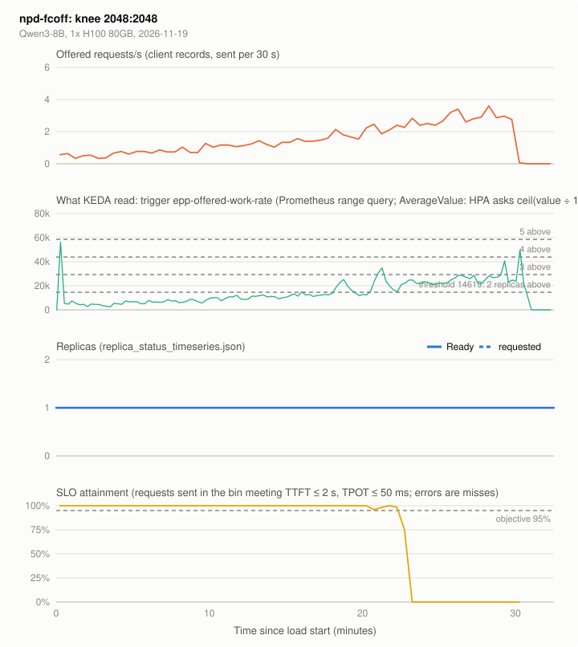

# Run 1b: knee 2048:2048

Part of the [npd-fcoff step 5 evaluation](../../npd-fcoff-step5.md).

| | |
|---|---|
| Namespace | `step5-npd-fcoff-20261119`, Kubernetes v1.32.9 (OpenShift) |
| Scenario / overlay | `staging/optimized-baseline/npd-fcoff.yaml` / `ocp/vllm-npd.yaml` (see the summary for the `--set` flags) |
| Model / GPU | Qwen/Qwen3-8B bf16 / 1 × NVIDIA H100 80GB HBM3 per replica |
| Images | as in the summary header |
| KEDA | Custom Metrics Autoscaler 2.19.0 |
| SLO | TTFT ≤ 2 s, TPOT ≤ 0.05 s; X = 0.95 |
| Profile / trace | [`profile.yaml`](profile.yaml), `knee-2048x2048.csv` (2,836 requests, seed 1); schedule in [`load.json`](load.json) (`gen_load.py knee --mix 2048:2048 --estimate 1.2`) |
| Arm | `pin 1`: autoscaling paused at 1 Ready replica |
| Session | `villardl-20261119-125454-138` |
| Start / end (UTC) | 2026-11-19 17:55:20 / 18:27:51 (inference-perf stage 0) |

Six 300 s stages of 2048:2048 at 0.48 to 3.0 req/s against one replica, with
autoscaling paused. Every request meets the SLO through 1.68 req/s. At
2.28 req/s, TTFT climbs into tens of seconds, and at 3.0 req/s requests time out
at the 157 s client timeout. The trigger follows the offered work rate in every
stage; it does not drive the pool in this run.

## Stages

Sources as in [run 1a](../knee-8192x256/report.md#stages): per-request records
via [`../stages.py`](../stages.py) ([`stages.json`](stages.json)), λ from the
trace (2048 tokens in and out per request), replicas from `triggers/`
(1 at every point).

| Stage | Scheduled req/s | Sent req/s | λ_in tok/s | λ_out tok/s | Sent | Errors | A | TTFT p50 / p90 / p99 (s) | TPOT p50 / p90 / p99 | Ready | Requested / Ready replica-s |
|---|---|---|---|---|---|---|---|---|---|---|---|
| 1 | 0.48 | 0.53 | 1,085 | 1,085 | 159 | 0 | 1.000 | 0.075 / 0.100 / 0.20 | 9 ms / 10 ms / 17 ms | 1 | 300 / 300 |
| 2 | 0.84 | 0.83 | 1,693 | 1,693 | 248 | 0 | 1.000 | 0.077 / 0.085 / 0.12 | 10 ms / 11 ms / 20 ms | 1 | 300 / 300 |
| 3 | 1.20 | 1.18 | 2,410 | 2,410 | 353 | 0 | 1.000 | 0.082 / 0.094 / 0.13 | 12 ms / 13 ms / 18 ms | 1 | 300 / 300 |
| 4 | 1.68 | 1.60 | 3,270 | 3,270 | 479 | 0 | 1.000 | 0.091 / 0.12 / 0.20 | 16 ms / 21 ms / 24 ms | 1 | 300 / 300 |
| 5 | 2.28 | 2.34 | 4,799 | 4,799 | 703 | 0 | 0.535 | 0.19 / 23.5 / 36.4 | 29 ms / 31 ms / 57 ms | 1 | 300 / 300 |
| 6 | 3.00 | 2.98 | 6,103 | 6,103 | 894 | 380 timeout | 0.000 | 65.8 / 98.5 / 113.6 | 29 ms / 33 ms / 43 ms | 1 | 300 / 300 |

## What the run shows

- **μ_SLO(2048:2048) = 1.74 req/s.** A crosses X = 0.95 between stage 4
  (1.68 req/s, A = 1.000) and stage 5 (2.28 req/s, A = 0.535). Linear
  interpolation gives 1.744 req/s. The crossing lies between stages 2 and 5,
  so the estimate of 1.2 req/s stands (§5.3). With A at 1.000 and then 0.535,
  the interpolation spans a wide step, and the true crossing can lie anywhere
  between 1.68 and 2.28 req/s.
- **TTFT binds, through queueing.** In stage 5, TPOT p90 is 31 ms, inside its
  limit, and TTFT p90 is 23.5 s. Prometheus over the same window
  (`vllm:num_requests_running`, `vllm:num_requests_waiting`,
  `vllm:kv_cache_usage_perc`, max per 300 s from the run start) reads 128
  running, up to 46 waiting and a KV cache at 1.0. Stage 4 reads 84 running,
  0 waiting, KV 0.65. `--max-num-seqs 128` and the KV cache are reached in the
  same stage; this run does not separate the two.
- **Work rate at the knee.** At μ_SLO, ν = 1.744 × (2048 + 3.3 × 2048) =
  15,363 work tok/s. Run 1a's ν_max (8192:256) is 15,836, 3 % higher.
- **The trigger tracks offered ν in every stage.** Median over each stage after
  its first 60 s, against `q × (2048 + 3.3 × 2048)`: 1.09, 0.93, 1.02, 0.89,
  1.10, 1.02. Requests keep completing in stage 6, so the ratio terms do not
  inflate as in run 1a.

Outcome: **as expected**. The knee crossing falls inside the stages, and
μ_SLO(2048:2048) = 1.74 req/s (n = 1).

## Tool notes

As in [run 1a](../knee-8192x256/report.md#tool-notes): the partial stage
report was restored from the harness's `stdout.log`, `metrics/processed/` was
extracted from `workspace.tar.zst`, and the figure shows requests/s only.

## Amendments

None.
