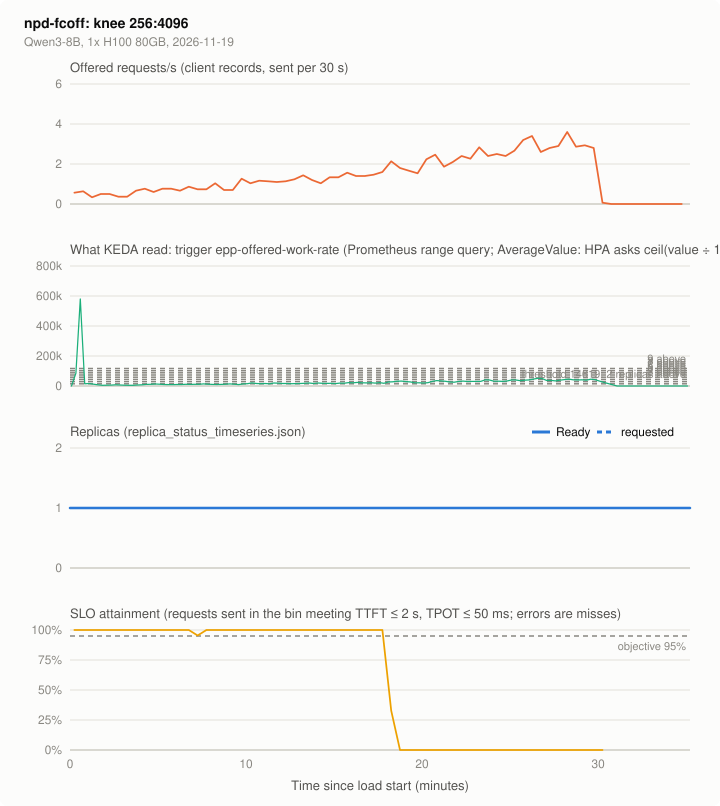

# Run 1c: knee 256:4096

Part of the [npd-fcoff step 5 evaluation](../../npd-fcoff-step5.md). This is
the second attempt; the first, at an estimate of 0.7 req/s, is listed under
the summary's discarded attempts.

| | |
|---|---|
| Namespace | `step5-npd-fcoff-20261119`, Kubernetes v1.32.9 (OpenShift) |
| Scenario / overlay | `staging/optimized-baseline/npd-fcoff.yaml` / `ocp/vllm-npd.yaml` (see the summary for the `--set` flags) |
| Model / GPU | Qwen/Qwen3-8B bf16 / 1 × NVIDIA H100 80GB HBM3 per replica |
| Images | as in the summary header |
| KEDA | Custom Metrics Autoscaler 2.19.0 |
| SLO | TTFT ≤ 2 s, TPOT ≤ 0.05 s; X = 0.95 |
| Profile / trace | [`profile.yaml`](profile.yaml), `knee-256x4096-r2.csv` (2,836 requests, seed 1); schedule in [`load.json`](load.json) (`gen_load.py knee --mix 256:4096 --estimate 1.2 --name knee-256x4096-r2`) |
| Arm | `pin 1`: autoscaling paused at 1 Ready replica |
| Session | `villardl-20261119-152140-005` |
| Start / end (UTC) | 2026-11-19 20:22:33 / 20:57:47 (inference-perf stage 0) |

Six 300 s stages of 256:4096 at 0.48 to 3.0 req/s against one replica, with
autoscaling paused. Attainment holds through 1.2 req/s and falls to 0.591 at
1.68 req/s. Above that, TTFT reaches minutes, and at 3.0 req/s requests time out
at the 311 s client timeout. The trigger follows the offered work rate in every
stage.

## Phases

Computed by [`../phases.py`](../phases.py) ([`phases.json`](phases.json)), as in
[run 1d](../knee-blend/report.md#phases).

| Phase | t (s) | Mix | Scheduled req/s | Sent req/s | λ_in tok/s | λ_out tok/s | Sent | Errors | A | TTFT p50 / p90 / p99 (s) | TPOT p50 / p90 / p99 | Ready | Requested / Ready replica-s |
|---|---|---|---|---|---|---|---|---|---|---|---|---|---|
| 1 | 0–300 | 256:4096 | 0.48 | 0.53 | 136 | 2,171 | 159 | 1 completed without latency | 0.994 | 0.032 / 0.043 / 0.093 | 9 ms / 10 ms / 13 ms | 1 | 300 / 300 |
| 2 | 300–600 | 256:4096 | 0.84 | 0.83 | 212 | 3,386 | 248 | 0 | 0.996 | 0.038 / 0.048 / 0.10 | 11 ms / 12 ms / 22 ms | 1 | 300 / 300 |
| 3 | 600–900 | 256:4096 | 1.20 | 1.18 | 301 | 4,820 | 353 | 0 | 1.000 | 0.050 / 0.060 / 0.11 | 16 ms / 17 ms / 27 ms | 1 | 300 / 300 |
| 4 | 900–1200 | 256:4096 | 1.68 | 1.60 | 409 | 6,540 | 479 | 1 completed without latency | 0.591 | 0.077 / 26.4 / 30.5 | 22 ms / 23 ms / 26 ms | 1 | 300 / 300 |
| 5 | 1200–1500 | 256:4096 | 2.28 | 2.34 | 600 | 9,598 | 703 | 0 | 0.000 | 116.7 / 198.9 / 213.1 | 22 ms / 23 ms / 26 ms | 1 | 300 / 300 |
| 6 | 1500–1800 | 256:4096 | 3.00 | 2.98 | 763 | 12,206 | 894 | 870 timeout | 0.000 | 217.2 / 220.6 / 221.1 | 22 ms / 22 ms / 23 ms | 1 | 300 / 300 |

## What the run shows

- **μ_SLO(256:4096) = 1.26 req/s.** A crosses X = 0.95 between stage 3
  (1.20 req/s, A = 1.000) and stage 4 (1.68 req/s, A = 0.591). Linear
  interpolation gives 1.259 req/s. The crossing lies between stages 2 and 5
  (§5.3). The discarded first attempt measured A = 1.000 at 1.33 req/s
  scheduled, 1.26 req/s sent (its stage 5), so the crossing lies between
  1.26 and 1.60 req/s sent. The interpolated value is at the low end of that
  range.
- **TTFT binds.** TPOT stays at 23 ms p90 or below in every stage. TTFT p90
  goes from 0.060 s at stage 3 to 26.4 s at stage 4.
- **The trigger tracks offered ν.** Median over each stage after its first
  60 s, against ν = λ_in + 3.3 × λ_out: 1.01, 0.98, 1.06, 1.02, 0.96, 1.01.
- **The mixes against the blend.** The harmonic mean of the three mixes' μ_SLO,
  3 / (1/1.752 + 1/1.744 + 1/1.259) = 1.55 req/s, is 3 % below the blend's
  measured 1.59 req/s (run 1d).

Outcome: **as expected**. The knee crossing falls inside the stages, and
μ_SLO(256:4096) = 1.26 req/s (n = 1).

## Tool notes

As in [run 1a](../knee-8192x256/report.md#tool-notes): the partial stage
report was restored from the harness's `stdout.log` and `metrics/processed/`
was extracted from `workspace.tar.zst`.

## Amendments

None.
