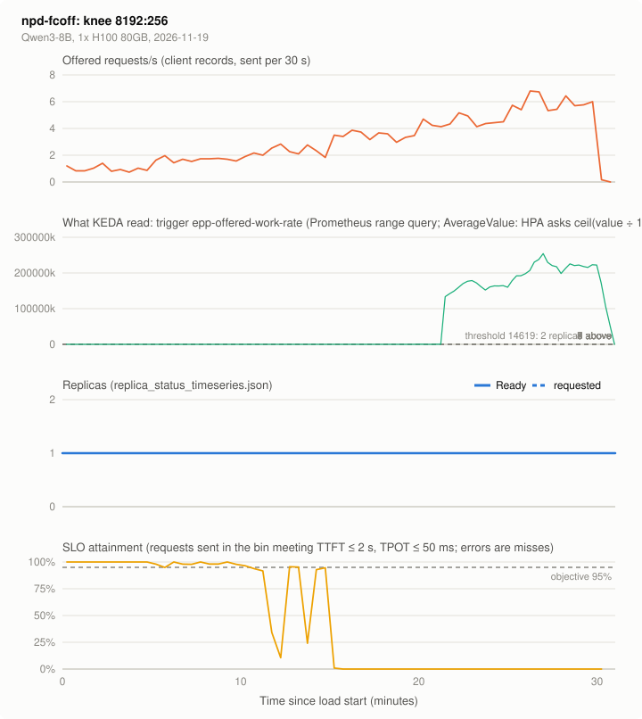

# Run 1a: knee 8192:256

Part of the [npd-fcoff step 5 evaluation](../../npd-fcoff-step5.md).

| | |
|---|---|
| Namespace | `step5-npd-fcoff-20261119`, Kubernetes v1.32.9 (OpenShift) |
| Scenario / overlay | `staging/optimized-baseline/npd-fcoff.yaml` / `ocp/vllm-npd.yaml` (see the summary for the `--set` flags) |
| Model / GPU | Qwen/Qwen3-8B bf16 / 1 × NVIDIA H100 80GB HBM3 per replica |
| Images | as in the summary header |
| KEDA | Custom Metrics Autoscaler 2.19.0 |
| SLO | TTFT ≤ 2 s, TPOT ≤ 0.05 s; X = 0.95 |
| Profile / trace | [`profile.yaml`](profile.yaml), `knee-8192x256.csv` (5,649 requests, seed 1); schedule in [`load.json`](load.json) (`gen_load.py knee --mix 8192:256 --estimate 2.4`) |
| Arm | `pin 1`: autoscaling paused at 1 Ready replica |
| Session | `villardl-20261119-121050-382` |
| Start / end (UTC) | 2026-11-19 17:11:20 / 17:42:21 (inference-perf stage 0) |

Six 300 s stages of 8192:256 at 0.96 to 6.0 req/s against one replica, with
autoscaling paused. Attainment holds through 1.68 req/s and collapses at
2.4 req/s. From 3.36 req/s, requests time out at the 60 s client timeout. The
trigger panel shows the work-rate query; it does not drive the pool in this
run. The offered-load panel shows requests/s only (see Tool notes).

## Stages

Offered req/s and the counts come from the per-request records
(`per_request_lifecycle_metrics.json`, binned by send time from the first
request; [`stages.json`](stages.json), computed by [`../stages.py`](../stages.py)).
λ_in and λ_out are the sent requests × 8192 and × 256 tokens, from the trace.
Replicas come from [`triggers/replicas-ready.json`](triggers/replicas-ready.json)
and `replicas-spec.json`: 1 at every point.

| Stage | Scheduled req/s | Sent req/s | λ_in tok/s | λ_out tok/s | Sent | Errors | A | TTFT p50 / p90 / p99 (s) | TPOT p50 / p90 / p99 | Ready | Requested / Ready replica-s |
|---|---|---|---|---|---|---|---|---|---|---|---|
| 1 | 0.96 | 0.97 | 7,946 | 248 | 291 | 0 | 1.000 | 0.30 / 0.63 / 1.19 | 11 ms / 18 ms / 38 ms | 1 | 300 / 300 |
| 2 | 1.68 | 1.68 | 13,735 | 429 | 503 | 1 completed without latency | 0.980 | 0.28 / 0.55 / 0.91 | 17 ms / 29 ms / 51 ms | 1 | 300 / 300 |
| 3 | 2.40 | 2.29 | 18,732 | 585 | 686 | 0 | 0.681 | 0.41 / 1.47 / 3.26 | 32 ms / 62 ms / 0.12 s | 1 | 300 / 300 |
| 4 | 3.36 | 3.47 | 28,399 | 887 | 1,040 | 320 timeout, 1 completed without latency | 0.001 | 25.5 / 43.3 / 44.2 | 63 ms / 0.10 s / 0.13 s | 1 | 300 / 300 |
| 5 | 4.56 | 4.50 | 36,837 | 1,151 | 1,349 | 1,349 timeout | 0.000 | – | – | 1 | 300 / 300 |
| 6 | 6.00 | 5.93 | 48,606 | 1,519 | 1,780 | 1,780 timeout | 0.000 | – | – | 1 | 300 / 300 |

TPOT is inference-perf's `time_per_output_token` per request. Errors are
counted from the per-request records: `TimeoutError` is the client's 60 s
timeout. "Completed without latency" is a request with no error and no
`computed_metrics`; it counts as a miss in A.

## What the run shows

- **μ_SLO(8192:256) = 1.75 req/s.** A crosses X = 0.95 between stage 2
  (1.68 req/s, A = 0.980) and stage 3 (2.40 req/s, A = 0.681). Linear
  interpolation gives 1.752 req/s. The crossing lies between stages 2 and 5, so
  the estimate of 2.4 req/s stands (§5.3).
- **TPOT binds first.** In stage 3, TTFT p90 is 1.47 s, inside its 2 s limit,
  and TPOT p90 is 62 ms, over its 50 ms limit.
- **Threshold.** At μ_SLO, ν = 1.752 × (8192 + 3.3 × 256) = 15,836 work tok/s,
  so `thresholdWork = 0.70 × ν_max = 11,086`. That is 24 % below the shipped
  14,619. It is applied before run 2 (see the summary).
- **The trigger tracks offered ν while requests complete.** Its median over
  each stage, after the first 60 s, against `q × (8192 + 3.3 × 256)` from the
  scheduled rate: 0.92 (stage 1), 1.02, 0.90, 1.07 (stage 4). In stages 5 and 6,
  where every request times out, it reads 161 × 10⁶ and 222 × 10⁶ work tok/s:
  3,914 and 4,085 × the offered ν. With no completions in the 1 m window,
  `clamp_min(rate(vllm:request_success_total), 0.001)` divides the ratio terms
  by 0.001. The step 1 verdict predicted this inflation (P8). Here it does not
  move the pool, because autoscaling is paused.

Outcome: **as expected**. The knee crossing falls inside the stages, and
μ_SLO(8192:256) = 1.75 req/s (n = 1).

## Tool notes

- The harness image (`llm-d-benchmark:v0.8.9`) deletes
  `inference-perf.partial.stage_0.yaml` after conversion. The load-vs-supply
  script needs that file to place the per-request records in UTC. Its content
  is printed verbatim in the harness's `stdout.log` (inside
  `workspace.tar.zst`), between `START_PARTIAL_BR_V0_2_STAGE_0` and
  `END_PARTIAL_BR_V0_2_STAGE_0`. It was restored from there into the results
  directory before drawing the figure.
- Timed-out records carry `input_tokens: 0`, and the profile does not keep the
  request body, so the script's offered-token panels read 0 for every
  timed-out request. The figure shows requests/s only; λ_in and λ_out above
  come from the trace.
- That image's benchmark report has no `observability.load_generator` block
  (schedule delay, placement in time), so the gate's generator checks use the
  per-request records: sent req/s per stage matches the schedule within 5 %
  (stage 3: 2.29 against 2.40).
- `metrics/processed/` (the replica series) is inside `workspace.tar.zst`, not
  next to it. It was extracted before drawing.

## Amendments

None.
