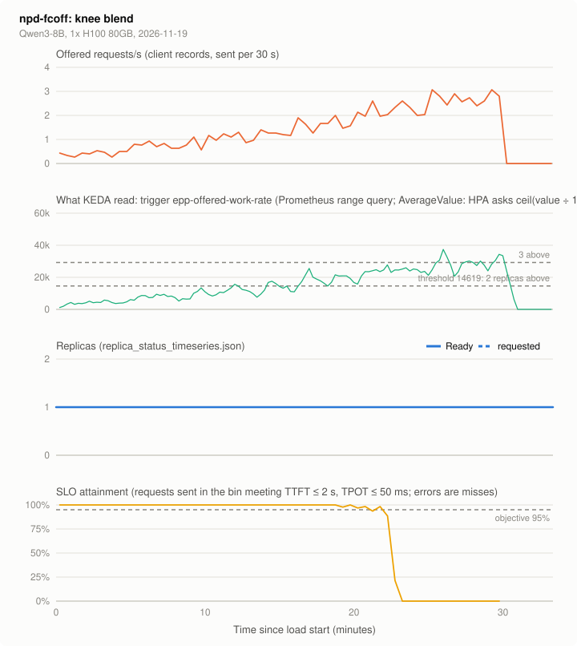

# Run 1d: knee blend

Part of the [npd-fcoff step 5 evaluation](../../npd-fcoff-step5.md).

| | |
|---|---|
| Namespace | `step5-npd-fcoff-20261119`, Kubernetes v1.32.9 (OpenShift) |
| Scenario / overlay | `staging/optimized-baseline/npd-fcoff.yaml` / `ocp/vllm-npd.yaml` (see the summary for the `--set` flags) |
| Model / GPU | Qwen/Qwen3-8B bf16 / 1 × NVIDIA H100 80GB HBM3 per replica |
| Images | as in the summary header |
| KEDA | Custom Metrics Autoscaler 2.19.0 |
| SLO | TTFT ≤ 2 s, TPOT ≤ 0.05 s; X = 0.95 |
| Profile / trace | [`profile.yaml`](profile.yaml), `knee-blend.csv` (2,649 requests, seed 1; each request's mix drawn from 8192:256, 2048:2048, 256:4096 with equal weight); schedule in [`load.json`](load.json) (`gen_load.py knee --mix blend --estimate 1.1`) |
| Arm | `pin 1`: autoscaling paused at 1 Ready replica |
| Session | `villardl-20261119-142739-473` |
| Start / end (UTC) | 2026-11-19 19:28:08 / 20:01:29 (inference-perf stage 0) |

Six 300 s stages of the blend at 0.44 to 2.75 req/s against one replica, with
autoscaling paused. Attainment holds at 0.997 or more through 1.54 req/s. At
2.09 req/s, TTFT p90 reaches 23.7 s, and at 2.75 req/s no request meets the
SLO. No request times out: the 311 s client timeout is longer than the
slowest one. The trigger follows the offered work rate in every stage.

## Phases

Computed by [`../phases.py`](../phases.py) ([`phases.json`](phases.json)):
per-request records matched one to one with the trace rows, so λ_in, λ_out and
each request's stage come from the trace. Replicas come from `triggers/`.

| Phase | t (s) | Mix | Scheduled req/s | Sent req/s | λ_in tok/s | λ_out tok/s | Sent | Errors | A | TTFT p50 / p90 / p99 (s) | TPOT p50 / p90 / p99 | Ready | Requested / Ready replica-s |
|---|---|---|---|---|---|---|---|---|---|---|---|---|---|
| 1 | 0–300 | blend | 0.44 | 0.41 | 1,412 | 880 | 124 | 0 | 1.000 | 0.076 / 0.29 / 0.53 | 8 ms / 9 ms / 19 ms | 1 | 300 / 300 |
| 2 | 300–600 | blend | 0.77 | 0.77 | 2,463 | 1,765 | 232 | 0 | 1.000 | 0.079 / 0.28 / 0.33 | 10 ms / 12 ms / 21 ms | 1 | 300 / 300 |
| 3 | 600–900 | blend | 1.10 | 1.16 | 4,034 | 2,488 | 347 | 1 completed without latency | 0.997 | 0.087 / 0.30 / 0.46 | 13 ms / 15 ms / 27 ms | 1 | 300 / 300 |
| 4 | 900–1200 | blend | 1.54 | 1.56 | 5,239 | 3,459 | 467 | 0 | 0.998 | 0.11 / 0.33 / 0.52 | 20 ms / 25 ms / 43 ms | 1 | 300 / 300 |
| 5 | 1200–1500 | blend | 2.09 | 2.20 | 7,735 | 4,703 | 660 | 0 | 0.482 | 1.82 / 23.7 / 28.3 | 30 ms / 33 ms / 62 ms | 1 | 300 / 300 |
| 6 | 1500–1800 | blend | 2.75 | 2.73 | 9,577 | 5,725 | 819 | 0 | 0.000 | 84.7 / 130.3 / 142.6 | 31 ms / 34 ms / 65 ms | 1 | 300 / 300 |

"Completed without latency" is a request with no error and no
`computed_metrics`; it counts as a miss in A. The schedule delay (sent offset
minus trace offset) stays between −0.04 s and +0.17 s in every stage: the
generator kept up.

## What the run shows

- **μ_SLO(B) = 1.59 req/s.** A crosses X = 0.95 between stage 4 (1.54 req/s,
  A = 0.998) and stage 5 (2.09 req/s, A = 0.482). Linear interpolation gives
  1.591 req/s. The crossing lies between stages 2 and 5, so the estimate of
  1.1 req/s stands (§5.3).
- **C = 6 × 1.591 = 9.55 req/s** of the blend, the pool's capacity at its cap.
- **TTFT binds.** In stage 5, TPOT p90 is 33 ms and TTFT p90 is 23.7 s.
- **The trigger tracks offered ν.** Median over each stage after its first
  60 s, against ν = λ_in + 3.3 × λ_out from the trace: 0.98, 0.99, 1.00, 1.15,
  1.06, 1.02. The 1.15 at stage 4 is unexplained.

Outcome: **as expected**. The knee crossing falls inside the stages, and
μ_SLO(B) = 1.59 req/s (n = 1).

## Collection

The load ran to the end, and the harness pod completed. The workstation's API
calls then returned `Bad Gateway` from 20:02 UTC, so `llmdbenchmark` could not
collect the results and exited 1. The results directory was copied from the
workload PVC afterwards, complete and unchanged, including
`inference-perf.partial.stage_0.yaml` and `metrics/processed/`. The trigger
series were exported over 19:27:38–20:02:29 UTC. The serving pods ran
throughout (no restart, no event). The fault was outside the plant, so the run
is kept.

## Amendments

None.
