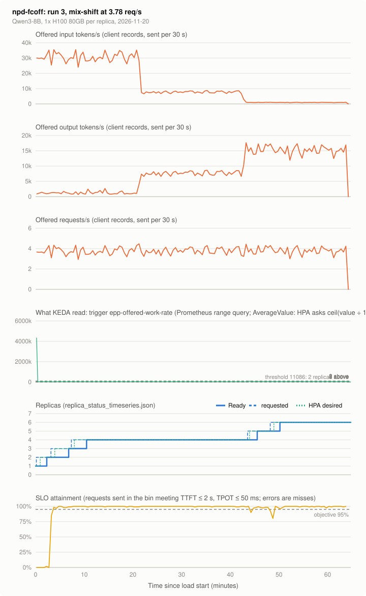

# Run 3: mix-shift at constant rate

Part of the [npd-fcoff step 5 evaluation](../../npd-fcoff-step5.md).

| | |
|---|---|
| Namespace | `step5-npd-fcoff-20261119`, Kubernetes v1.32.9 (OpenShift) |
| Scenario / overlay | `staging/optimized-baseline/npd-fcoff.yaml` / `ocp/vllm-npd.yaml` (see the summary for the `--set` flags) |
| Model / GPU | Qwen/Qwen3-8B bf16 / 1 × NVIDIA H100 80GB HBM3 per replica |
| Images | as in the summary header |
| KEDA | Custom Metrics Autoscaler 2.19.0 |
| ScaledObject | as rendered, with `thresholdWork` 11,086 ([`scaledobject.json`](scaledobject.json)) |
| SLO | TTFT ≤ 2 s, TPOT ≤ 0.05 s; X = 0.95 |
| Profile / trace | [`profile.yaml`](profile.yaml) (the summary's profile changes apply), `mixshift.csv` (14,519 requests); `mixshift` in [`../index.json`](../index.json), copied to [`load.json`](load.json) |
| Arm | `active`: paused at 1 Ready replica, 90 s, then resumed |
| Session | `villardl-20261119-211915-798` |
| Start / end (UTC) | 2026-11-20 02:20:02 / 03:24:47 (inference-perf stage 0) |

One request rate, q = 0.5 × 6 × 1.259 = 3.78 req/s, held through three 1,280 s
phases: 8192:256, then 2048:2048, then 256:4096. Offered input tokens fall
and output tokens rise at each shift while the request rate stays flat. The
pool ramps from 1 to 4 replicas in phase 1, holds 4 in phase 2, and grows to 6
in phase 3.

## Phases

Computed by [`../phases.py`](../phases.py) ([`phases.json`](phases.json)),
columns as in [run 2](../stair/report.md#phases). Need is
`ceil(q / μ_SLO(m))` with the phase's own mix.

| Phase | t (s) | Mix | Scheduled req/s | Sent req/s | λ_in tok/s | λ_out tok/s | Sent | Errors | A | TTFT p50 / p90 / p99 (s) | TPOT p50 / p90 / p99 | Need | Ready min–max | Ready at end (settled at, s) | HPA desired min–max | A after settling (n) | Requested / Ready replica-s |
|---|---|---|---|---|---|---|---|---|---|---|---|---|---|---|---|---|---|
| 1 | 0–1280 | 8192:256 | 3.78 | 3.76 | 30,813 | 966 | 4,816 | 4 completed without latency | 0.852 | 0.33 / 5.70 / 30.6 | 11 ms / 61 ms / 0.12 s | 3 | 1–4 | 4 (656) | 1–4 | 0.998 (2,369) | 4,352 / 3,872 |
| 2 | 1280–2560 | 2048:2048 | 3.78 | 3.78 | 7,730 | 7,754 | 4,838 | 2 completed without latency | 0.999 | 0.079 / 0.13 / 0.23 | 10 ms / 11 ms / 20 ms | 3 | 4 | 4 (6) | 4–4 | 0.999 (4,806) | 5,120 / 5,120 |
| 3 | 2560–3840 | 256:4096 | 3.78 | 3.80 | 973 | 15,568 | 4,865 | 4 completed without latency, 1 `ClientConnectorError` | 0.983 | 0.27 / 0.91 / 2.29 | 11 ms / 13 ms / 17 ms | 4 | 4–6 | 6 (496) | 4–6 | 0.997 (2,952) | 7,228 / 6,988 |

Whole run: 14,519 sent, A 0.945, requested 16,699 and Ready 15,979
replica-seconds (16,699 GPU-seconds). Peak Ready: 6, which arms run 6.

## What the run shows

- **The trigger follows the work, not the request rate.** Its median over each
  phase after the first 60 s, against ν = λ_in + 3.3 × λ_out: 0.98, 0.99, 1.01.
  ν is 34,001, 33,316 and 52,347 work tok/s at the same 3.78 req/s.
- **Settled replicas against the stated headroom.** The configuration targets
  0.70 × ν_max(8192:256), so the need with that headroom is
  `ceil(q / (0.70 × μ_SLO(m)))`: 4, 4 and 5. Settled Ready was 4, 4 and 6.
  Phase 3 settled one replica above it. The HPA asked for 5 at 76 s into
  phase 3 and for 6 at 376 s; `ceil(median trigger / 11,086)` is 5, with
  the median at 53,026, 96 % of 5 × 11,086. The 300 s scale-down window then
  held 6 to the end of the phase.
- **Attainment once settled.** A after settling: 0.998, 0.999, 0.997. Phase 1's
  whole-phase A is 0.852: the ramp from 1 to 4 replicas took 656 s (+1 per
  180 s, and 120 to 180 s from requested to Ready per step, read from `replicas-spec.json` and `replicas-ready.json`), and the requests sent
  before it missed.
- **A spike at the start.** At 11 s, one 15 s sample read 4,332,445 work tok/s,
  127 × the next sample (33,515). It follows the 90 s pause of the arm, with no
  completions in the 1 m window: the ratio inflation step 1 predicted (P8).
  The HPA went from 1 to 2 at 56 s. The real load also asked for 4 then, so
  the spike's own effect cannot be separated in this run.

Outcome: **problem shown**, by the protocol's rule: in phase 3, settled
replicas (6) exceed the headroom need (5) by one replica (n = 1). A held at or
above 0.997 once settled in every phase.

## Tool notes

As in [run 2](../stair/report.md#tool-notes).

## Amendments

None.
