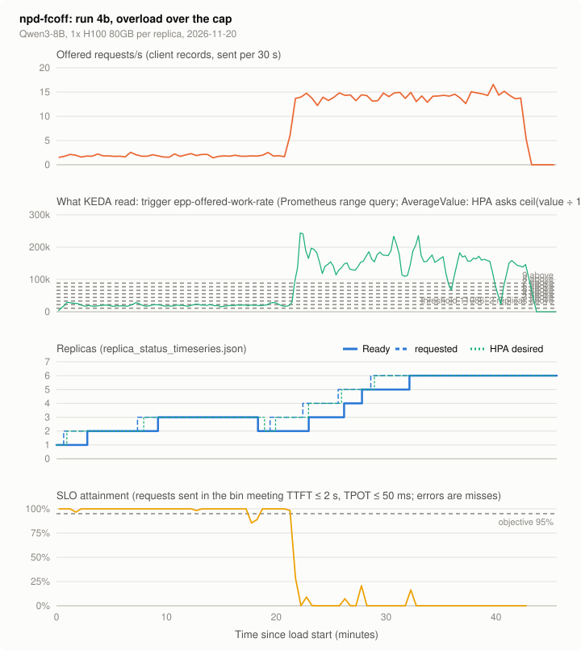

# Run 4b: overload over the cap

Part of the [npd-fcoff step 5 evaluation](../../npd-fcoff-step5.md). Second
attempt; the first is listed under the summary's discarded attempts.

| | |
|---|---|
| Namespace | `step5-npd-fcoff-20261119`, Kubernetes v1.32.9 (OpenShift) |
| Scenario / overlay | `staging/optimized-baseline/npd-fcoff.yaml` / `ocp/vllm-npd.yaml` (see the summary for the `--set` flags), plus `--set harness.resources.cpu=8 --set harness.resources.memory=32Gi` for the client |
| Model / GPU | Qwen/Qwen3-8B bf16 / 1 × NVIDIA H100 80GB HBM3 per replica |
| Images | as in the summary header |
| KEDA | Custom Metrics Autoscaler 2.19.0 |
| ScaledObject | as rendered, with `thresholdWork` 11,086 ([`scaledobject.json`](scaledobject.json), captured after the run) |
| SLO | TTFT ≤ 2 s, TPOT ≤ 0.05 s; X = 0.95 |
| Profile / trace | [`profile.yaml`](profile.yaml) (the summary's profile changes apply), `overload-over.csv` (20,506 requests); `overload-over` in [`../index.json`](../index.json), copied to [`load.json`](load.json) |
| Arm | `active`: paused at 1 Ready replica, 90 s, then resumed |
| Session | `villardl-20261120-011003-022` |
| Start / end (UTC) | 2026-11-20 06:11:05 / 06:56:37 (inference-perf stage 0) |

The blend at 1.2 × μ_SLO(B) = 1.91 req/s for 1,280 s, then at 1.5 × C =
14.3 req/s for 1,280 s. The pool reaches 3 replicas in phase 1, drops to 2,
and reaches the cap of 6 in phase 2. In phase 2 almost no request meets the
SLO, and the router pod's containers are killed and restart.

## Phases

Computed by [`../phases.py`](../phases.py) ([`phases.json`](phases.json)),
columns as in [run 2](../stair/report.md#phases).

| Phase | t (s) | Scheduled req/s | Sent req/s | λ_in tok/s | λ_out tok/s | Sent | Errors | A | TTFT p50 / p90 / p99 (s) | TPOT p50 / p90 / p99 | Need | Ready min–max | Ready at end (settled at, s) | HPA desired min–max | A after settling (n) | Requested / Ready replica-s |
|---|---|---|---|---|---|---|---|---|---|---|---|---|---|---|---|---|
| 1 | 0–1280 | 1.91 | 1.89 | 6,781 | 3,965 | 2,424 | 14 `ClientPayloadError`, 2 completed without latency | 0.993 | 0.083 / 0.31 / 0.51 | 10 ms / 19 ms / 30 ms | 2 | 1–3 | 2 (1,135) | 1–3 | 1.000 (297) | 3,249 / 2,925 |
| 2 | 1280–2560 | 14.32 | 14.13 | 49,228 | 30,241 | 18,082 | 2,372 timeout, 2,023 `ClientPayloadError`, 1,632 HTTP 400, 435 `ClientConnectorError`, 6 HTTP 503, 9 completed without latency | 0.026 | 167.8 / 223.9 / 275.8 | 31 ms / 43 ms / 81 ms | 9 | 2–6 | 6 (695) | 3–6 | 0.000 (8,349) | 6,854 / 6,099 |

Whole run: 20,506 sent, A 0.141, requested 10,104 and Ready 9,024
replica-seconds (10,104 GPU-seconds). The schedule delay stays under 0.23 s
in both phases: the generator kept up.

## What the run shows

- **The trigger holds at the cap.** Its median over phase 2 after the first
  60 s is 155,911 work tok/s, 1.05 × the offered ν (149,024); no sample reads
  0 and none exceeds 10⁶. `ceil(ν / 11,086)` is 14. The HPA reached 6 at
  06:40:02 UTC and 6 replicas were Ready from 06:44:02 until the load ended.
  Replicas did not stop below `maxReplicaCount`.
- **The router fails under the load.** Phase 2 runs from 06:32:26 UTC. The
  router pod's `epp` container is OOMKilled at its 1 Gi limit four times
  (restarts at 06:38, 06:43, 06:47 and 06:52 UTC, from
  `kube_pod_container_status_restarts_total`; last termination reason
  `OOMKilled`), and `envoy-proxy` exits with code 137 at 06:54:54. The
  1,632 HTTP 400 come from vLLM rejecting truncated request bodies
  (`JSON decode error … Unterminated string`), sent from 1,560 s into the run
  on. All 2,023 phase-2 `ClientPayloadError` were sent 2,280–2,640 s
  into the run, around Envoy's exit. The run did not measure why the bodies
  arrived truncated.
- **A scale-down and scale-up 60 s apart in phase 1, again.** The HPA went from
  3 to 2 at 06:30:02 and back to 3 at 06:31:02 UTC; Ready went from 3 to 2 at
  06:30:02. The 14 `ClientPayloadError` were sent 960–1,200 s into the run,
  the streams of the removed pod. Run 4a showed the same at the same rate.

Gate (§5.6): an OOM kill of a serving pod fails the gate when it is a fault
outside the configuration. Here the killed containers are the scenario's own
router, at the resource limits the scenario sets, under the load the run
applies, and the first attempt showed the same kills. The run is kept and
reported; the fault is the finding.

Outcome: **problem shown**. At 1.5 × C the trigger and the HPA held the cap,
but the router's EPP was OOMKilled four times and its Envoy once, and A in
phase 2 was 0.026 (n = 1). The failures are those of the router at the
scenario's limits (`router.epp.resources.limits.memory: 1Gi`,
`router.proxy.resources.limits.cpu: 500m`), not of the autoscaler.

## Tool notes

- `llmdbenchmark` exited 1: its run re-applied the workload PVC at 3 Gi, which
  Kubernetes rejects now that the PVC is 30 Gi, and it then found no data-access
  pod to collect with. The results directory was copied from the PVC, complete,
  including `inference-perf.partial.stage_0.yaml` and `metrics/processed/`.
  The trigger series were exported over 06:10:02–06:57:37 UTC.
- Otherwise as in [run 2](../stair/report.md#tool-notes).

## Amendments

None.
