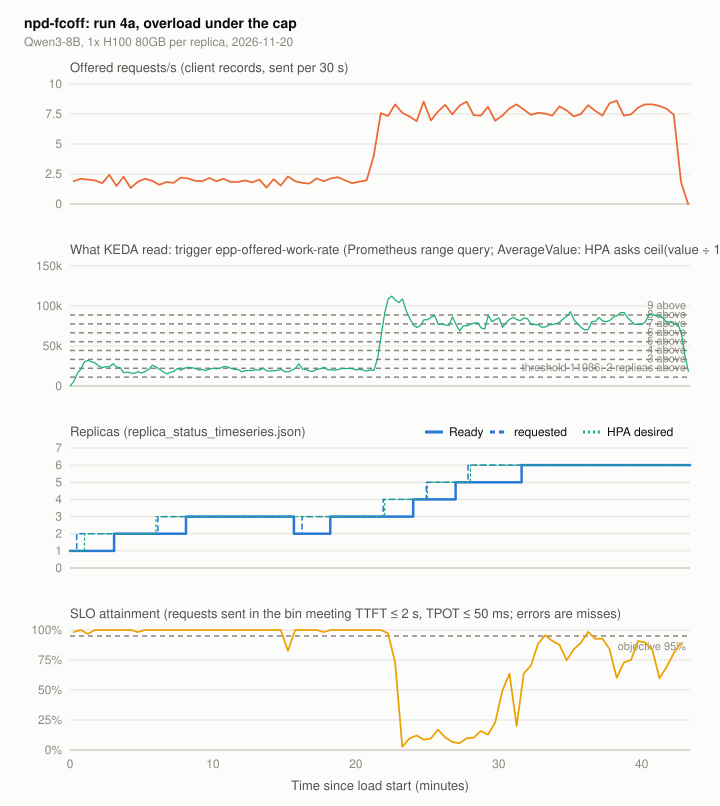

# Run 4a: overload under the cap

Part of the [npd-fcoff step 5 evaluation](../../npd-fcoff-step5.md).

| | |
|---|---|
| Namespace | `step5-npd-fcoff-20261119`, Kubernetes v1.32.9 (OpenShift) |
| Scenario / overlay | `staging/optimized-baseline/npd-fcoff.yaml` / `ocp/vllm-npd.yaml` (see the summary for the `--set` flags) |
| Model / GPU | Qwen/Qwen3-8B bf16 / 1 × NVIDIA H100 80GB HBM3 per replica |
| Images | as in the summary header |
| KEDA | Custom Metrics Autoscaler 2.19.0 |
| ScaledObject | as rendered, with `thresholdWork` 11,086 ([`scaledobject.json`](scaledobject.json)) |
| SLO | TTFT ≤ 2 s, TPOT ≤ 0.05 s; X = 0.95 |
| Profile / trace | [`profile.yaml`](profile.yaml) (the summary's profile changes apply), `overload-under.csv` (12,377 requests); `overload-under` in [`../index.json`](../index.json), copied to [`load.json`](load.json) |
| Arm | `active`: paused at 1 Ready replica, 90 s, then resumed |
| Session | `villardl-20261119-225315-014` |
| Start / end (UTC) | 2026-11-20 03:53:57 / 04:37:20 (inference-perf stage 0) |

The blend at 1.2 × μ_SLO(B) = 1.91 req/s for 1,280 s, then at 0.8 × C =
7.64 req/s for 1,280 s. The pool reaches 3 replicas in phase 1 and the cap of 6
in phase 2. Attainment holds in phase 1 and falls to 0.824 in phase 2 once the
pool is at 6.

## Phases

Computed by [`../phases.py`](../phases.py) ([`phases.json`](phases.json)),
columns as in [run 2](../stair/report.md#phases).

| Phase | t (s) | Scheduled req/s | Sent req/s | λ_in tok/s | λ_out tok/s | Sent | Errors | A | TTFT p50 / p90 / p99 (s) | TPOT p50 / p90 / p99 | Need | Ready min–max | Ready at end (settled at, s) | HPA desired min–max | A after settling (n) | Requested / Ready replica-s |
|---|---|---|---|---|---|---|---|---|---|---|---|---|---|---|---|---|
| 1 | 0–1280 | 1.91 | 1.93 | 6,656 | 4,212 | 2,470 | 12 `ClientPayloadError`, 1 completed without latency | 0.993 | 0.085 / 0.32 / 0.59 | 10 ms / 20 ms / 27 ms | 2 | 1–3 | 3 (1,140) | 1–3 | 0.996 (273) | 3,420 / 3,000 |
| 2 | 1280–2560 | 7.64 | 7.74 | 26,817 | 16,617 | 9,907 | 108 `ClientConnectorError`, 11 HTTP 503, 3 completed without latency | 0.566 | 1.53 / 12.5 / 28.8 | 17 ms / 31 ms / 56 ms | 5 | 3–6 | 6 (640) | 3–6 | 0.824 (4,966) | 7,020 / 6,540 |

Whole run: 12,377 sent, A 0.651, requested 10,440 and Ready 9,540
replica-seconds (10,440 GPU-seconds).

## What the run shows

- **The trigger tracks offered ν.** Median over each phase after its first
  60 s, against ν = λ_in + 3.3 × λ_out: 1.01 (20,723 against 20,556) and 0.99
  (80,492 against 81,655). `ceil(ν / 11,086)` is 2 and 8; phase 2 asks past
  the cap of 6.
- **A scale-down and scale-up 30 s apart in phase 1.** The trigger ran between
  17,782 and 27,721 from 04:02 to 04:11 UTC, around 2 × 11,086 = 22,172. At
  04:09:26 UTC the ReplicaSet deleted one of the 3 pods (a scale to 2, after
  the 300 s window). At 04:09:56 the HPA asked for 3 again ("New size: 3",
  second count) and a new pod started, Ready at 04:12:44 after a cold start.
  The 12 `ClientPayloadError` are the streams that pod was serving: all were
  sent 903–918 s into the run and cut at 958 s. kube-state-metrics, sampled
  every 15 s, does not show the 30 s at 2 replicas; the events do.
- **Phase 2 fails at the cap, at the router.** After Ready stopped rising (6
  replicas, from 640 s into the phase), A = 0.824 against X = 0.95. Over
  phase 2, the router's `envoy-proxy` is throttled in 100 % of CFS periods
  (median of 15 s samples) at its 0.50-core limit. The errors are 108
  `ClientConnectorError` (93 sent 1,320–1,680 s into the run, 4 at 1,860–1,920 s, 11 at
  2,460–2,520 s) and 11 HTTP 503. The router pod's readiness probe
  (`/ready` on Envoy's admin port) timed out during the phase, last at
  04:33:15 UTC; that event counts 272 failures since 2026-11-19 21:57 UTC,
  across run 2's attempts and this run.
  vLLM reached 128 running and 27 waiting on some pod during the phase (max of
  15 s samples), while the pool was still growing; the run does not separate
  the two limits after settling.

Outcome: **problem shown**. A = 0.824 after Ready stopped rising, against
X = 0.95 (n = 1), with the router's Envoy CPU-throttled. In phase 1, a scale-down
and immediate scale-up failed 12 requests.

## Tool notes

As in [run 2](../stair/report.md#tool-notes).

## Amendments

None.
