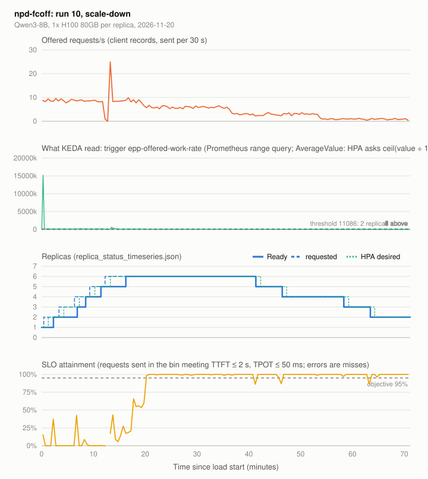

# Run 10: scale-down

Part of the [npd-fcoff step 5 evaluation](../../npd-fcoff-step5.md). Second
attempt; the first is listed under the summary's discarded attempts.

| | |
|---|---|
| Namespace | `step5-npd-fcoff-20261119`, Kubernetes v1.32.9 (OpenShift) |
| Scenario / overlay | `staging/optimized-baseline/npd-fcoff.yaml` / `ocp/vllm-npd.yaml` (see the summary for the `--set` flags), plus `--set harness.resources.cpu=8 --set harness.resources.memory=32Gi` for the client |
| Model / GPU | Qwen/Qwen3-8B bf16 / 1 × NVIDIA H100 80GB HBM3 per replica |
| Images | as in the summary header |
| KEDA | Custom Metrics Autoscaler 2.19.0, Thanos token renewed at 17:17 UTC (see the summary) |
| ScaledObject | as rendered, with `thresholdWork` 11,086 ([`scaledobject.json`](scaledobject.json)) |
| SLO | TTFT ≤ 2 s, TPOT ≤ 0.05 s; X = 0.95 |
| Profile / trace | [`profile.yaml`](profile.yaml) (the summary's profile changes apply), `scale-down.csv` (20,036 requests); `scale-down` in [`../index.json`](../index.json), copied to [`load.json`](load.json) |
| Arm | `active`: paused at 1 Ready replica, 90 s, then resumed |
| Session | `villardl-20261120-122028-910` |
| Start / end (UTC) | 2026-11-20 17:21:26 / 18:32:34 (inference-perf stage 0) |

The blend at 0.9 × C (8.59 req/s) for H = 1,178 s, then steps of D = 1,020 s
at 0.6, 0.3 and 0.1 × C. The pool takes 1,036 s to grow from 1 to 6 and holds
6 through the 0.6 × C step. It then sheds one replica per 300 s and ends each
later step above its need. Each removal cut in-flight streams.

## Phases

Computed by [`../phases.py`](../phases.py) ([`phases.json`](phases.json)),
columns as in [run 2](../stair/report.md#phases).

| Phase | t (s) | Scheduled req/s | Sent req/s | λ_in tok/s | λ_out tok/s | Sent | Errors | A | TTFT p50 / p90 / p99 (s) | TPOT p50 / p90 / p99 | Need | Ready min–max | Ready at end (settled at, s) | HPA desired min–max | A after settling (n) | Requested / Ready replica-s |
|---|---|---|---|---|---|---|---|---|---|---|---|---|---|---|---|---|
| 1 hold | 0–1178 | 8.59 | 8.63 | 29,512 | 18,736 | 10,168 | 1,528 timeout, 1,410 `ClientPayloadError`, 608 `ClientConnectorError`, 102 `ServerDisconnectedError`, 41 `ClientOSError`, 6 HTTP 503, 2 completed without latency | 0.141 | 7.30 / 211.4 / 290.1 | 28 ms / 49 ms / 92 ms | 6 | 1–6 | 6 (1,036) | 1–6 | 0.557 (1,198) | 4,888 / 4,108 |
| 2 step | 1178–2198 | 5.73 | 5.84 | 20,523 | 12,399 | 5,957 | 4 completed without latency | 0.990 | 0.32 / 0.72 / 1.81 | 11 ms / 13 ms / 24 ms | 4 | 6 | 6 | 6–6 | 0.992 (5,913) | 6,120 / 6,120 |
| 3 step | 2198–3218 | 2.86 | 2.93 | 10,335 | 6,190 | 2,985 | 21 `ClientPayloadError`, 1 completed without latency | 0.993 | 0.079 / 0.29 / 0.50 | 9 ms / 10 ms / 20 ms | 2 | 4–6 | 4 (638) | 4–6 | 0.999 (1,170) | 5,056 / 5,056 |
| 4 step | 3218–4238 | 0.95 | 0.91 | 3,031 | 2,013 | 926 | 4 `ClientPayloadError` | 0.996 | 0.073 / 0.28 / 0.31 | 8 ms / 9 ms / 17 ms | 1 | 2–4 | 2 (638) | 2–4 | 1.000 (352) | 3,016 / 3,016 |

Whole run: 20,036 sent, A 0.560, requested 19,080 and Ready 18,300
replica-seconds (19,080 GPU-seconds).

## Per step down

From [`scale_events.json`](scale_events.json) ([`../scale_events.py`](../scale_events.py))
and the per-request records. Replica-seconds above the need are the step's
requested replica-seconds minus need × 1,020 s.

| Step | Need | `ceil(ν / 11,086)` | Scale-downs (s into the run) | Ready at the end | Time to reach the need | Replica-s above the need | A | Streams cut |
|---|---|---|---|---|---|---|---|---|
| 0.6 × C | 4 | 6 | none | 6 | not reached | 2,040 | 0.990 | 0 |
| 0.3 × C | 2 | 3 | 2,536, 2,836 | 4 | not reached | 3,016 | 0.993 | 9 (ending at 2,506 s) and 12 (at 2,807 s) |
| 0.1 × C | 1 | 1 | 3,556, 3,856 | 2 | not reached | 1,996 | 0.996 | 1 (at 3,528 s) and 3 (at 3,829 s) |

## What the run shows

- **The release is slower than the steps.** After the 300 s scale-down
  window, the policy removes one pod per 300 s. The first removal came 338 s
  into the 0.3 × C step, 1,358 s after the load first fell. No step ended at
  its need. At 0.6 × C, `ceil(ν / 11,086)` is 6: the configuration's own
  headroom asks for 6 where the knee-based need is 4.
- **Every scale-down cut streams.** The four removals cut 9, 12, 1 and 3
  in-flight streams (`ClientPayloadError`), each group ending at one instant,
  13 to 30 s before the 15 s sample that shows the lower count.
- **A after each step down held.** 0.990, 0.993 and 0.996.
- **The hold at 0.9 × C failed.** The ramp from 1 to 6 took 1,036 s (+1 per
  180 s, 120 to 240 s from requested to Ready). The router's `envoy-proxy`
  exited with code 137 at 17:33:27 UTC, 720 s into the run, and 1,109
  `ClientPayloadError` ended between 720 and 780 s. A after settling was 0.557.
- **The trigger tracks offered ν in the steps.** Median over each phase after
  its first 60 s: 1.12 (hold), 1.00, 1.02, 1.05.

Outcome: **problem shown**. Replicas had not reached the new need at the end
of any step, and 25 requests failed at the four scale-downs (n = 1). A held
at 0.990 or more after each step down.

## Tool notes

As in [run 2](../stair/report.md#tool-notes).

## Amendments

None.
