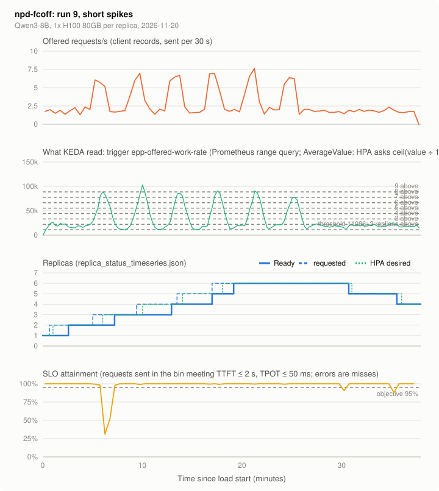

# Run 9: short spikes

Part of the [npd-fcoff step 5 evaluation](../../npd-fcoff-step5.md).

| | |
|---|---|
| Namespace | `step5-npd-fcoff-20261119`, Kubernetes v1.32.9 (OpenShift) |
| Scenario / overlay | `staging/optimized-baseline/npd-fcoff.yaml` / `ocp/vllm-npd.yaml` (see the summary for the `--set` flags), plus `--set harness.resources.cpu=8 --set harness.resources.memory=32Gi` for the client |
| Model / GPU | Qwen/Qwen3-8B bf16 / 1 × NVIDIA H100 80GB HBM3 per replica |
| Images | as in the summary header |
| KEDA | Custom Metrics Autoscaler 2.19.0 |
| ScaledObject | as rendered, with `thresholdWork` 11,086 ([`scaledobject.json`](scaledobject.json)) |
| SLO | TTFT ≤ 2 s, TPOT ≤ 0.05 s; X = 0.95 |
| Profile / trace | [`profile.yaml`](profile.yaml) (the summary's profile changes apply), `short-spikes.csv` (6,425 requests); `short-spikes` in [`../index.json`](../index.json), copied to [`load.json`](load.json) |
| Arm | `active`: paused at 1 Ready replica, 90 s, then resumed |
| Session | `villardl-20261120-101218-610` |
| Start / end (UTC) | 2026-11-20 15:13:01 / 15:50:57 (inference-perf stage 0) |

The blend at 0.2 × C (1.91 req/s) for 300 s, then six spikes at 0.7 × C
(6.68 req/s) of R/2 = 79 s, separated by gaps of G = 150 s at 0.2 × C, then
720 s at 0.2 × C. The pool adds one replica per spike or gap and reaches the
cap of 6 in the fourth gap. It holds 6 until 337 s after the last spike, then
sheds one replica per 300 s.

## Phases

Computed by [`../phases.py`](../phases.py) ([`phases.json`](phases.json)),
columns as in [run 2](../stair/report.md#phases). Even phases 2 to 12 are the
spikes; odd phases 3 to 11 are the gaps.

| Phase | t (s) | Scheduled req/s | Sent req/s | λ_in tok/s | λ_out tok/s | Sent | Errors | A | TTFT p50 / p90 / p99 (s) | TPOT p50 / p90 / p99 | Need | Ready min–max | Ready at end | HPA desired min–max | Requested / Ready replica-s |
|---|---|---|---|---|---|---|---|---|---|---|---|---|---|---|---|
| 1 | 0–300 | 1.91 | 1.84 | 6,629 | 3,878 | 553 | 0 | 1.000 | 0.11 / 0.34 / 0.56 | 14 ms / 22 ms / 39 ms | 2 | 1–2 | 2 | 1–2 | 539 / 419 |
| 2 spike | 300–379 | 6.68 | 6.19 | 21,941 | 12,813 | 489 | 0 | 0.810 | 0.32 / 9.66 / 15.7 | 27 ms / 31 ms / 60 ms | 5 | 2 | 2 | 2–3 | 176 / 158 |
| 3 gap | 379–529 | 1.91 | 1.87 | 6,654 | 4,004 | 280 | 0 | 0.843 | 0.28 / 7.97 / 17.5 | 11 ms / 24 ms / 50 ms | 2 | 2–3 | 3 | 3–3 | 450 / 348 |
| 4 spike | 529–608 | 6.68 | 6.42 | 21,530 | 14,018 | 507 | 0 | 0.996 | 0.28 / 0.61 / 1.56 | 19 ms / 22 ms / 46 ms | 5 | 3 | 3 | 3–4 | 244 / 237 |
| 5 gap | 608–758 | 1.91 | 1.91 | 6,704 | 4,082 | 287 | 0 | 1.000 | 0.23 / 0.54 / 1.36 | 12 ms / 17 ms / 35 ms | 2 | 3 | 3 | 4–4 | 600 / 450 |
| 6 spike | 758–837 | 6.68 | 6.91 | 25,581 | 13,873 | 546 | 1 completed without latency | 0.998 | 0.29 / 0.61 / 1.01 | 15 ms / 18 ms / 34 ms | 5 | 3–4 | 4 | 4–4 | 316 / 293 |
| 7 gap | 837–987 | 1.91 | 1.81 | 6,439 | 3,702 | 272 | 0 | 1.000 | 0.14 / 0.35 / 0.92 | 9 ms / 13 ms / 28 ms | 2 | 4 | 4 | 5–5 | 746 / 600 |
| 8 spike | 987–1066 | 6.68 | 6.81 | 24,119 | 14,436 | 538 | 0 | 0.996 | 0.30 / 0.81 / 1.60 | 13 ms / 15 ms / 26 ms | 5 | 4–5 | 5 | 5–5 | 395 / 361 |
| 9 gap | 1066–1216 | 1.91 | 1.85 | 6,378 | 3,948 | 278 | 0 | 1.000 | 0.077 / 0.31 / 0.72 | 8 ms / 11 ms / 16 ms | 2 | 5–6 | 6 | 6–6 | 885 / 765 |
| 10 spike | 1216–1295 | 6.68 | 7.16 | 26,527 | 14,498 | 566 | 0 | 0.998 | 0.28 / 0.72 / 1.13 | 11 ms / 13 ms / 26 ms | 5 | 6 | 6 | 6–6 | 474 / 474 |
| 11 gap | 1295–1445 | 1.91 | 1.89 | 6,552 | 4,064 | 284 | 0 | 1.000 | 0.075 / 0.34 / 0.82 | 8 ms / 10 ms / 16 ms | 2 | 6 | 6 | 6–6 | 900 / 900 |
| 12 spike | 1445–1524 | 6.68 | 6.58 | 23,750 | 13,594 | 520 | 1 completed without latency | 0.996 | 0.27 / 0.59 / 1.02 | 11 ms / 13 ms / 23 ms | 5 | 6 | 6 | 6–6 | 474 / 474 |
| 13 | 1524–2244 | 1.91 | 1.81 | 6,170 | 3,946 | 1,305 | 11 `ClientPayloadError` | 0.992 | 0.074 / 0.28 / 0.45 | 8 ms / 9 ms / 16 ms | 2 | 4–6 | 4 | 4–6 | 3,854 / 3,854 |

Whole run: 6,425 sent, A 0.976, requested 10,053 and Ready 9,333
replica-seconds (10,053 GPU-seconds).

## What the run shows

- **The pool chased the spikes to the cap.** Scale-ups were requested at 361,
  601, 841 and 1,081 s ([`scale_events.json`](scale_events.json)), one per
  180 s policy period; the first three were Ready after the spike that caused
  them had ended (at 481, 781 and 1,021 s). Each gap lasts 150 s, less than
  the 300 s scale-down window, so no replica was released between spikes.
  Ready reached 6 at 1,201 s. The need is 5 in a spike and 2 in a gap.
- **What it held afterwards.** After the last spike (1,524 s), 6 replicas
  stayed Ready until 1,861 s, 337 s later; the pool then shed one per 300 s
  and was at 4 when the load ended. Over the final 720 s phase the pool used
  3,854 requested replica-seconds, against 1,440 for the need of 2.
- **A in the gaps.** 0.843 in the first gap, then 1.000 in the other four. The
  first spike ran on 2 replicas (A 0.810, TTFT p90 9.66 s), and the first gap
  inherited its backlog: TTFT p90 7.97 s.
- **Requests failed at the scale-downs.** The removals at 1,861 and 2,161 s cut
  4 and 7 in-flight streams (`ClientPayloadError`, all ending at 1,861 s and
  at 2,162 s).

Outcome: **problem shown**. A = 0.843 in the first gap, against X = 0.95, and
11 requests failed at the two scale-downs (n = 1). The pool held 6 replicas,
the cap, for a load whose spikes need 5 and gaps 2.

## Tool notes

As in [run 2](../stair/report.md#tool-notes).

## Amendments

None.
