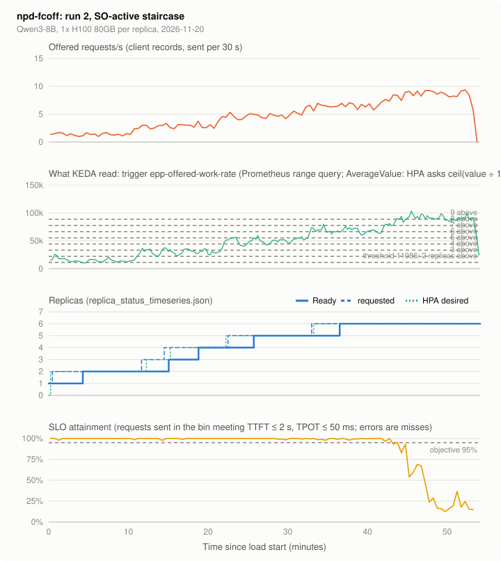

# Run 2: SO-active staircase

Part of the [npd-fcoff step 5 evaluation](../../npd-fcoff-step5.md). Third
attempt; the first two are listed under the summary's discarded attempts.

| | |
|---|---|
| Namespace | `step5-npd-fcoff-20261119`, Kubernetes v1.32.9 (OpenShift) |
| Scenario / overlay | `staging/optimized-baseline/npd-fcoff.yaml` / `ocp/vllm-npd.yaml` (see the summary for the `--set` flags) |
| Model / GPU | Qwen/Qwen3-8B bf16 / 1 × NVIDIA H100 80GB HBM3 per replica |
| Images | as in the summary header |
| KEDA | Custom Metrics Autoscaler 2.19.0 |
| ScaledObject | as rendered, with `thresholdWork` 11,086 ([`scaledobject.json`](scaledobject.json), captured after the run) |
| SLO | TTFT ≤ 2 s, TPOT ≤ 0.05 s; X = 0.95 |
| Profile / trace | [`profile.yaml`](profile.yaml) (the summary's profile changes apply), `stair.csv` (15,429 requests); `stair` in [`../index.json`](../index.json), copied to [`load.json`](load.json) |
| Arm | `active`: paused at 1 Ready replica, 90 s, then resumed |
| Session | `villardl-20261119-195458-309` |
| Start / end (UTC) | 2026-11-20 00:55:42 / 01:49:50 (inference-perf stage 0) |

Five 640 s stages of the blend at 0.15, 0.3, 0.5, 0.7 and 0.9 × C
(1.43 to 8.59 req/s). The pool steps up by one replica per 180 s policy
period and reaches the cap of 6 in stage 4. Attainment stays at or above
0.992 through stage 4 and falls to 0.446 in stage 5, with 6 replicas Ready.

## Phases

Computed by [`../phases.py`](../phases.py) ([`phases.json`](phases.json)).
Need is `ceil(q / μ_SLO(B))` with μ_SLO(B) = 1.591 req/s. Ready and requested
come from `triggers/replicas-ready.json` and `replicas-spec.json`; HPA desired
from `triggers/hpa-desired.json` (`kube_horizontalpodautoscaler_status_desired_replicas`,
because this harness image writes no `autoscaler_timeseries.json`). "Settled
at" is the time from the stage start until Ready reached its end-of-stage
value for good; "A after settling" counts the requests sent after it.

| Stage | t (s) | Scheduled req/s | Sent req/s | λ_in tok/s | λ_out tok/s | Sent | Errors | A | TTFT p50 / p90 / p99 (s) | TPOT p50 / p90 / p99 | Need | Ready min–max | Ready at end (settled at, s) | HPA desired min–max | A after settling (n) | Requested / Ready replica-s |
|---|---|---|---|---|---|---|---|---|---|---|---|---|---|---|---|---|
| 1 | 0–640 | 1.43 | 1.37 | 4,761 | 2,935 | 876 | 2 completed without latency | 0.998 | 0.100 / 0.33 / 0.69 | 10 ms / 17 ms / 28 ms | 1 | 1–2 | 2 (254) | 2–2 | 0.998 (537) | 1,266 / 1,026 |
| 2 | 640–1280 | 2.86 | 2.86 | 9,596 | 6,218 | 1,828 | 0 | 1.000 | 0.092 / 0.31 / 0.51 | 12 ms / 17 ms / 27 ms | 2 | 2–4 | 4 (514) | 2–4 | 1.000 (352) | 2,192 / 1,772 |
| 3 | 1280–1920 | 4.77 | 4.72 | 16,607 | 9,998 | 3,020 | 0 | 0.999 | 0.20 / 0.46 / 0.75 | 12 ms / 13 ms / 24 ms | 3 | 4–5 | 5 (294) | 4–5 | 0.999 (1,647) | 3,146 / 2,906 |
| 4 | 1920–2560 | 6.68 | 6.54 | 22,737 | 13,983 | 4,183 | 4 completed without latency | 0.993 | 0.43 / 1.02 / 1.81 | 13 ms / 15 ms / 28 ms | 5 | 5–6 | 6 (314) | 5–6 | 0.992 (2,157) | 3,766 / 3,526 |
| 5 | 2560–3200 | 8.59 | 8.63 | 29,975 | 18,603 | 5,522 | 69 `ClientConnectorError`, 19 HTTP 503, 2 completed without latency | 0.446 | 2.29 / 11.7 / 23.7 | 16 ms / 24 ms / 49 ms | 6 | 6 | 6 (4) | 6–6 | 0.444 (5,494) | 3,840 / 3,840 |

Whole run: 15,429 sent, A 0.800, requested 14,210 and Ready 13,070
replica-seconds (14,210 GPU-seconds). The schedule delay stays under 0.2 s.

## What the run shows

- **Replicas rise with the stages.** Ready at the end of each stage: 2, 4, 5,
  6, 6. HPA desired follows the trigger: `ceil(median trigger / 11,086)` is 2,
  3, 5, 7 and 9 for the five stages, capped at 6. Each step waits for the
  180 s scale-up period.
- **The trigger tracks offered ν.** Median over each stage after its first
  60 s, against ν = λ_in + 3.3 × λ_out from the trace: 0.97, 1.03, 1.03, 0.99,
  0.99.
- **More replicas than the need.** Settled Ready exceeds `ceil(q / μ_SLO(B))`
  by 1, 2, 2 and 1 in stages 1 to 4. The threshold is 0.70 × the 8192:256
  knee's ν_max, and the blend's ν per request (10,553 work tokens, from the
  trace's mean lengths) is higher than that mix's (9,037). Stage 2 settled at
  4, one above `ceil(ν / 11,086)` = 3: the HPA asked for 4 at about 514 s into
  the stage and the 300 s scale-down window held it. That excursion is
  unexplained beyond the trigger's noise.
- **Stage 5 fails at 6 Ready, the need.** A = 0.444 after settling, with
  TTFT p90 11.7 s. Over the same window, Prometheus reads each vLLM pod at
  most 72 running requests (of 128), at most 2 waiting, and the KV cache at
  most 0.55. The router pod's `envoy-proxy` container uses its 0.50-core
  limit, throttled in 100 % of CFS periods (median of 15 s samples), as it was
  in stage 4. The errors are 69 `ClientConnectorError` and 19 HTTP 503. The
  GPU pool was not the limit; the delay and the errors are at the router. The
  run did not measure where inside Envoy the time went.

Outcome: **problem shown**. A = 0.444 in stage 5 after the pool settled at 6
replicas, against X = 0.95 (n = 1). The configuration sized the pool to the
need; the router's Envoy, held at the scenario's 500m CPU limit, did not carry
0.9 × C.

## Tool notes

- The profile sets `summary: false` and `computed_metrics: false` (see the
  summary). TTFT and TPOT come from each record's token times with
  inference-perf's formulas. The load-vs-supply script derives them the same
  way ("latency derived from start/end and token times").
- The figure takes the live threshold, 11,086, through `--trigger
  FILE=11086:NAME`, because the rendered manifest holds 14,619.

## Amendments

None.
