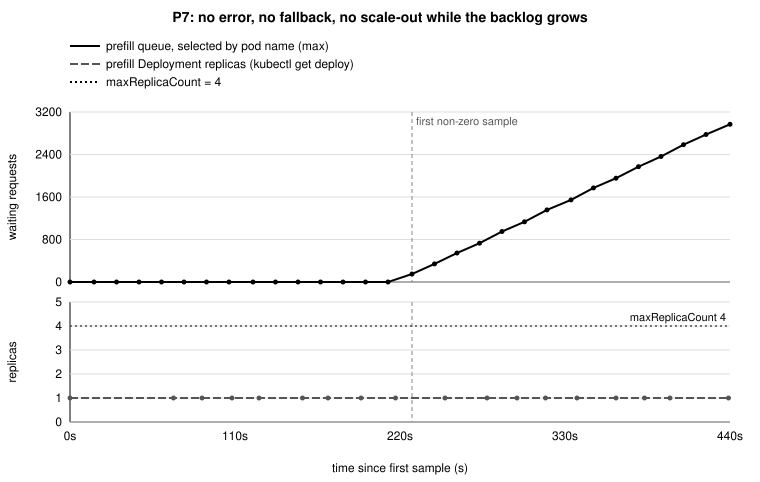
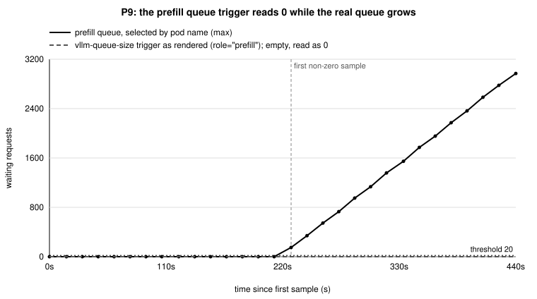
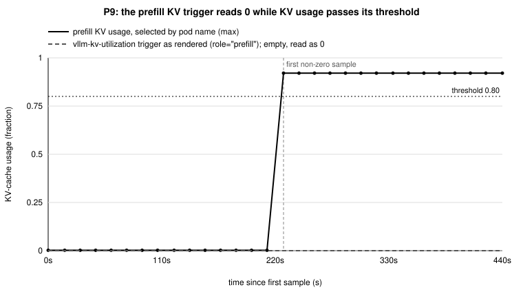

# Step 2: Verification with a simulator — pd-disaggregation/kv-early

Step 2 of the [evaluation protocol](../../2-simulator-verification.md), run with
the `simulator-verification` skill. It tests the properties the step 1
verdict [`kv-early.md`](kv-early.md) marked as failing. The properties P1–P9
are defined in [step 1](../../1-static-signal-analysis.md) §1.2.

| | |
|---|---|
| Scenario | `benchmark/config/scenarios/staging/pd-disaggregation/kv-early.yaml` |
| Backend overlay | `benchmark/config/cluster-configs/ocp/model-sim-qwen3-32b.yaml` |
| Simulator | `vllm-model-sim`: real vLLM on CPU, physics latency model, Qwen3-32B on H100 SXM5 (tuned profile) |
| Namespace | `step2-kv-early-20261117` (torn down after the run) |
| Cluster | OpenShift `4.19.19`, Kubernetes `v1.32.9` |
| KEDA | `2.19.0` (`custom-metrics-autoscaler`). Below the `>= 2.20` the README assumes |
| vLLM | `docker.io/vllm/vllm-openai-cpu@sha256:495c84fe30f3572b83a78100a1e8ba423dbb77fc532ecefebe114e6b77327bd9` (tag `v0.31.0`), prefill and decode |
| Simulator plugin | `ghcr.io/lionelvillard/vllm-sim-deps@sha256:b8cae7559367ec73c4ccaea60df188fadb9efb792deed995da65213aa87bc2b7` (tag `v0.3.0`) |
| EPP | `ghcr.io/llm-d/llm-d-router-endpoint-picker:v1.0.0` |
| Load | `guide_pd-disaggregation_1`: 45 req/s, 5000-token prompts, 250-token outputs |
| Date | 2026-11-17 |
| Result | step 1's verdict **holds** for P9 (4 triggers) and P7 (2 triggers); P1–P4 **not reproducible here**; the passing properties are **not verified by this skill** |

Both pools were left at the standup defaults. The ScaledObjects read
`READY=False` until the `prometheus-auth` secret held a token for the
`wva-prometheus-auth` ServiceAccount; every measurement below was taken after
they read `READY=True` with real HPA targets (`0/20`, `0/800m`).

Four triggers are tested: the queue and KV triggers of the prefill pool, and
the same two of the decode pool. Data and the plot script are in
[`kv-early-step2/`](kv-early-step2/). Where the text says *probe*, it means the
same metric selected by pod name (`pod=~".*prefill.*"`) in place of the
scenario's `role` filter, used only to read what the engines actually report.
The scenario was not modified.

## P1 proportional to load

| Trigger | Step 1 | Observation | Outcome |
|---|---|---|---|
| prefill queue | fail | the trigger returns no series, so there is no signal whose elasticity can be measured (see P9) | not reproducible here |
| decode queue | fail | same | not reproducible here |
| prefill KV, decode KV | not required for a guard | | not verified by this skill |

## P2 coupled to actuation

| Trigger | Step 1 | Observation | Outcome |
|---|---|---|---|
| prefill queue, decode queue | fail | no signal to compare across pod counts (see P9) | not reproducible here |
| prefill KV, decode KV | not required for a guard | | not verified by this skill |

## P3 target means a fixed busyness

| Trigger | Step 1 | Observation | Outcome |
|---|---|---|---|
| prefill queue, decode queue | fail | no signal to compare across traffic mixes (see P9) | not reproducible here |
| prefill KV, decode KV | not required for a guard | | not verified by this skill |

## P4 metric type matches aggregation

| Trigger | Step 1 | Observation | Outcome |
|---|---|---|---|
| prefill queue, decode queue, prefill KV, decode KV | fail (`max()` under `AverageValue`) | the HPA's current value is `0` for every trigger (`0/20`, `0/800m`), so `ceil(U/T)` cannot be compared with the pod count | not reproducible here |

## P5 bounds, P6 defined at zero, P8 lag and noise

| Trigger | Step 1 | Outcome |
|---|---|---|
| prefill queue, decode queue | P5 pass, P6 pass, P8 pass | not verified by this skill |
| prefill KV, decode KV | P5 pass, P8 pass | not verified by this skill |

## P7 fails visibly

| Trigger | Step 1 | Observation | Outcome |
|---|---|---|---|
| prefill queue | fail | confirmed, see below | **confirmed fail** |
| decode queue | fail | confirmed, see below | **confirmed fail** |
| prefill KV, decode KV | not required for a guard | | not verified by this skill |

**Proof.** With the source returning nothing (P9), KEDA reported neither an
error nor a fallback:

- `kubectl get scaledobject`, before and after the load: both ScaledObjects
  `READY=True`, `FALLBACK=False`. `spec.fallback` is not set on either.
- The HPA's current value for the queue trigger was `0` (`0/20 (avg)`) in all
  26 readings, from `t=0` to `t=647 s` ([`replicas.csv`](kv-early-step2/replicas.csv)).
- Over the same period the prefill queue read by pod name went from 0 to
  2969 waiting requests (`t=228 s` to `t=440 s`).
- The prefill Deployment had 1 replica in all 26 readings. A working trigger
  would have asked for `ceil(2969 / 20) = 149`, which `maxReplicaCount: 4`
  caps at 4.



The top panel is the prefill queue (probe); the bottom panel is the prefill
Deployment's replica count, read with `kubectl get deploy` on the same clock.
The queue starts rising at the first non-zero sample (`t=228 s`) and reaches
2969 requests, while the Deployment stays at 1 replica, well under the cap of
4, and the ScaledObject reports `READY=True` and `FALLBACK=False` the whole
time. An outage of the metric source is indistinguishable from an idle pool.
The decode pool shows the same status; its queue stayed at 0 (the decode
probe's maximum is 0), so the load shows no consequence there, but the
ScaledObject status proves the property for the decode trigger too.

## P9 measures what it claims

| Trigger | Step 1 | Observation | Outcome |
|---|---|---|---|
| prefill queue | fail | confirmed, see below | **confirmed fail** |
| prefill KV | fail | confirmed, see below | **confirmed fail** |
| decode queue | fail | confirmed, see below | **confirmed fail** |
| decode KV | fail | confirmed, see below | **confirmed fail** |

**Proof, labels.** `count by (role)(vllm:num_requests_waiting{namespace="step2-kv-early-20261117"})`
returns one series with an empty label set and value 4: the four series in the
namespace carry no `role` label. Their labels are `engine`, `job`,
`model_name` and `pod` (plus the target labels Prometheus adds). The four
triggers, as rendered in `27_keda-scaledobjects.yaml`, all return
`"result":[]`:

```promql
max(vllm:num_requests_waiting{model_name="Qwen/Qwen3-32B",role="prefill"})
max(vllm:kv_cache_usage_perc{model_name="Qwen/Qwen3-32B",role="prefill"})
max(vllm:num_requests_waiting{model_name="Qwen/Qwen3-32B",role="decode"})
max(vllm:kv_cache_usage_perc{model_name="Qwen/Qwen3-32B",role="decode"})
```

**Proof, under load.** The four trigger queries were run every 15 s alongside
the probe, 30 samples from `t=0` to `t=440 s` ([`samples.csv`](kv-early-step2/samples.csv)).
All 120 trigger readings were empty. For the same period:

- prefill queue (probe): 0, then 150 at `t=228 s`, rising to 2969 at `t=440 s`;
  against a threshold of 20 the trigger should have asked for
  `ceil(2969 / 20) = 149`, capped at 4;
- prefill KV (probe): 0.002, then 0.921 from `t=228 s` on; against a
  threshold of 0.80 the trigger should have asked for
  `ceil(0.921 / 0.80) = 2`;
- decode queue (probe): 0 throughout; decode KV (probe): 0 except 0.919 at
  `t=228 s`. The decode load never made a working trigger ask for more pods in
  this run, so for the decode triggers the proof is the missing label and the
  empty result, not a missed demand.



The solid line is the prefill queue selected by pod name; the dashed line is
the ScaledObject's own `vllm-queue-size` query, which returns nothing at every
sample and is read as 0 (KEDA's `ignoreNullValues` default). Load starts at
the first non-zero sample (`t=228 s`); the queue then grows by about 200
requests per 15 s sample to 2969, always above the threshold of 20, while the
trigger never leaves 0.



Prefill KV usage jumps from 0.002 to 0.921 at the first non-zero sample and
stays there, above the 0.80 threshold for every later sample, while the
`vllm-kv-utilization` trigger as rendered returns nothing. The cause is the
absent `role` label shown above, not the metric: the same metric selected by
pod name is present and responsive.

## Observations outside the properties

- **Two scrape jobs per pod.** Each pod is scraped by a `*-podmonitor` job and
  by a `vllm-<model>` job, so each metric has two series per pod
  (`count by (job, pod)` returns four series for two pods). A bare `sum()`
  over a pod would count its queue twice; the probe and the ground truth here
  use `max()`.
- **EPP killed under load.** The EPP container was OOMKilled at 21:05:15Z
  (`t=418 s`, limit `1Gi`), and the harness treatment failed 243 s after it
  started. The samples above span `t=0` to `t=440 s`, so the data window ends
  after the kill; the queue was still growing in the last samples.
- **Cluster API instability.** Several `kubectl` calls timed out on the API
  server's TLS handshake during the run; 26 of the 34 planned replica
  readings were recorded.

## Simulator gaps

- Qwen3-32B on H100 SXM5 is a tuned profile (`beta: [3.119229, 1.182904,
  0.146612]`). P9 and P7 depend on which series exist and on the ScaledObject's
  status, not on the latency model, so the profile does not affect them.
- The knee was not calibrated: no load-dependent property (P1, P2, P3, P5,
  P8) could be tested, so no `μ_SLO` is reported.

## Needs measurement

1. P1, P2, P3 and P4 need a working signal. Select the triggers by pod name
   (or add the `role` label to the series), re-run step 2 on the corrected
   scenario, and measure elasticity, coupling to pod count, mix sensitivity
   and the HPA's `desired` against `ceil(U/T)`.
2. Per-replica capacity of each role at the TTFT and ITL SLOs, and the knee
   (step 1 items 2 and 3).
3. Cold start of a prefill and of a decode pod (step 1 item 4).
4. The cause of the EPP kill (the container reported `OOMKilled`); the
   memory profile of the EPP under 45 req/s has not been measured.
5. Trap T7 on KEDA `2.19.0`: an empty query was read as 0 with no error and
   no fallback, as T7 describes. `traps.md` verifies T7 on a commit, not on
   this release.

## Teardown

The release, the namespace `step2-kv-early-20261117` and its cluster-scoped
bindings were removed after the data was exported; the namespace is confirmed
gone.
