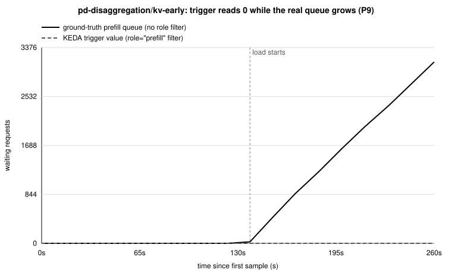
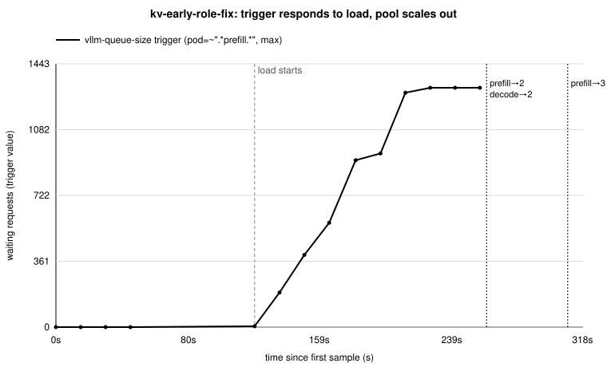

# Step 2: Verification with a simulator — pd-disaggregation/kv-early

Step 2 of the [evaluation protocol](../README.md), following the
[procedure](../2-simulator-verification.md). Builds on the step 1 verdict
[`verdicts/pd-disaggregation/kv-early.md`](kv-early.md).

| | |
|---|---|
| Scenario | `benchmark/config/scenarios/staging/pd-disaggregation/kv-early.yaml` |
| Backend overlay | `benchmark/config/cluster-configs/ocp/model-sim-qwen3-32b.yaml` |
| Simulator | `vllm-model-sim` (real vLLM on CPU, physics latency model) |
| Namespace | `step2-kv-early-20261113` |
| Cluster version | OpenShift `4.19.19`, Kubernetes server `v1.32.9` |
| KEDA | `2.19.0` (`openshift-keda`, `custom-metrics-autoscaler-rhel9`). **Below** the `>= 2.20` this repo's README assumes; trap T7 is unverified at this exact release — see Simulator gaps |
| vLLM image | `docker.io/vllm/vllm-openai-cpu:v0.31.0` (prefill and decode) |
| Router/EPP image | `ghcr.io/llm-d/llm-d-router-endpoint-picker:v1.0.0` |
| Date | 2026-11-13 |
| Overall result | step 1's verdict **holds** for `kv-early.yaml` as written; step 1's own fix, applied as `kv-early-role-fix.yaml`, is **confirmed** to restore a working signal (§ Follow-up) |

## Deployment note (not a step 2 finding, but required to get here)

Standing this scenario up surfaced two defects unrelated to the KEDA triggers
themselves, fixed before any claim below could be tested:

1. **EPP config incompatible with the pinned router image** (fixed in this
   repo, commit `a1437da8`). All four `staging/pd-disaggregation/*.yaml`
   scenarios used the pre-`v0.11.0` EPP plugin chain
   (`disagg-headers-handler`, `deciderPluginName`), which the pinned
   `llm-d-router-endpoint-picker:v1.0.0` image no longer registers
   ([llm-d-router#2815](https://github.com/llm-d/llm-d-router/pull/2815)).
   The EPP container crash-looped with `plugin type
   'disagg-headers-handler' is not registered` on every restart. Fixed by
   dropping the plugin and moving to the nested `deciders:` form, matching
   upstream's `guides/pd-disaggregation.yaml`.
2. **Per-namespace Prometheus auth secret goes stale across a
   teardown/standup cycle.** The overlay's `prometheus-auth` secret holds a
   bearer token for the `wva-prometheus-auth` ServiceAccount; a
   teardown/standup cycle recreates that ServiceAccount, invalidating the
   token already in the secret. Both ScaledObjects read `READY=False` and
   the HPA showed `<unknown>` targets (`403` from Thanos) until the secret
   was recreated. Not a repo bug — the overlay already documents the
   one-time creation command — but it needs repeating after every
   teardown/standup, which the overlay's comment doesn't say.

Both are now cleared: pods Ready, inference test passing, both
ScaledObjects `READY=True`, HPAs reporting non-`<unknown>` targets, per the
`run-benchmark` skill's Step 7 gate.

## Claims

From the step 1 verdict, every trigger failed P9 (the `role` label matches
no series) and, as a consequence, P1/P2/P4 (no driver; the pool is predicted
to sit at `minReplicaCount: 1` regardless of load). This step tests the P9
claim directly, with its downstream effect on the whole scaling pipeline, at
idle and under load.

| Step 1 says | Observation that confirms it | Outcome |
|---|---|---|
| P9: `role="prefill"` / `role="decode"` match no series on any of the four triggers | `count by (role)(vllm:num_requests_waiting{model_name="Qwen/Qwen3-32B"})` returns one series with an **empty label set** (`"metric":{}`), holding all 9 matching series cluster-wide. The exact trigger queries, `max(vllm:num_requests_waiting{model_name="Qwen/Qwen3-32B",role="prefill"})` and the KV equivalent, return `"result":[]` at idle. Reading the unfiltered series directly confirms why: every series carries `model_name`, `engine`, `pod`, `namespace`, `job`, `instance`, `container`, `endpoint` — no `role` label | **confirmed** |
| P7 (downstream of P9) + predicted combination: "both pools stay at `minReplicaCount: 1` whatever the load" | Drove the prefill pod with the `guide_pd-disaggregation_1` workload (45 req/s, 5000-token prompts, 250-token outputs, 120 s) while polling both the ground-truth queue (no `role` filter, read straight off the prefill pod) and the exact trigger query every 15 s. The ground-truth queue climbed from 0 to 3126 waiting requests over 4.4 minutes with no sign of draining; the trigger query returned an empty result at every single sample; the HPA (`keda-hpa-pd-disaggregation-prefill`) stayed at `0/20 (avg)` and the replica count never left 1 | **confirmed** |

### Plot



Data: [`kv-early-step2/p1-p9-queue.csv`](kv-early-step2/p1-p9-queue.csv)
(18 samples, 15 s apart, read directly from Thanos during the run described
above). Script: [`kv-early-step2/plot_p9.py`](kv-early-step2/plot_p9.py).

The solid line is `sum(vllm:num_requests_waiting{pod="<prefill-pod>"})`, read
straight off the prefill pod with no `role` filter — the real backlog the
engine sees. The dashed line is the ScaledObject's own query,
`max(vllm:num_requests_waiting{model_name="Qwen/Qwen3-32B",role="prefill"})`;
it returns an empty result at every sample, which trap T7's
`ignoreNullValues: true` default turns into 0, so it is flat at 0 for the
whole run. Load starts at the dashed vertical line (≈140 s); the real queue
starts climbing within one 15 s sample and reaches over 3000 waiting
requests by the last sample, while the trigger the ScaledObject actually
reads never moves. This is the queue backlog's shape predicted in step 1 (no
dead band is visible here because load starts well past the engine's
capacity) combined with the label miss: the signal that should eventually
drive scale-up never reaches KEDA at all.

Other properties (P1–P5, P8 on the queue; the KV guard; the decode pool)
were not separately tested: with the trigger query itself empty, there is no
non-zero signal whose proportionality, coupling, or lag could be measured on
this stack. Testing those properties required first applying the step 1 fix;
see § Follow-up below.

**Caveat on the "ground-truth" line's magnitude.** The `sum()` over one pod's
series, used above as the ground-truth reading, read consistently about 1.9×
the value the same pod gives under `max()` once two series exist for it (see
the Follow-up section's raw samples). That ratio matches two separate scrape
jobs hitting the same pod and port — this cluster's rendered PodMonitors
include both a `*-podmonitor` job and a `vllm-*` job per role, seen for this
exact pod in the unfiltered query dump during this run. If so, `sum()` over
a bare `pod=...` selector double-counts a single engine's queue, and the true
ground-truth backlog in the plot above is roughly half what is shown (still
clearly non-zero and climbing into four figures, so it does not change the
P9 conclusion, which rests on the *trigger* reading empty, not on the exact
ground-truth number). *Needs measurement*: confirm the duplicate-job
hypothesis directly (`count by (job) (vllm:num_requests_waiting{pod="..."})` )
before using a bare `sum(... pod=...)` reading as a capacity number anywhere
else in this protocol.

## Follow-up: kv-early-role-fix (step 1's fix, verified)

Step 1's verdict listed a fix for P9: select by pod name instead of the
missing `role` label. Applied as a new scenario,
[`kv-early-role-fix.yaml`](../../../config/scenarios/staging/pd-disaggregation/kv-early-role-fix.yaml)
(all four triggers changed from `model_name=...,role="prefill"/"decode"` to
`model_name=...,namespace="${namespace.name}",pod=~".*prefill.*"` /
`".*decode.*"`, matching the pattern `token-aware.yaml`'s decode-KV trigger
already uses in this directory), with its own spec entrypoint
`kv-early-role-fix.yaml.j2`. Re-run in the same namespace
(`step2-kv-early-20261113`, teardown then standup — a trigger-query change
needs a redeploy, not an in-place update), same backend overlay, same date.

The per-namespace Prometheus auth secret went stale again across this
teardown/standup cycle (same cause as the deployment note above) and was
refreshed the same way before testing.

| Step 1's fix says | Observation | Outcome |
|---|---|---|
| Selecting by pod name makes the queries match real series | `max(vllm:num_requests_waiting{model_name="Qwen/Qwen3-32B",namespace="step2-kv-early-20261113",pod=~".*prefill.*"})` returns a non-empty result (`"result":[{"metric":{},"value":[...,"0"]}]`) at idle, and the KV equivalent reads `0.0021`, matching the live pod's actual KV usage. Both ScaledObjects are `READY=True`; `pd-disaggregation-prefill` also reads `ACTIVE=True` | **confirmed** |
| A real, responsive signal lets the pool actually scale | Re-ran the same `guide_pd-disaggregation_1` load profile (45 req/s, 120 s) used in the P9 run. The trigger climbed from 0 to 1312 over about 4 minutes (see plot). The prefill Deployment scaled 1→2 at t≈260s and 2→3 at t≈309s; decode scaled 1→2 at t≈260s. This is the opposite of kv-early's "stuck at `minReplicaCount: 1`" prediction | **confirmed** |

### Plot



Data: [`kv-early-step2/p1-p9-trigger-role-fix.csv`](kv-early-step2/p1-p9-trigger-role-fix.csv)
(13 samples, read directly from Thanos) and
[`kv-early-step2/scale-events-role-fix.csv`](kv-early-step2/scale-events-role-fix.csv)
(replica count read from `kubectl get deploy`, same clock). Script:
[`kv-early-step2/plot_role_fix.py`](kv-early-step2/plot_role_fix.py).

The line is the ScaledObject's own `vllm-queue-size` trigger value — no
separate ground-truth series this time, since the point of this run is that
the trigger itself is now a real reading. It is flat at 0 before load starts
(dashed vertical line), then climbs with the same shape as the P9 run's
ground-truth line. The dotted vertical lines mark when `kubectl get
deployment` showed the prefill or decode replica count actually change:
both pools grow once the trigger is well past its threshold of 20. Four
samples between the baseline and the start of load (t = 45 s to 120 s) are
missing — the collection pod's loop ran at a fixed cadence and this gap
falls where the load generator's own pod was still starting — so the rise
looks steeper here than the true curve; the P9 run's plot, sampled through
the same period, does not have this gap.

**Not explained here:** the prefill pool grew by one pod twice, 49 seconds
apart (t≈260s, t≈309s), inside the `periodSeconds: 180` scale-up policy
window that this scenario shares with kv-early. Whether that is expected
HPA behavior (the policy bounds the rate of change, not a strict one-event-
per-window floor) or a sign the bound reads differently than step 1 assumed
is *needs measurement* — out of scope for confirming P9's fix, but worth
returning to before relying on `periodSeconds` to bound a cold-start
overshoot (P5).

The EPP container was OOMKilled again under this load (same cause as the
Simulator gaps note below), confirming that finding was not a one-off.

## Simulator gaps

- **KV-cache usage exceeded 1.0** (`sum(vllm:kv_cache_usage_perc{pod=...})`
  read `1.84` at peak, see the CSV's last column) against the metric's
  documented range of 0–1. `sum()` over this pod's series should not exceed
  the per-engine value when there is exactly one engine reporting, so this
  looks like a `vllm-model-sim` artifact (an engine shard, or the simulated
  KV-cache accounting, not clamping under extreme queueing) rather than a
  property this scenario's KV trigger would see on real hardware. *Needs
  measurement*: re-check the KV reading on a tuned real-hardware run before
  treating this as a general fact about the KV guard; not folded into the
  step 1 verdict.
- **EPP OOMKilled under sustained overload.** At 45 req/s against a single,
  uninflatable prefill replica, the EPP container (`resources.limits.memory:
  1Gi`, the router chart's default) was OOMKilled after about 18 minutes of
  sustained load — well after the data above was captured, so it does not
  affect the P9 claim, but it means this backend cannot sustain a long
  overload run without also raising the EPP memory limit or shortening the
  load window. Not investigated further here: this is about the EPP's own
  resource sizing under backlog, not the KEDA triggers this scenario is
  being evaluated for.
- Qwen3-32B on H100 SXM5 is a tuned profile (`beta: [3.119229, 1.182904,
  0.146612]` in the overlay); no retuning was needed for this claim, since
  P9 depends only on which labels the metric carries, not on the latency
  model.

## Needs measurement (carried over from step 1, still open)

1. Per-replica capacity and KV usage at that capacity (step 1 items 2–3):
   not reachable until the `role` label is fixed and a real driver exists to
   test against.
2. Cold start of a prefill/decode pod (step 1 item 4): not tested here.
3. The exact KEDA release in trap T7's verified range: now narrowed to
   `2.19.0` on `openshift-custom-metrics-autoscaler`, which is **outside**
   the `>= 2.20` this repository's README states as the requirement, and
   outside the commit T7 was verified against. `ignoreNullValues` behaved as
   T7 describes in this run, so the trap's effect holds on `2.19.0`, but
   `traps.md` should get this version added to its verified range.
4. On `kv-early-role-fix` (still deployed, § Follow-up): P1 (proportionality),
   P2 (coupling to replica count), P3 (mix sensitivity), P5's cap on the KV
   guard, P8 (lag and noise), and the decode pool's own behavior — none
   tested here, which only confirmed the trigger is no longer empty and that
   the pool scales. Also unresolved: whether the two prefill scale-ups 49 s
   apart are consistent with the `periodSeconds: 180` policy (§ Follow-up),
   and the duplicate-scrape-job hypothesis for the `sum()` magnitude caveat
   above.

## Teardown

Everything above — the original kv-early P9 run and the kv-early-role-fix
follow-up — ran in `step2-kv-early-20261113`, teardown then standup between
the two (a trigger-query change needs a redeploy). The namespace is left up
after this session, now running `kv-early-role-fix`: P1–P5 and the decode
pool, on the now-working signal, are the natural next claims to test in it
(§ Needs measurement). Tear down with:

```bash
llmdbenchmark teardown --spec benchmark/config/specification/staging/pd-disaggregation/kv-early-role-fix.yaml.j2 \
  --cluster-config benchmark/config/cluster-configs/ocp/model-sim-qwen3-32b.yaml \
  --workspace benchmark/results -p step2-kv-early-20261113
kubectl delete namespace step2-kv-early-20261113
kubectl delete clusterrolebinding allow-thanos-querier-api-access-step2-kv-early-20261113
```
